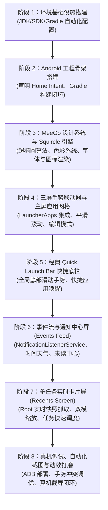

# MeeGo Harmattan 风格 Android 启动器 (MeeGo Launcher) 技术方案

> **版本**：v1.2.0  
> **文档位置**：`MEEGO_LAUNCHER_TECH_SPEC.md`（项目根目录）  
> **维护规范**：全程在 DSH 环境中进行自主开发，每次会话针对架构、需求、实现的任何调整，均需即时同步更新此文档。

---

## 1. 项目定位与核心目标

本项目旨在构建一个高保真、**1:1 还原经典诺基亚 N9 (MeeGo 1.2 Harmattan) 操作系统桌面与交互体验**的 Android 原生启动器应用。

### 1.1 MeeGo Harmattan 核心交互精髓
- **三屏无限水平滑动架构（Three-Screen Swipe Architecture）**：
  1. **Events Feed（事件与通知流）**：时间、天气、日历提醒、系统聚合通知与未读消息。
  2. **Application Grid（应用网格/启动器）**：标志性 Squircle（连续曲率圆角）图标、纯黑背景、纵向流畅惯性滑动、长按编辑管理（抖动与快速卸载/隐藏）。
  3. **Multitasking View（多任务/运行中应用）**：**真实后台卡片实时预览**（由 Root 特权链路赋能）、双列大卡片（详尽视图）与三/四列紧凑视图平滑无级切换、单卡片上划即刻终结任务、点击卡片秒级切回前台、底部一键关闭所有任务。
- **Swipe UI 手势核心**：
  - **Quick Launch Bar（快速启动底栏）**：屏幕底部轻微上划呼出 4 个常驻核心图标（电话、短信、相机、浏览器）。
  - **边缘滑动直达**：屏幕边缘手势无界切换屏。
- **视觉与美学规范（Nokia Pure & Harmattan Design）**：
  - 纯黑（OLED Deep Black `#000000`）背景与超高对比度。
  - MeeGo Squircle 连续曲率超椭圆图标裁切与高保真光泽反射效果。
  - 极简 MeeGo 风格状态栏集成。
  - 物理阻尼滚动、弹簧动效（Spring Animation）与线性马达触觉反馈（Haptic Feedback）。

---

## 2. 当前开发环境分析与准备方案

### 2.1 当前运行环境诊断
- **宿主系统**：Ubuntu 24.04 LTS (Linux x86_64)
- **沙盒环境**：DSH (Data Science Host) 命令行交互沙盒，具备工作空间读写权限 (`/home/tiny/dsh-workspace/test-android-launcher`)
- **系统工具发现**：
  - 本地已具备 Android 源码构建环境及预编译工具包，内含成熟的 OpenJDK 17：`/home/tiny/trebuchet-build/prebuilts/jdk/jdk17/linux-x86`。
  - 本地具备预编译 ADB：`/home/tiny/trebuchet-build/prebuilts/runtime/adb`。
  - 网络支持对 Google Maven、Maven Central 以及 dl.google.com 的顺畅访问。

### 2.2 环境准备策略（完全自主可控、零 sudo 依赖）
1. **JDK 环境变量配置**：
   - 提取并固定使用本地已验证的 OpenJDK 17.0.2：
     ```bash
     export JAVA_HOME="/home/tiny/trebuchet-build/prebuilts/jdk/jdk17/linux-x86"
     export PATH="$JAVA_HOME/bin:$PATH"
     ```
2. **Android SDK 配置**：
   - 在项目目录或用户隔离目录下部署轻量级标准 Android SDK（命令行工具 `cmdline-tools`）：
     - API 级别：`android-34` (Android 14)
     - 构建工具：`build-tools;34.0.0`
     - 设置 `ANDROID_HOME` 与 `ANDROID_SDK_ROOT`
3. **Gradle 架构构建**：
   - 采用 Gradle 8.4 + Android Gradle Plugin 8.3+，生成标准的 `gradlew` 包装器。
   - 所有构建在命令行下执行 `./gradlew assembleDebug`，无需依赖任何桌面 IDE 即可实现完整编译闭环。
4. **自动化脚本集合**：
   - `scripts/setup_env.sh`：自动检测/配置 JDK 与 Android SDK 环境变量。
   - `scripts/build.sh`：自动化执行静态检查、单元测试及 APK 打包。
   - `scripts/deploy.sh`：通过 adb 安装并启动启动器。
   - `scripts/screenshot.sh`：通过 adb 捕获物理机屏幕供 DSH 环境审查 UI 还原度。

### 2.3 物理机调试与设备交互环境配置（物理机测试就绪方案）
针对用户提供物理机进行真机测试的场景，在 DSH 环境中制定以下真机调试策略：
1. **ADB 运行时与连接通道**：
   - 固定复用本地高版本 ADB (`/home/tiny/trebuchet-build/prebuilts/runtime/adb`)。
   - **连接模式**：
     - **USB 调试**：物理机通过 USB 线缆直连宿主机，开启“开发者选项 -> USB 调试”以及“允许通过 USB 安装应用”。
       - *注（Linux udev 权限）*：若执行 `adb devices` 显示 `no permissions (user in plugdev group)`，需在宿主机配置 Android udev 规则（运行一次）：
         ```bash
         sudo sh -c 'echo "SUBSYSTEM==\"usb\", ATTR{idVendor}==\"18d1\", MODE=\"0666\", GROUP=\"plugdev\"" > /etc/udev/rules.d/51-android.rules'
         sudo udevadm control --reload-rules && sudo udevadm trigger
         /home/tiny/trebuchet-build/prebuilts/runtime/adb kill-server
         ```
     - **无线调试（ADB over Wi-Fi，无需配置 USB udev）**：手机连接与本机相同局域网，开启“开发者选项 -> 无线调试”，执行：
       ```bash
       /home/tiny/trebuchet-build/prebuilts/runtime/adb pair <IP>:<PORT>
       /home/tiny/trebuchet-build/prebuilts/runtime/adb connect <IP>:<PORT>
       ```
   - **设备状态就绪探针**：
     ```bash
     /home/tiny/dsh-workspace/test-android-launcher/scripts/check_device.sh
     ```
2. **非破坏性开发调试策略（Safe Dev/Test Lifecycle）**：
   - **避免系统锁死风险**：在早期和迭代测试阶段，启动器仅作为可独立运行的 Activity 进行调试 (`adb shell am start -n com.meego.launcher/.MainActivity`)，不强制将手机系统唯一默认桌面替换掉。
   - **桌面切换可逆性**：在 Launcher 内部设置中提供“设为默认主屏幕”以及“退出当前启动器回到原桌面”按钮，确保物理机日常使用与测试切换无缝安全。
3. **DSH 内自主验证反馈闭环（Autonomous In-DSH Verification Loop）**：
   - **一键构建并部署**：执行 `scripts/deploy.sh`，在编译后自动推送到已连接的物理机，并拉起前台界面。
   - **真机视觉截屏回传**：通过 `scripts/screenshot.sh`（底层为 `adb exec-out screencap -p`）捕获渲染画面至本地，Agent 可即时分析 UI 还原度与布局贴合度。
   - **日志与崩溃诊断**：通过 `adb logcat -d | grep MeeGoLauncher` 实时追踪生命周期、掉帧、ANR 与异常堆栈。
4. **已验证真机规格与 Root 特权通道（Root Privileged Channel）**：
   - **实测物理机基准**：
     - 型号：Redmi K40 / POCO F3 (`alioth` / `M2012K11AC`)
     - 系统：LineageOS (Android 16 / SDK 36)
     - 屏幕规格：1080×2400 (20:9)，密度 440 DPI
     - Root 状态：`adbd root` 已就绪（`uid=0(root) gid=0(root) context=u:r:su:s0`）
   - **Root 赋能多任务实时预览的技术链路**：
     - 普通 Android 应用受沙盒机制限制，无法直接调用 `ActivityTaskManager.getTaskSnapshot` 或跨应用捕获窗口内容。
     - 依托已就绪的 Root 特权，采用双层架构：
       1. **特权权限注入与系统接口直连**：启动器安装时通过 Root 脚本赋予系统特权权限（`pm grant com.meego.launcher android.permission.REAL_GET_TASKS` 等），或通过私有反射调用 `ActivityTaskManager` / `IActivityTaskManager` 提取真实 HardwareBitmap 快照。
       2. **Root Companion 守护管道**：通过 `su` 管道启动轻量级伴侣进程，提供高效的任务列表与缩略图抓取 RPC 服务，向 Compose 提供流式位图更新。
       3. **硬核任务控制**：通过特权执行 `am switch-to-task <taskId>`（零延迟切回前台应用）与 `am task remove <taskId>`（单卡片上划干净销毁进程）。

---

## 3. 技术选型与整体架构

### 3.1 技术栈选型
| 分层 | 技术选型 | 选型理由 |
| :--- | :--- | :--- |
| **开发语言** | Kotlin 1.9+ | 官方首选、协程支持、与现代 Android 库高度契合 |
| **UI 框架** | Jetpack Compose + Material 3 (底层定制) | 声明式动画系统最适合实现 MeeGo 复杂的动态多任务缩放、物理弹簧阻尼与 Squircle 实时着色 |
| **异步流驱动** | Kotlin Coroutines + StateFlow / Flow | 高性能响应式状态流，无缝驱动事件聚合与图标装载 |
| **依赖注入** | 手工轻量级 DI 或 Hilt | 保证启动速度极快，启动器（Launcher）对冷启动耗时有极致严苛要求（< 300ms） |
| **系统交互能力** | `LauncherApps` + `NotificationListenerService` + `UsageStatsManager` | 遵循 Android 原生标准接口，兼顾安全与权限最小化 |
| **后台实时快照与任务调度** | Root / `ActivityTaskManager` 特权调用 + `am task` 管道 | 突破 Android 原生沙盒隔离，1:1 还原 MeeGo 后台多任务真实卡片预览，支持低延迟切回与任务销毁 |

### 3.2 模块化架构设计
```
test-android-launcher/
├── build.gradle.kts
├── settings.gradle.kts
├── gradle/
├── gradlew
├── scripts/
│   ├── setup_env.sh             # 环境变量与 SDK 自动化就绪脚本
│   ├── build.sh                 # 一键编译脚本
│   ├── deploy.sh                # 部署安装脚本
│   ├── check_device.sh          # 物理机连接与 Root 诊断脚本
│   └── screenshot.sh            # 物理机屏幕快速回传脚本
├── app/
│   ├── build.gradle.kts
│   └── src/main/
│       ├── AndroidManifest.xml
│       └── java/com/meego/launcher/
│           ├── MainActivity.kt                  # 启动器单一宿主 Activity (全屏、手势捕获)
│           ├── ui/
│           │   ├── theme/                       # MeeGo Harmattan 主题规范
│           │   │   ├── Color.kt                 # 纯黑背景、经典 Nokia 调色板
│           │   │   ├── Shape.kt                 # Squircle 超椭圆曲线数学实现
│           │   │   ├── Type.kt                  # Nokia Pure 字体排版尺度
│           │   │   └── Motion.kt                # MeeGo 弹簧曲线与触觉反馈参数
│           │   ├── components/                  # 通用原子组件
│           │   │   ├── SquircleIcon.kt          # 自适应 MeeGo 图标容器与光泽效果
│           │   │   ├── SwipePager.kt            # 三屏无缝平滑滑动器
│           │   │   └── QuickLaunchBar.kt        # 经典上滑快捷底栏
│           │   └── screens/
│           │       ├── feed/                    # 屏1：事件与通知聚合流
│           │       │   ├── FeedScreen.kt
│           │       │   └── components/ClockWeatherCard.kt, NotificationItem.kt
│           │       ├── grid/                    # 屏2：应用网格启动器
│           │       │   ├── AppGridScreen.kt
│           │       │   └── components/AppGridItem.kt, EditModeOverlay.kt
│           │       └── recents/                 # 屏3：多任务动态卡片视图
│           │           ├── RecentsScreen.kt
│           │           └── components/
│           │               ├── TaskCard.kt      # 包含真实 TaskSnapshot 的圆角卡片
│           │               ├── DensityToggle.kt # 双列/多列无缝无级缩放
│           │               └── CloseAllButton.kt# 底部圆形“关闭全部”浮动按键
│           ├── core/
│           │   ├── apps/                        # 应用列表加载、缓存与过滤 (LauncherApps)
│           │   ├── notification/                # 通知捕获与同步管理
│           │   ├── recents/                     # 运行中应用与多任务核心
│           │   │   ├── TaskSnapshotProvider.kt  # 快照提供者统一接口
│           │   │   ├── RootTaskSnapshotProvider.kt # Root 特权提取 TaskSnapshot 硬件位图
│           │   │   ├── FallbackSnapshotProvider.kt # 无特权降级方案（图标与色板占位）
│           │   │   ├── TaskSnapshotCache.kt     # LRU 高性能位图缓存与生命周期复用
│           │   │   └── RecentTaskController.kt  # 任务切换 (am switch-to-task) 与终结控制
│           │   └── gestures/                    # 全局边缘手势与惯性滑动控制器
│           └── service/
│               └── MeeGoNotificationListener.kt # 系统通知监听服务
```

---

## 4. 1:1 MeeGo Harmattan 细节还原设计规范

### 4.1 MeeGo Squircle 超椭圆几何模型
MeeGo 图标并非 Android 原生的简单圆形或普通 `RoundedCornerShape(16.dp)`，而是著名的 **Lamé 曲线（超椭圆，Superellipse）**：
$$\left|\frac{x}{a}\right|^n + \left|\frac{y}{b}\right|^n = 1 \quad (n \approx 5.0)$$
- 拥有 $G2$ 甚至 $G3$ 级别的连续曲率过渡，杜绝普通圆角在直线连接处的视觉棱角感。
- 自带微妙的暗调外边缘微光与下边缘极细投影，在纯黑背景上呈现立体浮凸质感。
- 对于第三方非规范方形图标，采用动态背景提取或统一承载在黑/灰调 Squircle 容器中，实现一致性视觉呈现。

### 4.2 三屏联动与手势体系
- **三屏顺序**：`[屏0: Events Feed]` $\longleftrightarrow$ `[屏1: Application Grid]` $\longleftrightarrow$ `[屏2: Multitasking]`
- **水平视差与循环**：支持高帧率流畅手势跟随，无死区，具备边界阻尼回弹效果。
- **Quick Launch Bar**：
  - 无论处于哪一屏，从屏幕底部边缘向上轻推 $\approx 32\text{dp}$，呼出毛玻璃渐隐底栏。
  - 4 个标准快捷槽位：电话、短信、相机、浏览器。手指拖动即可直达释放，松手回弹收起。

### 4.3 多任务（Recents）动态双模交互与真实后台快照体系
- **Root 赋能的真实后台卡片实时预览（Live Task Snapshot）**：
  - 在 Android 原生架构中，普通 Launcher 只能展示静态应用 Icon。本项目通过 Root 特权管道直接获取系统的 `TaskSnapshot` 真实硬件快照（HardwareBitmap）或高精度视图流。
  - 真正实现诺基亚 N9 标志性的“当前后台界面所见即所得”效果，动态捕捉浏览器网页、聊天消息、播放器卡片的实时状态。
  - **优雅降级策略（Graceful Degradation）**：若无 Root 权限时，自动平滑回退为带有应用大图标与主色调微渐变的 Squircle 卡片，保证系统高鲁棒性。
- **动态双模视图与手势缩放**：
  - **双列详尽视图（2-Column Detailed View）**：卡片以大比例呈现，清晰辨识应用实时内容。
  - **三列/四列紧凑视图（3/4-Column Grid View）**：双指捏合（Pinch）或顶部/底部密度切换按键触发平滑缩放，一屏浏览更多后台任务。
- **任务控制与生命周期同步**：
  - **单卡片上划**：卡片附带加速度飞出屏幕，触发 `RecentTaskController.removeTask(taskId)`，同步从系统任务栈中彻底清理。
  - **点击卡片**：直接触发 `RecentTaskController.switchToTask(taskId)`（调用 `am switch-to-task`），实现零冷启动时延的秒级切回。
  - **一键清理所有（Close All）**：底部常驻 MeeGo 经典圆形浮动按键，点击后伴随卡片序列依次渐隐飞出动效，并释放后台内存。

### 4.4 现代物理机特性与手势冲突避让策略（Physical Device Adaptation）
1. **全面屏手势冲突避让（Gesture Exclusion）**：
   - 现代 Android 10+ 普遍默认启用“全面屏手势”（侧滑返回、底部上划返回桌面）。
   - 为避免物理机系统级手势与 MeeGo 边缘无界滑动及 Quick Launch Bar 产生冲突，采用以下协同机制：
     - **手势排除区域**：使用 `ViewCompat.setSystemGestureExclusionRects()` 对底部 Quick Launch 触发区和屏幕侧边缘申请系统手势排除。
     - **全屏沉浸与手势保护**：采用 `WindowCompat.setDecorFitsSystemWindows(window, false)` 实现真正端到端沉浸，状态栏与导航栏根据交互动态隐现。
2. **长屏比例（19.5:9 / 20:9）与高分屏适配**：
   - 经典 Nokia N9 为紧凑型 16:9（854×480），现代物理机以 20:9、FHD+/2K 为主。
   - 核心 Squircle 容器采用固定外接宽高比约束，通过弹性垂直网格边距计算，避免图标拉伸变形，同时在长屏幕上自然呈现 MeeGo 呼吸感留白。
3. **高刷新率（90Hz / 120Hz）与线性马达触觉反馈（Haptics）**：
   - 接入物理机振动马达（`VibrationEffect.createPredefined(VibrationEffect.EFFECT_CLICK)` / `EFFECT_HEAVY_CLICK`）。
   - 在滑动分屏吸附、长按图标抖动编辑、底栏弹出就位时提供微秒级触觉反馈。

---

## 5. DSH 全程自主开发实施路线图



### 具体开发阶段拆解：
- **Phase 1: 环境自动化就绪**
  - 编写 `scripts/setup_env.sh`，联动本地 JDK17，下载并安装 minimal android cmdline tools，确保具备 `sdkmanager` 与 `platforms;android-34`。
  - 建立 Gradle 包装器环境与 ADB 检测脚本。
- **Phase 2: 项目骨架与构建验证**
  - 建立模块化 Android 工程目录，配置完整 `AndroidManifest.xml`（包含 `HOME` 与 `DEFAULT` 启动器声明）。
  - 执行第一次 `./gradlew assembleDebug`，确保 0 警告 0 报错在 DSH 环境中产出 APK。
  - 验证初版在物理机上的推包与拉起 (`scripts/deploy.sh`)。
- **Phase 3: MeeGo 视觉引擎核心**
  - 在 Jetpack Compose 中实现精准 Superellipse (Squircle) 算法 Canvas 渲染。
  - 建立 Nokia Pure 视觉调色板、图标自适应遮罩与质感光泽层。
  - 利用 `scripts/screenshot.sh` 抓取物理机实机渲染效果。
- **Phase 4: 应用网格与主屏手势**
  - 调用 Android `LauncherApps` 异步加载已安装应用。
  - 实现 4 列经典网格，带有平滑物理动效、应用字母索引或自由拖拽排序。
- **Phase 5: 经典上滑底栏 (Quick Launch Bar)**
  - 实现全局底层手势识别器，底部上划展开 4 个主打快捷图标。
  - 针对物理机系统手势冲突进行排除区域适配。
- **Phase 6: Events Feed 屏**
  - 实现时间、天气面板。
  - 接入 `NotificationListenerService`，聚合展示来自微信、短信、未接电话等通知。
- **Phase 7: 多任务实时卡片屏（Root 实时快照与调度）**
  - 接入 `RootTaskSnapshotProvider`，实时提取后台 TaskSnapshot 硬件位图。
  - 接入 `RecentTaskController`，支持单卡片上划杀进程与点击秒切回。
  - 实现 2 列/3 列/4 列密度平滑手势缩放与底部“全部清除”按键动效。
- **Phase 8: 物理机全面联调与性能打磨**
  - 通过 ADB 持续进行真机 UI 验证、高刷手势掉帧排查（120Hz 满帧调优）与触觉反馈对齐。

---

## 6. 技术方案动态同步机制

为了确保开发过程中的一致性与透明度，执行以下准则：
1. **单点事实源（Single Source of Truth）**：本文件 `MEEGO_LAUNCHER_TECH_SPEC.md` 作为项目的唯一技术基线。
2. **每次对话变更必同步**：Coding Agent 在每次收到新的设计偏好、架构调整或完成重大模块开发后，均在当次回复中直接更新此文档中的状态与设计细节。
3. **维护变更日志（Changelog）**：所有对技术方案的修订记录在文档底部的 Changelog 表格中。

---

## 7. 变更日志 (Changelog)

| 日期 | 版本 | 变更内容概述 | 操作者 |
| :--- | :--- | :--- | :--- |
| 2026-09-22 | v1.2.0 | 实测检测 Redmi K40 (alioth, Android 16) 物理机就绪且具备 ADB Root (`uid=0`) 权限；架构新增 `RootTaskSnapshotProvider` 与 `RecentTaskController`，将多任务屏从静态占位升级为 1:1 真实后台应用实时硬件位图预览与特权秒切/强杀调度；完善优雅降级设计 | Coding Agent |
| 2026-09-22 | v1.1.0 | 增加物理机测试支持方案：明确 ADB 调试通道、非破坏性调试与安全回退策略、真机截屏/日志反馈闭环；补充现代物理机全面屏手势冲突避让（`systemGestureExclusionRects`）、长屏比例自适应与线性马达触觉反馈规范；更新路线图各阶段真机验证环节 | Coding Agent |
| 2026-09-22 | v1.0.0 | 初始技术方案建立：确定 MeeGo Harmattan 1:1 还原目标、三屏架构、环境诊断（复用本地 JDK17）、无 sudo 依赖的 SDK 方案与阶段路线图 | Coding Agent |
