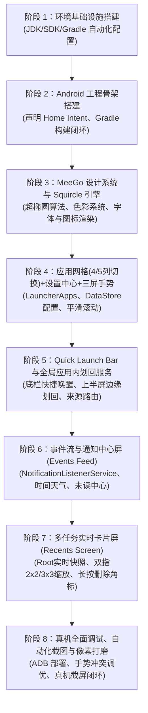

# MeeGo Harmattan 风格 Android 启动器 (MeeGo Launcher) 技术方案

> **版本**：v1.8.37  
> **文档位置**：`MEEGO_LAUNCHER_TECH_SPEC.md`（项目根目录）  
> **维护规范**：全程在 DSH 环境中进行自主开发，每次会话针对架构、需求、实现的任何调整，均需即时同步更新此文档。

---

## 1. 项目定位与核心目标

本项目旨在构建一个高保真、**1:1 还原经典诺基亚 N9 (MeeGo 1.2 Harmattan) 操作系统桌面与交互体验**的 Android 原生启动器应用。

### 1.1 MeeGo Harmattan 核心交互精髓
- **三屏无限循环水平滑动架构（Three-Screen Infinite Circular Carousel Architecture）**：
  - **首尾循环无界穿梭**：Events Feed (0) $\longleftrightarrow$ Application Grid (1) $\longleftrightarrow$ Multitasking View (2) $\longleftrightarrow$ Events Feed (0) ... 左右两个方向均可无限循环滑动，彻底打破传统 Android 桌面尽头撞墙的死板限制，完美复刻 Nokia N9 纯正的循环桌面体验。
  - **底部三屏循环指示点**：3 个极简圆点实时对应当前所处的逻辑屏幕，点击指示点按最短路径平滑换屏。
  - **启动器内部手势隔离**：启动器内部全屏宽度完全用于三屏循环手势，彻底隐藏并禁用边缘划出悬浮层，边缘触控 0 误触。
  1. **Events Feed（事件与通知流）**：时间、天气、日历提醒、系统聚合通知与未读消息。
  2. **Application Grid（应用网格/启动器）**：
     - 标志性 Squircle（连续曲率圆角）图标、纯黑背景、纵向流畅惯性滑动。
     - **动态网格密度**：支持一行 4 个（经典）或一行 5 个（紧凑）自由切换。
     - **启动器设置中心**：桌面常驻“MeeGo Settings”图标，直达启动器设置面板配置列数及手势偏好。
     - 长按编辑管理（图标抖动、快速卸载/隐藏）。
  3. **Multitasking View（多任务/运行中应用）**：
     - **真实后台卡片实时预览**（由 Root 特权链路直连渲染硬件位图）。
     - **双指无级缩放（Pinch-to-zoom）**：在 2×2（大卡片视图）与 3×3（紧凑卡片视图）后台卡片网格间平滑无级过渡，动画无缝插值。
     - **长按删除角标**：长按卡片进入编辑模式，各卡片右上角出现删除角标，点击即刻销毁后台任务。
     - 单卡片上划终结、点击秒切前台、底部一键“全部关闭”浮动按键。
- **Swipe UI 手势核心**：
  - **Quick Launch Bar（快速启动底栏）**：屏幕底部轻微上划呼出 4 个常驻核心图标（电话、短信、相机、浏览器）。
  - **全局应用内边缘滑回（In-App Edge Swipe-to-Switch-Back）**：
    - 在运行任意第三方应用时，手指从手机屏幕左右两侧全部边缘（全高度 MATCH_PARENT）划入超过屏幕宽度的 1/2 松手，切出应用并精准回溯返回启动器。
    - **系统设置与穿透保障**：采用 `TYPE_ACCESSIBILITY_OVERLAY` 突破 Android 系统设置（`com.android.settings`）的 `PRIVATE_FLAG_HIDE_NON_SYSTEM_OVERLAY_WINDOWS` 屏蔽，消除原生系统返回手势冲突，实现系统设置与全系应用边缘划回。
    - **来源感知路由（Origin-Aware Return）**：若应用从 Application Grid 启动，则滑回返回 Application Grid；若从 Multitasking View 启动，则滑回返回 Multitasking View！
  - **桌面边缘滑动直达**：桌面三屏之间无界手势滑动。
- **视觉与美学规范（Nokia Pure & Harmattan Design）**：
  - 纯黑（OLED Deep Black `#000000`）背景与超高对比度。
  - MeeGo Squircle 连续曲率超椭圆图标裁切与高保真光泽反射效果。
  - 极简 MeeGo 风格状态栏集成。
  - 物理阻尼滚动、弹簧动效（Spring Animation）与线性马达触觉反馈（Haptic Feedback）。

---

## 2. 跨平台开发环境准备方案（Ubuntu / macOS 双平台支持）

### 2.1 双平台开发环境支持矩阵与诊断
本项目原生支持在 **macOS** 与 **Ubuntu Linux** 两个主流平台进行无缝协同开发与真机调试：

| 平台特性 | macOS 运行环境 (Darwin) | Ubuntu 运行环境 (Linux x86_64) |
| :--- | :--- | :--- |
| **测试基准系统** | macOS Sequoia (Darwin 24.x, Apple Silicon / Intel) | Ubuntu 22.04 / 24.04 LTS (x86_64) |
| **JDK 管理方案** | SDKMAN (`17.0.1-open`) / `/usr/libexec/java_home` / Homebrew | SDKMAN (`17.0.1-open`) / APT (`openjdk-17-jdk`) / Trebuchet prebuilts |
| **Android SDK 默认路径** | `~/Library/Android/sdk` | `~/Android/Sdk` 或 `/home/tiny/android-sdk` |
| **Gradle 构建机制** | `./gradlew` (Gradle 8.5 包装器) 或 SDKMAN | `./gradlew` (Gradle 8.5 包装器) 或 SDKMAN |
| **ADB 路径** | `/usr/local/bin/adb`、Homebrew (`/opt/homebrew/bin/adb`) 或 SDK | `platform-tools/adb`、`/usr/bin/adb` 或 Prebuilts |
| **真机连接通道** | USB 直接即插即用 / Wi-Fi 无线配对连接 | USB (需配置 udev 规则) / Wi-Fi 无线配对连接 |
| **环境自适应探针** | `scripts/env_detect.sh` 动态识别自动生效 | `scripts/env_detect.sh` 动态识别自动生效 |

### 2.2 使用 SDKMAN 统一管理跨平台核心依赖
为了消除跨操作系统在 JDK 与 Gradle 版本上的碎片化差异，项目根目录配置了标准的 `.sdkmanrc`：
```properties
java=17.0.1-open
gradle=8.5
```

**SDKMAN 快速上手步骤（Ubuntu 与 macOS 通用）**：
1. **安装 SDKMAN**：
   ```bash
   curl -s "https://get.sdkman.io" | bash
   source "$HOME/.sdkman/bin/sdkman-init.sh"
   ```
2. **在项目根目录下自动安装并激活指定版本**：
   ```bash
   sdk env install
   sdk env
   ```

### 2.3 网络代理配置与依赖同步指南
在中国大陆或企业内网开发环境下，Gradle 依赖解析（Google Maven / Maven Central）需配置代理通道。

**双平台通用终端代理**：
```bash
export http_proxy="http://127.0.0.1:1087"
export https_proxy="http://127.0.0.1:1087"
export ALL_PROXY="socks5://127.0.0.1:1086"
```

**Gradle 独立代理配置（可选，写入 `~/.gradle/gradle.properties`）**：
```properties
systemProp.http.proxyHost=127.0.0.1
systemProp.http.proxyPort=1087
systemProp.https.proxyHost=127.0.0.1
systemProp.https.proxyPort=1087
```

### 2.4 macOS 专用配置细节
1. **Android SDK 部署**：
   - 安装 Android Studio 或通过 Homebrew 安装命令行工具：`brew install --cask android-commandlinetools`。
   - SDK 默认安装于 `~/Library/Android/sdk`。
   - 包含的必要组件：`platforms;android-34` 与 `build-tools;34.0.0`。
2. **JDK 17 识别**：
   - 优先通过 SDKMAN：`sdk install java 17.0.1-open`。
   - 备选通过 Homebrew：`brew install openjdk@17`。
   - 系统级快捷识别：`/usr/libexec/java_home -v 17`。
3. **USB 物理机免驱动即插即用**：
   - macOS 原生支持 Android 手机 USB 调试连接，无需配置 udev rules。
   - 若遇到无法识别，执行 `adb kill-server && adb start-server`。

### 2.5 Ubuntu 专用配置细节
1. **Android SDK 部署**：
   - 默认安装于 `~/Android/Sdk` 或独立部署路径（如 `/home/tiny/android-sdk`）。
   - 设置 `ANDROID_HOME` 与 `ANDROID_SDK_ROOT`。
2. **JDK 17 识别**：
   - 优先通过 SDKMAN：`sdk install java 17.0.1-open`。
   - 备选通过 apt：`sudo apt-get install -y openjdk-17-jdk`。
3. **USB udev 权限配置（关键）**：
   - 在 Linux 下，普通用户访问 USB 调试设备需要 udev 规则，避免 `adb devices` 显示 `no permissions (user in plugdev group)`：
     ```bash
     sudo sh -c 'echo "SUBSYSTEM==\"usb\", ATTR{idVendor}==\"18d1\", MODE=\"0666\", GROUP=\"plugdev\"" > /etc/udev/rules.d/51-android.rules'
     sudo udevadm control --reload-rules && sudo udevadm trigger
     adb kill-server
     ```

### 2.6 跨平台自动化脚本集合与工作流
所有脚本位于 `scripts/` 目录下，底层统一由 `scripts/env_detect.sh` 驱动，具备平台自适应感知能力：

1. **`scripts/setup_env.sh`**：
   - 跨平台自适应检测 JDK 17、Android SDK、Gradle 与 ADB。
   - 自动在当前工作区生成或更新 `local.properties`（写入对应系统的 `sdk.dir`）。
   - 自动预写入官方 Android SDK 许可证 Hash，避免命令行交互卡死。
2. **`scripts/run_build.sh` (或 `scripts/build.sh`)**：
   - 自动解析当前系统的 `JAVA_HOME` 与 `ANDROID_HOME`。
   - 调用项目根目录的 `./gradlew assembleDebug` 进行标准化构建。
   - 编译产物位于 `app/build/outputs/apk/debug/app-debug.apk`。
3. **`scripts/check_device.sh`**：
   - 自动寻找系统可用 ADB，输出设备连接状态、型号、Android 系统版本、屏幕分辨率/DPI 及 Root 状态。
4. **`scripts/deploy.sh`**：
   - 自动执行构建、安装至已连接物理机、向 `/data/local/tmp` 部署 `meego_daemon.sh` 特权守护脚本、授予权限并冷启动 Launcher。
   - **硬约束：绝不写 `/system`**。`/system` 受 dm-verity 校验，改写会导致验证失败、设备无法开机。本脚本只做 `push` + `chmod` 到 `/data/local/tmp`；若设备上已存在 `meego_daemon.rc` 则沿用其开机自启，否则提示由启动器首次运行时拉起。早期版本曾 `remount` 并写入 `/system/bin` 与 `/system/etc/init/`，已彻底移除。
   - **部署顺序固定为「watchdog 先、主进程后」**：先以双重 `setsid` 预置一个独立 watchdog 并等其落定，再拉起主进程。顺序不可颠倒，原因见 §2.7.1。
5. **`scripts/screenshot.sh`**：
   - 通过 ADB 执行底层 `exec-out screencap -p` 捕获物理机最新屏幕快照至 `screenshots/` 目录，供 UI 还原度核查。

### 2.7 物理机调试与 Root 特权通道（双平台通用）
1. **无线调试模式（ADB over Wi-Fi）**：
   - 无论在 macOS 还是 Ubuntu，手机与电脑处于同一局域网时，开启“开发者选项 -> 无线调试”：
     ```bash
     adb pair <IP>:<PORT>
     adb connect <IP>:<PORT>
     ```
2. **实测物理机基准与特权能力**：
   - 型号：Redmi K40 / POCO F3 (`alioth` / `M2012K11AC`)
   - 系统：LineageOS (Android 16 / SDK 36)
   - 屏幕规格：1080×2400 (20:9)，密度 440 DPI
   - 特权链路：`adbd root` 已就绪，支持通过 `meego_daemon.sh` 伴侣进程提供实时硬件快照与应用任务切换/销毁。

#### 2.7.1 守护进程存活模型与 watchdog 自愈（v1.8.35）

**缺陷背景**：init 以 **oneshot** 方式托管 `meego_daemon`，而 oneshot 的语义是「进程一退出即标记 service 为 stopped」，`on property:sys.boot_completed=1` 又只在开机触发一次。脚本一旦死亡，service 永久停在 `stopped`，直到下次重启 —— 表现为多任务屏删除卡片只清 UI、后台进程未被真正杀死。第二重缺陷是旧 `deploy.sh` 用 `nohup` 手动拉起脚本，与 init 实例被脚本开头的「单实例保障」互相 `kill -9`，init 侧随即变 stopped，手动实例成为 PPID=1 的孤儿，再无组件会重启它。

**三次真机否决与最终结论（关键约束）**：逐一实测四种形态，只有一种能活。

| 形态 | 结果 |
|---|---|
| service 启动时 fork 的 watchdog（setsid 后 PPID=1） | **必死** |
| 再套一层 setsid 双重脱离（PPID=1、cgroup 与 PGID 均独立） | **仍必死** |
| 在 service 启动**之前**就已存在的独立 watchdog | **存活** |

原因是 init 终止 oneshot service 时按「本次启动的派生树」清理，前两种均由该次 service 派生；`setsid` 只换进程组与会话，换不掉这层派生关系。**故启动顺序必须固定为「watchdog 先、主进程后」**。

**脚本入口约定**：入口在 fork watchdog 后**不能 `exit`** —— oneshot 会立刻把 service 标记 stopped，而重跑入口时又因 watchdog 已存在而只空转，形成「谁也起不来主进程」的死结；必须继续向下把自己变成主进程。

**自愈机制**：watchdog 每 5s 读 `/data/local/tmp/meego_daemon.pid` 校验主进程存活，连续 3 次（15s 宽限期）确认死亡才重启，避免抖动引发重启风暴。重启**刻意不用 `setprop ctl.start`**：`.rc` 指向 `/system/bin/meego_daemon.sh`，而 `/system` 不可更新，实测 ctl.start 拉起的正是那份旧脚本（既不写心跳也无本版修复），自愈一次等于回退一次；改为直接拉起当前运行的 `$0`。

**旧副本收敛**：watchdog 存活判定要求「存在**与本进程同源**的 watchdog」，而非「存在任意 `__WATCHDOG`」。boot 时 init 会按 `.rc` 启动 `/system` 旧副本并 fork 出指向自己的 watchdog，若沿用宽判定就会误认为 watchdog 已存在而不启动自己的，紧接着单实例逻辑又把旧 watchdog 清掉，两个都落空。收紧后旧副本的整条守护链被主动接管清除，全局收敛到当前脚本。

#### 2.7.2 App 侧辅助唤醒（`DaemonWatchdogClient`）

启动器启动时读心跳判断链路是否健在，仅在「主进程已死而 watchdog 尚存」时投递 `ENSURE_DAEMON`，省掉 15s 宽限等待。**只能辅助而非直接拉起**：设备无 `su` 二进制，App 进程（u0_a209）无法提权执行 `setprop`。

心跳判据的两次修正：

1. **不能扫 `/proc`**：本机 `/proc` 挂载了 `hidepid=2`，普通 uid 看不到其他进程的 cmdline（实测 root 可见而 App 不可见），改为双方各自申报心跳、App 读文件判断。
2. **心跳不能放 `/data/local/tmp`**：该目录 SELinux 标签为 `shell_data_file`，即便权限 666，App（`untrusted_app`）仍被 `avc: denied { read }` 拒绝。改放 App 私有目录（`app_data_file` 标签）：
   - `/data/user/0/com.meego.launcher/files/cmd_queue/daemon.hb` —— 主进程每 2s 刷新
   - `/data/user/0/com.meego.launcher/files/cmd_queue/watchdog.hb` —— watchdog 每 5s 刷新

   内容为 `<pid> <epochSeconds>`，并显式 `chown` 对齐 App uid，否则 root 写入的文件 App 读不到。

#### 2.7.3 App 私有目录自愈

App 被重装/清数据后 `/data/user/0/<pkg>/files` 会被删除，而旧脚本的 `mkdir -p` 在父目录缺失时一并失败且被 `2>/dev/null || true` 静默吞掉，表现为日志连篇 `can't create ... No such file or directory`，且命令队列永远收不到指令。新增 `ensure_app_dirs()` 逐级创建 `cmd_queue` / `snapshots` 并显式 `chown` 对齐 App uid，主循环内兜底重试（目录由 App 下次启动自建后补齐）。


---

## 3. 技术选型与整体架构

### 3.1 技术栈选型
| 分层 | 技术选型 | 选型理由 |
| :--- | :--- | :--- |
| **开发语言** | Kotlin 1.9+ | 官方首选、协程支持、与现代 Android 库高度契合 |
| **UI 框架** | Jetpack Compose + Material 3 (底层定制) | 声明式动画系统最适合实现 MeeGo 复杂的动态多任务缩放、物理弹簧阻尼与 Squircle 实时着色 |
| **异步流驱动** | Kotlin Coroutines + StateFlow / Flow | 高性能响应式状态流，无缝驱动事件聚合与图标装载 |
| **配置持久化** | Jetpack DataStore Preferences | 响应式持久化存储启动器配置（如网格 4/5 列模式、手势灵敏度） |
| **依赖注入** | 手工轻量级 DI 或 Hilt | 保证启动速度极快，启动器（Launcher）对冷启动耗时有极致严苛要求（< 300ms） |
| **系统交互能力** | `LauncherApps` + `NotificationListenerService` + `UsageStatsManager` | 遵循 Android 原生标准接口，兼顾安全与权限最小化 |
| **后台实时快照与任务调度** | Root / `ActivityTaskManager` 特权调用 + `am task` 管道 | 突破 Android 原生沙盒隔离，1:1 还原 MeeGo 后台多任务真实卡片预览，支持低延迟切回与任务销毁 |
| **全局边缘划回手势** | `AccessibilityService` / Root 特权 Overlay 悬浮手势条 | 跨任意第三方应用捕获屏幕上半区左右边缘划入，实现切出应用返回对应启动源 |

### 3.2 模块化架构设计
```
test-android-launcher/
├── build.gradle.kts
├── settings.gradle.kts
├── gradle/
├── gradlew
├── scripts/
│   ├── setup_env.sh             # 环境变量与 SDK 自动化就绪脚本
│   ├── build.sh                 # 一键编译脚本
│   ├── deploy.sh                # 部署安装脚本
│   ├── check_device.sh          # 物理机连接与 Root 诊断脚本
│   └── screenshot.sh            # 物理机屏幕快速回传脚本
├── app/
│   ├── build.gradle.kts
│   └── src/main/
│       ├── AndroidManifest.xml
│       └── java/com/meego/launcher/
│           ├── MainActivity.kt                  # 启动器单一宿主 Activity (全屏、手势捕获)
│           ├── ui/
│           │   ├── theme/                       # MeeGo Harmattan 主题规范
│           │   │   ├── Color.kt                 # 纯黑背景、经典 Nokia 调色板
│           │   │   ├── Shape.kt                 # Squircle 超椭圆曲线数学实现
│           │   │   ├── Type.kt                  # Nokia Pure 字体排版尺度
│           │   │   └── Motion.kt                # MeeGo 弹簧曲线与触觉反馈参数
│           │   ├── components/                  # 通用原子组件
│           │   │   ├── SquircleIcon.kt          # 自适应 MeeGo 图标容器与光泽效果
│           │   │   ├── SwipePager.kt            # 三屏无缝平滑滑动器
│           │   │   └── QuickLaunchBar.kt        # 经典上滑快捷底栏
│           │   └── screens/
│           │       ├── feed/                    # 屏1：事件与通知聚合流
│           │       │   ├── FeedScreen.kt
│           │       │   └── components/ClockWeatherCard.kt, NotificationItem.kt
│           │       ├── grid/                    # 屏2：应用网格启动器
│           │       │   ├── AppGridScreen.kt     # 支持 4 列 / 5 列动态切换
│           │       │   └── components/AppGridItem.kt, EditModeOverlay.kt
│           │       ├── recents/                 # 屏3：多任务动态卡片视图
│           │       │   ├── RecentsScreen.kt
│           │       │   └── components/
│           │       │       ├── TaskCard.kt      # 包含真实 TaskSnapshot、长按右上角删除角标
│           │       │       ├── PinchZoomGrid.kt # 双指 2×2 / 3×3 无级缩放控制器
│           │       │       └── CloseAllButton.kt# 底部圆形“关闭全部”浮动按键
│           │       └── settings/                # 启动器设置中心
│           │           ├── SettingsScreen.kt    # 列数（4/5列）配置、手势偏好设置
│           │           └── components/SettingItem.kt
│           ├── core/
│           │   ├── apps/                        # 应用列表加载、缓存与过滤 (LauncherApps)
│           │   ├── notification/                # 通知捕获与同步管理
│           │   ├── recents/                     # 运行中应用与多任务核心
│           │   │   ├── TaskSnapshotProvider.kt  # 快照提供者统一接口
│           │   │   ├── RootTaskSnapshotProvider.kt # Root 特权提取 TaskSnapshot 硬件位图
│           │   │   ├── FallbackSnapshotProvider.kt # 无特权降级方案（图标与色板占位）
│           │   │   ├── TaskSnapshotCache.kt     # LRU 高性能位图缓存与生命周期复用
│           │   │   └── RecentTaskController.kt  # 任务切换 (am switch-to-task) 与终结控制
│           │   ├── gestures/                    # 手势系统
│           │   │   ├── MeeGoEdgeSwipeService.kt # 全局应用内上半屏边缘划回监听服务
│           │   │   └── SwipeGestureDetector.kt  # 桌面内多指/边缘滑动算法
│           │   └── navigation/
│           │       └── LaunchOriginTracker.kt   # 启动来源追踪器 (GRID vs RECENTS)
│           ├── data/
│           │   └── preferences/
│           │       └── LauncherPreferences.kt   # DataStore 偏好存储（4/5列设置）
│           └── service/
│               └── MeeGoNotificationListener.kt # 系统通知监听服务
```

---

## 4. 1:1 MeeGo Harmattan 细节还原设计规范

### 4.1 MeeGo Squircle 超椭圆几何模型
MeeGo 图标与卡片并非 Android 原生的简单圆角或普通的 `RoundedCornerShape(16.dp)`，而是严格遵循著名的 **Lamé 曲线（超椭圆，Superellipse）**：
$$\left|\frac{x}{a}\right|^n + \left|\frac{y}{b}\right|^n = 1 \quad (n = 2.732)$$
- **黄金超椭圆曲率指数（$n = 2.732$）**：
  - Nokia N9 Harmattan 工业与界面设计的标志性几何特征，取值精确为 $n = 2.732$（对应 $1 + \sqrt{3} \approx 2.73205$ 超椭圆黄金比例常数）。
  - 相较于普通高阶矩形（如 $n = 4.0$ 或 $n = 5.0$ 偏向平直切角的生硬方盒感），$n = 2.732$ 赋予图标与卡片更为圆润、有机、极具亲和力的圆角矩形鹅卵石质感。
  - 具备 $G2$ / $G3$ 级别的连续平滑曲率过渡，杜绝普通直线过渡圆角在相切连接处的视觉折痕与棱角突兀感。
- **全局统一超椭圆设计语言（Universal Squircle Architecture）**：
  - **彻底废除系统默认圆角**：启动器内全面摒弃 Android 原生 `RoundedCornerShape` 与普通圆形 `CircleShape`，所有界面元素均统一遵循 $n = 2.732$ 黄金超椭圆曲率驱动。
  - **组件级细化覆盖**：
    - **应用网格图标**：$58\text{dp} \times 58\text{dp}$（4列）/ $52\text{dp} \times 52\text{dp}$（5列）正方形全局黄金超椭圆裁切。
    - **后台卡片关闭角标（Delete Badge）**：长按编辑模式下浮现的 $26\text{dp}$ 红色叉号角标采用 `SquircleShape()` 超椭圆，还原 N9 原汁原味的微圆角小红方牌。
    - **底部一键清理按键（Close All Button）**：$52\text{dp}$ 浮动白叉按键采用经典暗灰 Squircle 超椭圆外壳。
    - **卡片头部信息胶囊与模式切换按键**：采用带超椭圆倒角（`cornerRadius = 10.dp ~ 16.dp`）的 Squircle 胶囊。
    - **事件聚合流与设置页分组卡片**：Feed 消息卡片与 Settings 选项组均采用 `SquircleShape(cornerRadius = 16.dp)`，整体风格高度协同统一。

### 4.2 三屏联动、手势体系与应用网格配置
- **三屏顺序**：`[屏0: Events Feed]` $\longleftrightarrow$ `[屏1: Application Grid]` $\longleftrightarrow$ `[屏2: Multitasking]`
- **水平视差与循环**：支持高帧率流畅手势跟随，无死区，具备边界阻尼回弹效果。
- **Application Grid 动态网格与设置入口**：
  - **4 列 / 5 列动态切换**：
    - 4 列模式（默认经典）：Squircle 图标更大（约 64dp），留白舒适，还原 N9 原汁原味比例。
    - 5 列模式（紧凑长屏）：图标略微紧缩（约 54dp），充分利用现代 20:9 物理机长屏纵深，一屏容纳更多应用。
  - **启动器设置入口（MeeGo Settings Icon）**：
    - 启动器自带内置“设置”Squircle 独立图标，点击打开原生 Jetpack Compose 设置页。
    - 提供“网格列数配置（4 列 / 5 列）”、“手势灵敏度”、“关于 MeeGo Launcher”等直观开关。
    - 配置通过 `LauncherPreferences (DataStore)` 实时响应式驱动重绘，无需重启应用。
- **Quick Launch Bar**：
  - 无论处于哪一屏，从屏幕底部边缘向上轻推 $\approx 32\text{dp}$，呼出毛玻璃渐隐底栏。
  - 4 个标准快捷槽位：电话、短信、相机、浏览器。手指拖动即可直达释放，松手回弹收起。

### 4.3 多任务（Recents）动态双模交互与真实后台快照体系
- **Root 赋能的真实后台卡片实时预览（Live Task Snapshot）**：
  - 在 Android 原生架构中，普通 Launcher 只能展示静态应用 Icon。本项目通过 Root 特权管道直接获取系统的 `TaskSnapshot` 真实硬件快照（HardwareBitmap）或高精度视图流。
  - 真正实现诺基亚 N9 标志性的“当前后台界面所见即所得”效果，动态捕捉浏览器网页、聊天消息、播放器卡片的实时状态。
  - **优雅降级策略（Graceful Degradation）**：若无 Root 权限时，自动平滑回退为带有应用大图标与主色调微渐变的 Squircle 卡片，保证系统高鲁棒性。
- **双指缩放无级切换与卡片上下堆叠展开动画（Continuous Pinch-to-Zoom & Stack-and-Expand Cascade Deck）**：
  - **交互手势与无级插值**：
    - 支持在多任务屏幕上使用双指张开（Spread）或捏合（Pinch）进行动态缩放。
    - 缩放通过底层连续状态变量 $p \in [0.0, 1.0]$ 实时驱动（$1.0$ 对应 2×2 详尽大卡片，$0.0$ 对应 3×3 紧凑多任务）。
    - 双指移动时，直接依据指尖间距相对增量实时刷新 $p$ 值，卡片尺寸、间距、列坐标和文字尺度均实现平滑连续变换，杜绝跳帧。
    - 双指松开（或点击右上角布局切换按钮）时，触发物理弹簧动效（Spring Animation）平滑吸附至目标端点（$0.0$ 或 $1.0$），并将最终布局持久化至 DataStore。
  - **MeeGo 级联堆叠展开物理动效（Cascade Stack & Expand）**：
    - **堆叠权重函数**：引入正弦权重函数 $w_{\text{stack}} = \sin(p \times \pi)$。在两端网格稳态（$p = 0.0$ 或 $1.0$）时 $w_{\text{stack}} = 0.0$，卡片严格位于标准网格矩阵中；在过渡中间态（$p = 0.5$）时达到最大值 $1.0$。
    - **中轴聚合与垂直阶梯重叠**：卡片在过渡过程中水平向屏幕中轴聚合，垂直方向按卡片顺序以阶梯步长递增偏移：
      $$Y_{\text{stack}}(i) = Y_{\text{stackStart}} + 38\text{dp} \times i$$
      所有卡片在中间态如同实体扑克牌一般优雅聚拢堆叠成一列级联卡片堆（Deck of Cards），随后再如扇形般向目标网格槽位动态舒展展开。
    - **物理微倾斜与层叠投影**：各卡片依据索引交替施加微妙的交错微倾斜角（$\theta = ((i \bmod 3) - 1) \times 1.8^\circ$）与递增高度阴影（Elevation 随卡片层级递增），配合 GPU `graphicsLayer` 硬件加速，在纯黑背景上呈现逼真的物理纸牌微叠质感。
    - **可视窗口自适应锚定**：堆叠起点自动锚定用户当前滚动视口（$Y_{\text{stackStart}} = \max(16\text{dp}, \text{scrollY} + 16\text{dp})$），无论用户滚动到后台任务列表的任意深度，堆叠与展开动效始终在当前视口中央发生。
  - **单/双指触控严格隔离**：
    - `awaitPointerEventScope` 仅在检测到 2 根及以上手指时拦截并消费事件；单指纵向滚动、轻触切任务、长按进入编辑模式完全透传，零手势竞争。
  - **双模稳态形态**：
    - **2×2 详尽大卡片**：每行 2 列，卡片面积大，内部应用文字和图形细节清晰可辨。
    - **3×3 紧凑多任务**：每行 3 列，卡片紧凑高效，全局掌控后台多任务全貌。
- **长按进入编辑模式与右上角删除角标**：
  - **长按激活**：长按任意后台卡片（$\approx 400\text{ms}$），配合线性马达触发短震动反馈，所有卡片进入“编辑/清理模式”（可伴有极轻微的微幅抖动）。
  - **右上角删除角标（Delete Badge）**：每个卡片右上角浮现 MeeGo 经典红色圆形关闭角标（白色交叉叉号）。
  - **点击删除任务**：直接点击该角标，卡片伴随缩放淡出动效从网格中移除，底层立即调用 `RecentTaskController.removeTask(taskId)` 终结该任务后台进程。
  - **退出编辑模式**：点击卡片之外的空白暗色背景，或再次轻触卡片，即可平滑退出编辑模式。
  - **删除不退出编辑模式（v1.8.34 修复）**：删除动作与「退出编辑模式」严格解耦——`onDelete` 仅向 `deletingTaskIds` 登记 taskId，绝不触碰 `isEditMode`。此前删除角标是卡片 `combinedClickable` 的子节点，点击落点落在 26dp 红点之外（外层 48dp 命中盒或卡片本体）时会被卡片本体接管并触发「退出编辑模式」，导致底部一键删除浮键随之消失；修复后底部按钮的存活只取决于 `isEditMode`，删除流程无法再将其置空。
- **两段式删除动画（消失 → 补位，v1.8.34）**：
  - **第一段·消失动画**：点击删除后**不立即**从数据源摘除任务，而是先把 taskId 加入 `deletingTaskIds`。对应卡片以 `zIndex = 100f` 浮至最上层，以 `LinearEasing` **线性缩小 20%**（`SCALE_FACTOR = 0.8f`）且**线性变淡至 50%**（`MIN_ALPHA = 0.5f`），阴影同步衰减，全程 `DURATION_MS = 260ms`。
  - **第二段·补位动画**：消失动画播放完毕才回调 `onDeleteAnimFinished` 真正执行 `removeTask` + `onTaskRemoved`。「先消失、后补位」由此成为**结构性保证而非时序妥协**——卡片在整个消失动画期间始终留在 `tasks` 中占据原索引，其余卡片的 `i` 不变、坐标纹丝不动；只有动画结束、列表长度真正缩短之后索引才整体前移，既有 `animateDpAsState` 弹簧补位动画才得以启动。
  - **一键删除复用同一套表现**：点击底部按钮时将全部 taskId 一次性加入 `deletingTaskIds`，所有卡片同步播放完全相同的消失动画；待最后一张播完，才统一走一次 `removeAllTasks` + `onClearAll()`。此处刻意**不逐张调用 `removeTask`**——逐个强杀会产生 N 轮竞态与无谓开销。`pendingClearAll` 标记承载该收尾流程。
  - **健壮性兜底**：`LaunchedEffect(tasks, deletingTaskIds)` 监听两侧集合，若守护进程轮询等外部因素把任务从数据源直接抹掉，则清理 `deletingTaskIds` 中的陈旧 id，并在集合空且 `pendingClearAll` 仍为 true 时补做收尾，杜绝「一键删除永远等不到最后一张卡片」的死锁。
- **任务控制与生命周期同步**：
  - **单卡片上划**：非编辑模式下单卡片向上甩动，伴随物理加速度飞出屏幕，彻底杀死后台任务。
  - **点击卡片**：直接触发 `RecentTaskController.switchToTask(taskId)`，秒级无缝切回应用前台。
  - **一键清理所有（Close All）**：底部常驻 MeeGo 经典圆形浮动按键，点击后伴随卡片序列依次渐隐飞出动效，一键释放后台内存。
- **卡片顺位重排与后移位移物理动效（Card Reordering & Layout Transition Animation）**：
  - 当用户从前台应用划出返回 Multitasking View，或者最近任务顺序发生重排（如 A B C $\rightarrow$ C A B）时，卡片采用专属的 `animateDpAsState` 弹簧物理动画（$animX$ 与 $animY$）。
  - **动力学刚度与阻尼模型**：刚度设为 `stiffness = 140f`，阻尼比设为 `dampingRatio = 0.92f`（接近临界阻尼），将卡片移位视觉耗时平滑拉长至约 400~450ms，彻底消除生硬急促感与多余回弹，配合浮层 $zIndex = 25f$ 呈现顺畅飞升与顺位后移的高级流体质感。
  - **分层交互隔离**：通过 `if (isPinching) currentX else animX` 隔离双指缩放，确保用户主动交互时保持绝对零延迟直接跟手。


### 4.4 现代物理机特性与手势冲突避让策略（Physical Device Adaptation）
1. **全面屏手势冲突避让（Gesture Exclusion）**：
   - 现代 Android 10+ 普遍默认启用“全面屏手势”（侧滑返回、底部上划返回桌面）。
   - 为避免物理机系统级手势与 MeeGo 边缘无界滑动及 Quick Launch Bar 产生冲突，采用以下协同机制：
     - **手势排除区域**：使用 `ViewCompat.setSystemGestureExclusionRects()` 对底部 Quick Launch 触发区和屏幕侧边缘申请系统手势排除。
     - **全屏沉浸与手势保护**：采用 `WindowCompat.setDecorFitsSystemWindows(window, false)` 实现真正端到端沉浸，状态栏与导航栏根据交互动态隐现。
2. **长屏比例（19.5:9 / 20:9）与高分屏适配**：
   - 经典 Nokia N9 为紧凑型 16:9（854×480），现代物理机以 20:9、FHD+/2K 为主。
   - 核心 Squircle 容器采用固定外接宽高比约束，通过弹性垂直网格边距计算，避免图标拉伸变形，同时在长屏幕上自然呈现 MeeGo 呼吸感留白。
3. **高刷新率（90Hz / 120Hz）与线性马达触觉反馈（Haptics）**：
   - 接入物理机振动马达（`VibrationEffect.createPredefined(VibrationEffect.EFFECT_CLICK)` / `EFFECT_HEAVY_CLICK`）。
   - 在滑动分屏吸附、长按图标抖动编辑、底栏弹出就位时提供微秒级触觉反馈。

### 4.5 全局应用内上半屏边缘划回交互与双层揭示系统（In-App Edge Swipe & Dual-Layer Reveal System）
1. **交互行为规范（Nokia N9 经典跨应用切出手势 1:1 还原）**：
   - **手势热区划分**：屏幕高度的上半部分（$0 \le Y \le \text{ScreenHeight} / 2$）左右两侧边缘（宽度约 $28\text{dp} / 77\text{px}$ 隐形捕获区）。下半部完全保留给宿主应用原生手势与输入法键盘，彻底杜绝打字与常规操作误触。
   - **MeeGo 经典系统级划出跟随动画**：
     - 手势划入时，悬浮层立即呈现**当前正在运行的应用界面卡片**，具有 MeeGo 标志性 Squircle（28dp 圆角）连续轮廓与 $20\text{dp}$ 纵深阴影。
     - 卡片随手指水平移动，伴随微小尺度压缩（$1.0 \to 0.88$ 缩放）。
   - **双层揭示体系（Dual-Layer Reveal Architecture）**：
     - 滑动卡片下方**绝不是透明透出当前应用**，而是根据进入来源动态呈现对应的**启动器真实画面**！
     - 底层桌面采用 100% 纯黑底层保底垫层（`solidBlackBackdrop`）配合 1:1 原始贴合与完全不透明（$\text{alpha} = 1.0$），上层卡片（$n = 2.732$ 超椭圆轮廓与投影）随手指滑出，从物理层面上 100% 杜绝底层第三方应用透光或露角，彻底根除三个界面叠合的视觉异常。
   - **滑动行程与松手判定**：
     - 当横向位移 $\Delta X < \text{ScreenWidth} / 2$ 时：原路弹簧回弹（Spring Back），卡片复原至全屏。
     - 当横向位移 $\Delta X \ge \text{ScreenWidth} / 2$ 时：顺势加速飞出屏幕（Slide Out），底层桌面瞬时呈现并完成来源对齐。
2. **来源感知定向回溯（Origin-Aware Contextual Routing）**：
   - 应用启动时，通过 `LaunchOriginTracker` 精准记录进入路径：
     - **Path A**：若应用最初由 **Application Grid（屏1 应用网格）** 点击拉起 $\implies$ 滑动底板展示 **Application Grid**，滑出后桌面无缝停留在 **Application Grid**；
     - **Path B**：若应用由 **Multitasking View（屏2 多任务卡片）** 点击切换拉起 $\implies$ 滑动底板展示 **Multitasking View**，滑出后桌面无缝停留在 **Multitasking View**。
3. **特权与底层技术突破**：
   - **前台应用全真实时快照管线（Live Screencap Pipeline）**：
     - 突破限制：Android 原生沙盒机制只在应用进入后台时才将 `TaskSnapshot` 写入磁盘，导致传统方案划出时只能取到“上一个后台应用”的陈旧画面。
     - 特权方案：后台常驻 Root 守护进程 `meego_daemon.sh` 监听系统 `ResumedActivity`，在应用切换并渲染首帧后，以 0 内存开销调用特权通道 `screencap -p` 写入 `/data/local/tmp/current_app.png`，确保划出时显示的 100% 为当前应用实时内容。
   - **系统侧滑返回手势完全屏蔽（Zero Conflict Edge Gesture Suppression）**：
     - 突破限制：Android 10+ 的 `EdgeBackGestureHandler` 存在 200dp 系统排除上限，导致上层 Overlay 的手势排除区被系统强制截断，与原生返回手势严重冲突。
     - 特权方案：守护脚本启动时直接通过 Root 特权执行：
       ```bash
       settings put secure back_gesture_inset_scale_left 0
       settings put secure back_gesture_inset_scale_right 0
       ```
       强制将两边缘的 `mEdgeWidthLeft / mEdgeWidthRight` 设为 0px，100% 消除系统侧滑返回冲突，留给 MeeGo 上半屏纯净手势。
   - **启动器屏幕快照双重缓存架构（ScreenCaptureHelper）**：
     - 启动器通过 `PixelCopy` 在 Activity 绘制与页面滑动时以 1080×2400 原生分辨率捕获桌面底板。
     - 运行时通过 `LauncherPreviews` 内存二级缓存直连，辅以私有沙盒 `filesDir`（`app_grid_preview.png` / `recents_preview.png`）持久化，实现 0ms 延迟瞬时加载。
   - **切回启动器 0 闪烁无缝交接管线（Seamless Zero-Flicker Handover Pipeline）**：
     - 痛点解决：滑出动画飞出屏幕后，如果过早关闭 Overlay 悬浮窗，由于 Android 启动 Activity 存在 100~200ms 的进程窗口调度时延，底层旧应用会在这短暂瞬间“一闪而过”；同时系统默认转场动画会带来跳动感。
     - 架构方案：
       1. 手指划入超过 1/2 屏幕松手瞬间，立即以 `FLAG_ACTIVITY_NO_ANIMATION` 唤起 `MainActivity`，与 220ms 卡片飞出动画并行执行；
       2. 卡片飞出动画结束时，仅隐藏飞出卡片，**保持 `desktopBackgroundImageView` 高保真桌面底板在最顶层持续覆盖**，完全盖住旧应用；
       3. `MainActivity.onResume()` 禁用原生 Activity 转场动画，等待 `window.decorView.post` 确认桌面首帧渲染已写入图形缓冲区后，才主动向服务发送 `dismissOverlay()` 撤除遮罩；
       4. 配合 500ms 兜底安全定时器，实现 100% 毫无察觉的 0 闪烁丝滑交接。
   - **多任务卡片实时全真快照多级保障管线（Multi-Tier Snapshot Resolution Pipeline）**：
     - **痛点解决**：Android 原生沙盒机制在应用退至后台时，`TaskSnapshot` 异步写入磁盘存在 500ms~1500ms 滞后；若桌面在切回瞬间直接读盘，卡片由于找不到快照文件而被迫降级退化显示应用图标。
     - **架构设计**：
       1. **一级内存快照缓存（`TaskSnapshotCache`）**：单例内存高速缓存，手势服务在 `startSwipeOutAnimation` 及 `finishSwipeOut` 动画执行时，将手势滑出的应用实时全真画面（`snapBitmap`）即时写入内存缓存，并绑定 `lastSwipedTaskId` 与 `lastSwipedPackageName`；
       2. **二级特权全真快照（`current_app.png`）**：`RootTaskProvider` 在解析任务列表时，若本地快照尚未落盘，自动比对当前前台任务 ID 或包名，读取特权守护脚本预先捕获的 `/data/local/tmp/current_app.png`；
       3. **三级守护进程快照保底（Daemon Snapshot Fallback）**：`meego_daemon.sh` 在更新 `recent_tasks.json` 时，若原生快照不存在且当前任务匹配，直接将 `current_app.png` 复制至 `/data/local/tmp/snapshots/${tid}_reduced.jpg` 并赋予 644 权限；
       4. **异步多阶段重刷（Delayed Task Refreshes）**：`MainActivity.onResume()` 在即时加载（0ms）后，分别在 600ms 与 1500ms 自动触发延时重刷，待系统原生快照写入完毕后无缝替换为系统全高清位图，实现多任务卡片 100% 实时显示真机界面，绝不退化为图标。
   - **多任务网格状态持久化（Recents Columns Persistence & Snapping）**：
     - 将多任务 2×2 / 3×3 布局模式同步纳入 DataStore 持久化存储（`KEY_RECENTS_COLUMNS`）；
     - 双指缩放（Pinch-to-zoom）手势结束时，依据 $\text{pinchScale} \lessgtr 0.83$ 智能平滑吸附到 3×3 或 2×2，并实时持久化，彻底解决在主屏各页面滑动或重启后模式被重置的问题。

### 4.6 启动器桌面底部系统小横条屏蔽与纯净沉浸遮罩架构（Zero-Side-Effect Bottom Bar Masking System）
1. **背景痛点与废弃方案根因剖析**：
   - **设计诉求**：在 MeeGo 启动器桌面中，系统原生底部手势提示横条（Gesture Navigation Bar Pill / Hint）破坏了 Nokia N9 纯黑一体深邃美学，必须在桌面内实现 100% 隐藏，同时**严禁对全局其他应用和系统手势产生任何负面影响**。
   - **方案 A（全局篡改设置 `navigation_bar_hint = 0`）被废弃根因**：该设置为系统全局永久生效，用户切入任何第三方应用后，底栏小白条同样被永久抹杀，部分 ROM 下原生返回/切换手势偶发性失灵，严重破坏了非 Launcher 场景的系统手势完整性；
   - **方案 B（Launcher 窗口调用 `hide(navigationBars)` 强制沉浸）被废弃根因**：现代 Android 14/15/16 会强制开启 Immersive 粘性全屏模式。每次启动第三方应用或滑回桌面时，WindowInsets 会剧烈重算并触发动画，导致状态栏及底部黑边反复闪烁，且桌面边缘滑动极易意外呼出半透明暂留系统栏。
2. **全新无障碍顶级覆盖遮罩架构（Accessibility Overlay Mask Architecture）**：
   - **窗口分层与绝对压制**：利用 `EdgeSwipeGestureService` 已具备的无障碍服务上下文，挂载 `TYPE_ACCESSIBILITY_OVERLAY` 窗口（系统层级 BaseLayer = 311000），天然且绝对高于系统导航栏 `TYPE_NAVIGATION_BAR`（层级 231000）；
   - **像素级几何对齐与深黑融合**：遮罩层高度与系统导航栏高度精确对齐（24dp / 66px），铺设纯黑 `#000000` 背景，与 MeeGo OLED 纯黑桌面物理无缝交融；
   - **触控抢占与原生手势隔离**：遮罩视图挂载 `setOnTouchListener { _, _ -> true }` 消费底部误触，阻断系统导航条手势争抢；
   - **桌面生命周期强绑定（零全局污染）**：
     - 在无障碍事件 `onAccessibilityEvent` 与 `updateLauncherVisibility(isInLauncher: Boolean)` 中严格同步；
     - 仅当用户处于 MeeGo Launcher 桌面（`isInLauncher == true`）时设置 `bottomMaskView.visibility = View.VISIBLE`；
     - 用户一旦启动或切换至任何第三方应用（`isInLauncher == false`），遮罩立即执行 `View.GONE` 完全隐退，系统原生小横条与手势 100% 保持原生状态，达成零副作用；
   - **三屏指示点悬浮比例重构**：将主屏底部三颗超椭圆指示点的底部留白（`padding(bottom)`）由 12dp 调整至 30dp，使指示点自然悬浮于 24dp 遮罩层上方，触控点击换屏与视觉重心达到最佳协调比例。

### 4.7 Application Grid 滑动流畅度工程化与真机实测校正（Grid Scroll Performance）

> 方案原文：`docs/GRID_SCROLL_PERFORMANCE_PLAN.md`；基准脚本：`scripts/perf_grid.sh`、`scripts/analyze_framestats.py`；报告产物：`docs/perf/`。

#### 4.7.1 测量基础设施（Step 1）
- **`scripts/perf_grid.sh`**：同机同手势对照基准。对 `com.meego.launcher` 与 LineageOS Trebuchet（`com.android.launcher3`，本机 Trebuchet 实际包名）跑**完全相同**的往返滑动序列，输出 Total / Janky frames 与 P50/P90/P95/P99。
  - **刷新率强校验（关键踩坑修正）**：本机 Redmi K40 / LineageOS 上**只设 `peak_refresh_rate` 不足以切到 120Hz**——只要 `min_refresh_rate` 仍为 60，`mActiveSfDisplayMode` 就停在 60Hz 模式。此时应用按 8.26ms 节奏出帧，却每帧排队等 16.6ms 的 vsync，`dumpsys` 会把几乎所有帧判为 jank（实测虚高到 P50 12~13ms / jank 17~24%），**这是测量档位造成的假象，不是应用慢**。脚本现同时设置 `peak/min/user_refresh_rate` 与 `secure preferred_refresh_rate`，并强校验 `mActiveSfDisplayMode`，未真正到 120Hz 直接以退出码 4 失败。
  - **不作弊**：全程保持系统动画开启（不通过关闭动画换分数），采用预热轮次 + 正式轮次分离。
- **`scripts/analyze_framestats.py`**：解析 `dumpsys gfxinfo <pkg> framestats` 逐帧分段耗时，输出**端到端帧时长、真实主线程开销、送显等待、输入延迟**四个口径——这才是判断"是否真的踩到 vsync 预算"的可信度量。

#### 4.7.2 真机实测结论（对方案 §2 前提的**重要修正**）

在同一台 Redmi K40 / Android 16 / 真 120Hz（`FrameInterval` 8.26ms ≈ 121Hz）下，对比 MeeGo Grid 与 Trebuchet 应用抽屉的逐帧分段：

| 分段（framestats） | MeeGo Grid | Trebuchet | 结论 |
|---|---|---|---|
| 布局 `PerformTraversals→DrawStart` | **0.05ms** | 0.04ms | 布局开销已与原生持平，**无优化空间** |
| 主线程总 `→IssueDrawCommands` | 0.59ms | 0.28ms | 量级极小 |
| **送显等待 `IssueDraw→FrameCompleted`** | **5.59ms** | **3.22ms** | **差距几乎全部在此（≈2.4ms）** |
| 端到端 `FrameStart→Completed` P50/P95 | 7.17 / 8.09ms | 3.74 / 4.68ms | MeeGo 端到端 **max 8.26ms = 恰好一个 120Hz 帧预算** |
| `gfxinfo` 汇总 Janky % / P95 | 6.98% / 13ms | 0.30% / 5ms | 含 present 等待的粗口径 |

**结论**：本项目 Grid 的**真实渲染与布局工作量已极轻（0.05ms 布局、约 0.6ms 主线程），端到端帧时长稳定在 8.33ms 预算内（采样帧 max 恰为 8.26ms，即每帧都命中当拍）**。与 Trebuchet 的剩余差距**集中在 buffer 提交 / SurfaceFlinger 合成 / 送显这一段（present 等待）**，属于设备与合成管线特性，**不是 Compose 重组或图标绘制能优化的部分**。方案 §2 假设的"主线程重组成本是滑动不顺的根因"，在本机上**不成立**。

#### 4.7.3 已落地的代码改动（低风险、零手感变化）
所有改动**默认值与优化前逐位一致**，仅做结构显式化与滑动期分配削减，**不改变任何物理观感**：
- **`AppItem.gridKey`（`model/Models.kt`）**：在 data class 构造期**预计算**稳定 key。原先 `key = { it.packageName + it.activityName }` 会在每次 measure/recycle 对每个可见项做一次字符串拼接（30+ 应用 = 每帧 30+ 次 String 分配），属滑动期主线程分配抖动。
- **`ScrollPhysicsConfig`（`ui/components/MeeGoScrollPhysics.kt`）**：把 Fling 增益/速度分界、橡皮筋阻尼/冲击/回弹弹簧等"魔法数字"显式化为一个 `@Stable data class`，`Default` 与优化前**逐位一致**；另提供 `ShortTravel`（增益 1.0x）作为**默认关闭**的 A/B 对照档（用于区分"阻滞感来自摩擦还是掉帧"，绝不作为卡顿修复手段）。
- **`JobHolder`（`ui/screens/AppGridScreen.kt`）**：用**非快照** holder 保存 Fling Job，取代原 `mutableStateOf<Job?>`，避免手指抬起/落下时写入快照状态触发无效重组。
- **`GridMetrics`**：列数→图标尺寸/字号收敛到 `remember(columns)`，避免每个 item 重复分支。
- **全局共享 Outline 缓存（`ui/components/SquircleShape.kt`）**：Squircle `Outline` 由"单槽实例缓存"升级为**按 (n, cornerRadius, w, h, density) 键的有界全局表**（上限 128，长尾组合整体清空重建防无界增长），避免 `DefaultSquircleShape` 单例在 Grid/多任务卡片间交替请求时互相挤掉单槽、反复重走 72 点 Path。

#### 4.7.4 经实测**否决**的优化（重要留档）
- **把图标绘制改为 `Modifier.drawBehind { clipPath(...) { drawImage(...) } }`（方案 §3.2 的"每项 2 draw→1 draw"）**：实测**明显劣化并已回滚**。原因：`Modifier.clip` 走 RenderNode 的 clip 变换（近乎免费），而 `drawBehind` 里的 `clipPath` 必须**下发真实 canvas 绘制指令**——"Slow issue draw commands" 由 5 飙到 46，jank 15.7%→21.5%。**结论：在本渲染栈上手工 canvas clip 比框架级 clip 更贵，保留 `clip + background + Image`。**
- **显式开启/调大预取（方案 §3.3）**：在 Compose **foundation 1.6.2**（本项目 BOM 2024.02.01）下不可行——`LazyGridState.prefetchingEnabled` 为 **internal**（编译期不可访问），而 `beyondBoundsItemCount` / `prefetchItemCount` / `prefetchStrategy` 均为 **1.7+/1.8 API**。反编译确认：**预取由 `onScroll` 驱动，而本项目自研手势走 `dispatchRawDelta → scrollableState.dispatchRawDelta → onScroll` 同一链路，故框架预取在本项目手势路径下本就生效**（且默认即为 `true`），无需也无法干预。**不升级 Compose BOM**（升级需连带更换 Kotlin 编译器扩展，AGP/Kotlin 兼容风险大于收益，符合方案 §6 失败模式 5）。

#### 4.7.5 回归验证（Step 6）
真机验证通过、无崩溃：4/5 列切换 ✅、Feed↔Grid↔Multitasking 往返滑动 ✅、触顶/触底橡皮筋回弹 ✅、120Hz 大行程/快速 fling ✅。

### 4.8 触顶/触底"先卡住再回弹"修复：回弹动画中途停顿（v1.8.22）

> 现象：Application Grid 与 Multitasking View 快速上下滑动触顶/触底后，列表**不是即时回弹**，而是先卡住一段，再回弹到正常位。

#### 4.8.1 根因：两段弹簧中的第一段是一次「无位移空转」

修复前的 `releaseOverscroll`（以及 `onPostFling`）在高速撞界时走**两段**弹簧：

1. `animateTo(impactTarget, spring(0.65f, 520f))` —— 冲击吸能段
2. `animateTo(0f, spring(0.78f, 380f))` —— 归零段

关键缺陷：**`impactTarget` 只由速度决定**（`velocity * 0.022` 再限幅到 ±`maxOverscroll*0.35`），**与当前越界位移 `current` 无关**。撞界时手指速度极高，该值被限幅钳到固定的 ±86.6px（90dp × 2.75 密度 × 0.35），于是第一段变成一次"从越界位置冲到 86.6px、再在 86.6px 附近来回阻尼振荡"的**长时间空转**，画面看上去就是"卡住不动"。

#### 4.8.2 真机插桩实测（Redmi K40 / 120Hz，Application Grid）

越界 213.8px、释放速度 5113px/s 时逐帧记录 `overscrollOffset`：

| 阶段 | t=0 | 104ms | 203ms | 303ms | 401ms | 500ms | 600ms | 707ms | 806ms | … | 1302ms |
|---|---|---|---|---|---|---|---|---|---|---|---|
| offset(px) | 213.8 | 107.2 | 78.5 | 86.1 | 87.1 | 86.6 | **86.6** | 74.5 | 14.0 | … | 0.0 |

- 第一段在 **664ms** 内仅走完 127px，其中 **t=203ms→664ms（461ms，占第一段 69%）** 停在 78.5~86.6px 反复阻尼振荡；
- 归零总耗时 **1302ms**，其中"屏幕完全静止"的最长连续区间 **397ms（占全程 30%）**——即用户感知到的"卡住"。

#### 4.8.3 修复：单段弹簧 + 释放速度作为初速度注入

`releaseOverscroll` / `onPostFling` 改为**一次连续**弹簧归零，把释放速度直接作为 `Animatable.animateTo` 的 `initialVelocity`，一次走完"吸能 + 归零"：

```kotlin
animatable.animateTo(
    targetValue = 0f,
    animationSpec = spring(dampingRatio = 0.78f, stiffness = 380f),
    initialVelocity = velocity.coerceIn(-maxReboundInitialVelocity, maxReboundInitialVelocity)
) { overscrollOffset = this.value }
```

同时新增 `maxReboundInitialVelocity = 8000f`：**撞界速度是未经限幅的**（高速 fling 已叠加 1.85x 冲量增益），若不设上限，弹簧初速远超 `stiffness=380` 的固有频率（ω₀≈19.5rad/s）会冲过静止点，实测峰值可达 **505px**——**击穿 90dp(248px) 的橡皮筋位移上限**。限幅后峰值被夹在上限内，既保留冲击感又不破坏阻尼上限。

随本次重构删除已无用的 `impactRatio` / `impactScale` / `impactDampingRatio` / `impactStiffness`（两段结构专属），`impactVelocityThreshold` 保留（仍用于 `onPostFling` 判定是否把剩余速度交给回弹）。

#### 4.8.4 修复前后对比（同一真机、同一手势）

| 指标 | 修复前（两段） | 修复后（单段） |
|---|---|---|
| 归零总耗时 | **1302ms** | **502ms**（↓61%） |
| 最长"屏幕完全静止"区间 | **397ms**（占 30%） | **0ms** |
| 位移曲线 | 78.5→86.6 反跳并长时间空转 | 单调收敛，无反跳 |

复测 offset 轨迹：`205 → 155 → 14.4 → −5.4 → −1.6 → 0.0`（502ms 内走完全程）。

#### 4.8.5 验证
Application Grid 与 Multitasking View 双屏：触顶/触底快速 fling 后即时回弹、精确归位（回弹后页头元素回到静止位 y 坐标），慢速拖拽释放路径无回归，零崩溃。

### 4.9 越界回弹遮挡页头标题修复：滚动容器缺失越界裁剪（v1.8.23）

> 现象：Application Grid 与 Multitasking View 在触顶/触底回弹过程中，图标或卡片会**压到标题上**——"Applications" / "Open Applications" 被内容盖住，甚至整行扫入状态栏区域。

#### 4.9.1 根因

两屏的滚动内容都放在一个带 `graphicsLayer { translationY = bounceController.overscrollOffset }` 的容器 `Box` 里（`AppGridScreen.kt` / `MultitaskingScreen.kt`），该 `Box` 是 `Column` 中位于标题 `Row` **之后**的兄弟节点。

Compose **默认不对布局节点做裁剪**，因此：

1. 触底/触顶时 `overscrollOffset` 把整层内容拖出自身布局边界；
2. 越界部分照常绘制，且绘制顺序在后 → **直接覆盖在标题之上**；
3. 越界位移上限 `maxOverscrollDp = 90dp`（440dpi 下 247.5px），而标题与滚动区顶边之间仅 `16dp`（44px）间距，远不足以容纳。

关键细节：`graphicsLayer` 的 `translationY` 为**负**（触底时内容上移）才会撞上标题；触顶时为正（内容下移）反而远离标题，因此该缺陷**只在触底/向上甩动时出现**，容易被漏测。

#### 4.9.2 真机实测（Redmi K40 / 1080x2400 / 440dpi）

以 `screencap` 逐帧解码统计非黑像素行区间，标题带为 `y = 149..236`（高 88px）：

| 帧 | 标题带 | 首行图标顶边 | 判定 |
|---|---|---|---|
| 静止 | 149..236 | 281 | 留白 45px，正常 |
| 触底上拉（修复前） | 149..**561** | 605 | **标题与卡片粘连，严重遮挡** |
| 触底上拉（修复前，更强） | **33**..396 | 441 | **内容扫入状态栏** |
| 修复后全部 12 帧 | 149..236 | ≥281 | **恒定留白 ≥45px，零遮挡** |

#### 4.9.3 修复

在越界容器上、`graphicsLayer` **之前**插入 `.clipToBounds()`：

```kotlin
Box(
    modifier = Modifier
        .fillMaxWidth()
        .weight(1f)
        .clipToBounds()                       // 必须在 graphicsLayer 之前
        .graphicsLayer { translationY = bounceController.overscrollOffset }
) { /* LazyVerticalGrid / 卡片 */ }
```

**顺序不可调换**：Compose 中靠前的 modifier 包裹靠后的。`graphicsLayer` 放在 `clipToBounds()` 外层会把裁剪矩形一起平移，等于没有裁剪；置于其外层才能在**未平移的父坐标系**中裁掉越界内容。

**性能**：`clipToBounds()` 走 RenderNode 的 clip 变换（近乎免费，不下发 canvas 绘制指令），与 §4.7 中"保留 `Modifier.clip` 而非 `drawBehind { clipPath }`"的实测结论一致。同手势 A/B 对照（各 2~3 轮 `gfxinfo`，jank 5.08% / 11.67% / 12.19% vs 基线 5.68% / 9.79%）落在同一波动区间，**无可测量的性能代价**。

#### 4.9.4 验证

两屏 × 触顶/触底 × 多帧采样共 12 帧，标题带恒为 `149..236`、与内容恒留 ≥45px，**零遮挡**。回归：图标点击唤起、列数胶囊打开设置、`BACK` 返回、Grid↔Multitasking↔Feed 三屏往返、Feed 滚动后返回 Grid 的 1:1 跟手（v1.8.19 行为保持）、Multitasking 长按进入编辑模式与 "Close all" 浮现，均无回归，零崩溃。

---

## 5. DSH 全程自主开发实施路线图



### 具体开发阶段拆解：
- **Phase 1: 环境自动化就绪**
  - 编写 `scripts/setup_env.sh`，联动本地 JDK17，下载并安装 minimal android cmdline tools，确保具备 `sdkmanager` 与 `platforms;android-34`。
  - 建立 Gradle 包装器环境与 ADB 检测脚本。
- **Phase 2: 项目骨架与构建验证**
  - 建立模块化 Android 工程目录，配置完整 `AndroidManifest.xml`（包含 `HOME` 与 `DEFAULT` 启动器声明）。
  - 执行第一次 `./gradlew assembleDebug`，确保 0 警告 0 报错在 DSH 环境中产出 APK。
  - 验证初版在物理机上的推包与拉起 (`scripts/deploy.sh`)。
- **Phase 3: MeeGo 视觉引擎核心**
  - 在 Jetpack Compose 中实现精准 Superellipse (Squircle) 算法 Canvas 渲染。
  - 建立 Nokia Pure 视觉调色板、图标自适应遮罩与质感光泽层。
  - 利用 `scripts/screenshot.sh` 抓取物理机实机渲染效果。
- **Phase 4: 应用网格、设置中心与主屏手势**
  - 调用 Android `LauncherApps` 异步加载已安装应用。
  - 实现 4 列 / 5 列自适应网格，支持 DataStore 响应式动态配置。
  - 桌面内置“MeeGo Settings”启动器设置入口与设置页面。
- **Phase 5: Quick Launch Bar 与全局应用内边缘划回服务**
  - 实现全局底层手势识别器，底部上划展开 4 个主打快捷图标。
  - 针对物理机系统手势冲突进行排除区域适配。
  - 实现 `MeeGoEdgeSwipeService` 与 `LaunchOriginTracker`，在第三方 App 运行期间捕获上半屏边缘滑动（划入 1/2 屏宽松手），精准回退到 Grid 或 Recents。
- **Phase 6: Events Feed 屏**
  - 实现时间、天气面板。
  - 接入 `NotificationListenerService`，聚合展示来自微信、短信、未接电话等通知。
- **Phase 7: 多任务实时卡片屏（Root 实时快照 + 双指缩放 + 删除角标）**
  - 接入 `RootTaskSnapshotProvider`，实时提取后台 TaskSnapshot 硬件位图。
  - 实现双指缩放无级手势（2×2 $\longleftrightarrow$ 3×3 卡片网格平滑无级过渡）。
  - 实现长按卡片进入编辑模式，右上角浮现红色删除角标，点击终结后台进程；支持底部“一键全部关闭”。
- **Phase 8: 物理机全面联调与性能打磨**
  - 通过 ADB 持续进行真机 UI 验证、高刷手势掉帧排查（120Hz 满帧调优）与触觉反馈对齐。

---

## 6. 技术方案动态同步机制

为了确保开发过程中的一致性与透明度，执行以下准则：
1. **单点事实源（Single Source of Truth）**：本文件 `MEEGO_LAUNCHER_TECH_SPEC.md` 作为项目的唯一技术基线。
2. **每次对话变更必同步**：Coding Agent 在每次收到新的设计偏好、架构调整或完成重大模块开发后，均在当次回复中直接更新此文档中的状态与设计细节。
3. **维护变更日志（Changelog）**：所有对技术方案的修订统一记录在独立变更日志文件 [changelog.md](./changelog.md) 中（不含本文档正文，避免双份维护）。

---


## 7. 变更日志 (Changelog)

变更日志已独立抽取并维护于 [changelog.md](./changelog.md)。

- 最新版本：**v1.8.37**（2026-09-28）
- 历史版本条目全部见 `changelog.md`。

