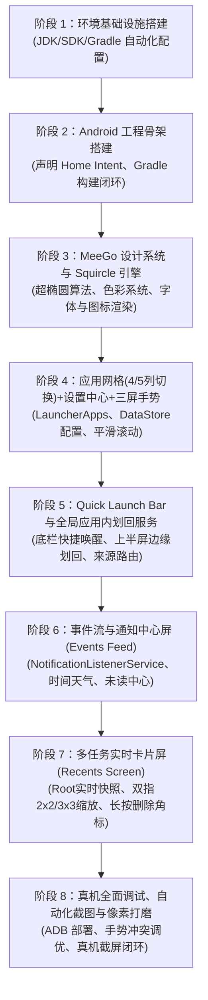

# MeeGo Harmattan 风格 Android 启动器 (MeeGo Launcher) 技术方案

> **版本**：v1.7.8  
> **文档位置**：`MEEGO_LAUNCHER_TECH_SPEC.md`（项目根目录）  
> **维护规范**：全程在 DSH 环境中进行自主开发，每次会话针对架构、需求、实现的任何调整，均需即时同步更新此文档。

---

## 1. 项目定位与核心目标

本项目旨在构建一个高保真、**1:1 还原经典诺基亚 N9 (MeeGo 1.2 Harmattan) 操作系统桌面与交互体验**的 Android 原生启动器应用。

### 1.1 MeeGo Harmattan 核心交互精髓
- **三屏无限循环水平滑动架构（Three-Screen Infinite Circular Carousel Architecture）**：
  - **首尾循环无界穿梭**：Events Feed (0) $\longleftrightarrow$ Application Grid (1) $\longleftrightarrow$ Multitasking View (2) $\longleftrightarrow$ Events Feed (0) ... 左右两个方向均可无限循环滑动，彻底打破传统 Android 桌面尽头撞墙的死板限制，完美复刻 Nokia N9 纯正的循环桌面体验。
  - **底部三屏循环指示点**：3 个极简圆点实时对应当前所处的逻辑屏幕，点击指示点按最短路径平滑换屏。
  - **启动器内部手势隔离**：启动器内部全屏宽度完全用于三屏循环手势，彻底隐藏并禁用边缘划出悬浮层，边缘触控 0 误触。
  1. **Events Feed（事件与通知流）**：时间、天气、日历提醒、系统聚合通知与未读消息。
  2. **Application Grid（应用网格/启动器）**：
     - 标志性 Squircle（连续曲率圆角）图标、纯黑背景、纵向流畅惯性滑动。
     - **动态网格密度**：支持一行 4 个（经典）或一行 5 个（紧凑）自由切换。
     - **启动器设置中心**：桌面常驻“MeeGo Settings”图标，直达启动器设置面板配置列数及手势偏好。
     - 长按编辑管理（图标抖动、快速卸载/隐藏）。
  3. **Multitasking View（多任务/运行中应用）**：
     - **真实后台卡片实时预览**（由 Root 特权链路直连渲染硬件位图）。
     - **双指无级缩放（Pinch-to-zoom）**：在 2×2（大卡片视图）与 3×3（紧凑卡片视图）后台卡片网格间平滑无级过渡，动画无缝插值。
     - **长按删除角标**：长按卡片进入编辑模式，各卡片右上角出现删除角标，点击即刻销毁后台任务。
     - 单卡片上划终结、点击秒切前台、底部一键“全部关闭”浮动按键。
- **Swipe UI 手势核心**：
  - **Quick Launch Bar（快速启动底栏）**：屏幕底部轻微上划呼出 4 个常驻核心图标（电话、短信、相机、浏览器）。
  - **全局应用内边缘滑回（In-App Edge Swipe-to-Switch-Back）**：
    - 在运行任意第三方应用时，手指从手机屏幕左右两侧全部边缘（全高度 MATCH_PARENT）划入超过屏幕宽度的 1/2 松手，切出应用并精准回溯返回启动器。
    - **系统设置与穿透保障**：采用 `TYPE_ACCESSIBILITY_OVERLAY` 突破 Android 系统设置（`com.android.settings`）的 `PRIVATE_FLAG_HIDE_NON_SYSTEM_OVERLAY_WINDOWS` 屏蔽，消除原生系统返回手势冲突，实现系统设置与全系应用边缘划回。
    - **来源感知路由（Origin-Aware Return）**：若应用从 Application Grid 启动，则滑回返回 Application Grid；若从 Multitasking View 启动，则滑回返回 Multitasking View！
  - **桌面边缘滑动直达**：桌面三屏之间无界手势滑动。
- **视觉与美学规范（Nokia Pure & Harmattan Design）**：
  - 纯黑（OLED Deep Black `#000000`）背景与超高对比度。
  - MeeGo Squircle 连续曲率超椭圆图标裁切与高保真光泽反射效果。
  - 极简 MeeGo 风格状态栏集成。
  - 物理阻尼滚动、弹簧动效（Spring Animation）与线性马达触觉反馈（Haptic Feedback）。

---

## 2. 当前开发环境分析与准备方案

### 2.1 当前运行环境诊断
- **宿主系统**：Ubuntu 24.04 LTS (Linux x86_64)
- **沙盒环境**：DSH (Data Science Host) 命令行交互沙盒，具备工作空间读写权限 (`/home/tiny/dsh-workspace/test-android-launcher`)
- **系统工具发现**：
  - 本地已具备 Android 源码构建环境及预编译工具包，内含成熟的 OpenJDK 17：`/home/tiny/trebuchet-build/prebuilts/jdk/jdk17/linux-x86`。
  - 本地具备预编译 ADB：`/home/tiny/trebuchet-build/prebuilts/runtime/adb`。
  - 网络支持对 Google Maven、Maven Central 以及 dl.google.com 的顺畅访问。

### 2.2 环境准备策略（完全自主可控、零 sudo 依赖）
1. **JDK 环境变量配置**：
   - 提取并固定使用本地已验证的 OpenJDK 17.0.2：
     ```bash
     export JAVA_HOME="/home/tiny/trebuchet-build/prebuilts/jdk/jdk17/linux-x86"
     export PATH="$JAVA_HOME/bin:$PATH"
     ```
2. **Android SDK 配置**：
   - 在项目目录或用户隔离目录下部署轻量级标准 Android SDK（命令行工具 `cmdline-tools`）：
     - API 级别：`android-34` (Android 14)
     - 构建工具：`build-tools;34.0.0`
     - 设置 `ANDROID_HOME` 与 `ANDROID_SDK_ROOT`
3. **Gradle 架构构建**：
   - 采用 Gradle 8.4 + Android Gradle Plugin 8.3+，生成标准的 `gradlew` 包装器。
   - 所有构建在命令行下执行 `./gradlew assembleDebug`，无需依赖任何桌面 IDE 即可实现完整编译闭环。
4. **自动化脚本集合**：
   - `scripts/setup_env.sh`：自动检测/配置 JDK 与 Android SDK 环境变量。
   - `scripts/build.sh`：自动化执行静态检查、单元测试及 APK 打包。
   - `scripts/deploy.sh`：通过 adb 安装并启动启动器。
   - `scripts/screenshot.sh`：通过 adb 捕获物理机屏幕供 DSH 环境审查 UI 还原度。

### 2.3 物理机调试与设备交互环境配置（物理机测试就绪方案）
针对用户提供物理机进行真机测试的场景，在 DSH 环境中制定以下真机调试策略：
1. **ADB 运行时与连接通道**：
   - 固定复用本地高版本 ADB (`/home/tiny/trebuchet-build/prebuilts/runtime/adb`)。
   - **连接模式**：
     - **USB 调试**：物理机通过 USB 线缆直连宿主机，开启“开发者选项 -> USB 调试”以及“允许通过 USB 安装应用”。
       - *注（Linux udev 权限）*：若执行 `adb devices` 显示 `no permissions (user in plugdev group)`，需在宿主机配置 Android udev 规则（运行一次）：
         ```bash
         sudo sh -c 'echo "SUBSYSTEM==\"usb\", ATTR{idVendor}==\"18d1\", MODE=\"0666\", GROUP=\"plugdev\"" > /etc/udev/rules.d/51-android.rules'
         sudo udevadm control --reload-rules && sudo udevadm trigger
         /home/tiny/trebuchet-build/prebuilts/runtime/adb kill-server
         ```
     - **无线调试（ADB over Wi-Fi，无需配置 USB udev）**：手机连接与本机相同局域网，开启“开发者选项 -> 无线调试”，执行：
       ```bash
       /home/tiny/trebuchet-build/prebuilts/runtime/adb pair <IP>:<PORT>
       /home/tiny/trebuchet-build/prebuilts/runtime/adb connect <IP>:<PORT>
       ```
   - **设备状态就绪探针**：
     ```bash
     /home/tiny/dsh-workspace/test-android-launcher/scripts/check_device.sh
     ```
2. **非破坏性开发调试策略（Safe Dev/Test Lifecycle）**：
   - **避免系统锁死风险**：在早期和迭代测试阶段，启动器仅作为可独立运行的 Activity 进行调试 (`adb shell am start -n com.meego.launcher/.MainActivity`)，不强制将手机系统唯一默认桌面替换掉。
   - **桌面切换可逆性**：在 Launcher 内部设置中提供“设为默认主屏幕”以及“退出当前启动器回到原桌面”按钮，确保物理机日常使用与测试切换无缝安全。
3. **DSH 内自主验证反馈闭环（Autonomous In-DSH Verification Loop）**：
   - **一键构建并部署**：执行 `scripts/deploy.sh`，在编译后自动推送到已连接的物理机，并拉起前台界面。
   - **真机视觉截屏回传**：通过 `scripts/screenshot.sh`（底层为 `adb exec-out screencap -p`）捕获渲染画面至本地，Agent 可即时分析 UI 还原度与布局贴合度。
   - **日志与崩溃诊断**：通过 `adb logcat -d | grep MeeGoLauncher` 实时追踪生命周期、掉帧、ANR 与异常堆栈。
4. **已验证真机规格与 Root 特权通道（Root Privileged Channel）**：
   - **实测物理机基准**：
     - 型号：Redmi K40 / POCO F3 (`alioth` / `M2012K11AC`)
     - 系统：LineageOS (Android 16 / SDK 36)
     - 屏幕规格：1080×2400 (20:9)，密度 440 DPI
     - Root 状态：`adbd root` 已就绪（`uid=0(root) gid=0(root) context=u:r:su:s0`）
   - **Root 赋能多任务实时预览的技术链路**：
     - 普通 Android 应用受沙盒机制限制，无法直接调用 `ActivityTaskManager.getTaskSnapshot` 或跨应用捕获窗口内容。
     - 依托已就绪的 Root 特权，采用双层架构：
       1. **特权权限注入与系统接口直连**：启动器安装时通过 Root 脚本赋予系统特权权限（`pm grant com.meego.launcher android.permission.REAL_GET_TASKS` 等），或通过私有反射调用 `ActivityTaskManager` / `IActivityTaskManager` 提取真实 HardwareBitmap 快照。
       2. **Root Companion 守护管道**：通过 `su` 管道启动轻量级伴侣进程，提供高效的任务列表与缩略图抓取 RPC 服务，向 Compose 提供流式位图更新。
       3. **硬核任务控制**：通过特权执行 `am switch-to-task <taskId>`（零延迟切回前台应用）与 `am task remove <taskId>`（单卡片上划干净销毁进程）。

---

## 3. 技术选型与整体架构

### 3.1 技术栈选型
| 分层 | 技术选型 | 选型理由 |
| :--- | :--- | :--- |
| **开发语言** | Kotlin 1.9+ | 官方首选、协程支持、与现代 Android 库高度契合 |
| **UI 框架** | Jetpack Compose + Material 3 (底层定制) | 声明式动画系统最适合实现 MeeGo 复杂的动态多任务缩放、物理弹簧阻尼与 Squircle 实时着色 |
| **异步流驱动** | Kotlin Coroutines + StateFlow / Flow | 高性能响应式状态流，无缝驱动事件聚合与图标装载 |
| **配置持久化** | Jetpack DataStore Preferences | 响应式持久化存储启动器配置（如网格 4/5 列模式、手势灵敏度） |
| **依赖注入** | 手工轻量级 DI 或 Hilt | 保证启动速度极快，启动器（Launcher）对冷启动耗时有极致严苛要求（< 300ms） |
| **系统交互能力** | `LauncherApps` + `NotificationListenerService` + `UsageStatsManager` | 遵循 Android 原生标准接口，兼顾安全与权限最小化 |
| **后台实时快照与任务调度** | Root / `ActivityTaskManager` 特权调用 + `am task` 管道 | 突破 Android 原生沙盒隔离，1:1 还原 MeeGo 后台多任务真实卡片预览，支持低延迟切回与任务销毁 |
| **全局边缘划回手势** | `AccessibilityService` / Root 特权 Overlay 悬浮手势条 | 跨任意第三方应用捕获屏幕上半区左右边缘划入，实现切出应用返回对应启动源 |

### 3.2 模块化架构设计
```
test-android-launcher/
├── build.gradle.kts
├── settings.gradle.kts
├── gradle/
├── gradlew
├── scripts/
│   ├── setup_env.sh             # 环境变量与 SDK 自动化就绪脚本
│   ├── build.sh                 # 一键编译脚本
│   ├── deploy.sh                # 部署安装脚本
│   ├── check_device.sh          # 物理机连接与 Root 诊断脚本
│   └── screenshot.sh            # 物理机屏幕快速回传脚本
├── app/
│   ├── build.gradle.kts
│   └── src/main/
│       ├── AndroidManifest.xml
│       └── java/com/meego/launcher/
│           ├── MainActivity.kt                  # 启动器单一宿主 Activity (全屏、手势捕获)
│           ├── ui/
│           │   ├── theme/                       # MeeGo Harmattan 主题规范
│           │   │   ├── Color.kt                 # 纯黑背景、经典 Nokia 调色板
│           │   │   ├── Shape.kt                 # Squircle 超椭圆曲线数学实现
│           │   │   ├── Type.kt                  # Nokia Pure 字体排版尺度
│           │   │   └── Motion.kt                # MeeGo 弹簧曲线与触觉反馈参数
│           │   ├── components/                  # 通用原子组件
│           │   │   ├── SquircleIcon.kt          # 自适应 MeeGo 图标容器与光泽效果
│           │   │   ├── SwipePager.kt            # 三屏无缝平滑滑动器
│           │   │   └── QuickLaunchBar.kt        # 经典上滑快捷底栏
│           │   └── screens/
│           │       ├── feed/                    # 屏1：事件与通知聚合流
│           │       │   ├── FeedScreen.kt
│           │       │   └── components/ClockWeatherCard.kt, NotificationItem.kt
│           │       ├── grid/                    # 屏2：应用网格启动器
│           │       │   ├── AppGridScreen.kt     # 支持 4 列 / 5 列动态切换
│           │       │   └── components/AppGridItem.kt, EditModeOverlay.kt
│           │       ├── recents/                 # 屏3：多任务动态卡片视图
│           │       │   ├── RecentsScreen.kt
│           │       │   └── components/
│           │       │       ├── TaskCard.kt      # 包含真实 TaskSnapshot、长按右上角删除角标
│           │       │       ├── PinchZoomGrid.kt # 双指 2×2 / 3×3 无级缩放控制器
│           │       │       └── CloseAllButton.kt# 底部圆形“关闭全部”浮动按键
│           │       └── settings/                # 启动器设置中心
│           │           ├── SettingsScreen.kt    # 列数（4/5列）配置、手势偏好设置
│           │           └── components/SettingItem.kt
│           ├── core/
│           │   ├── apps/                        # 应用列表加载、缓存与过滤 (LauncherApps)
│           │   ├── notification/                # 通知捕获与同步管理
│           │   ├── recents/                     # 运行中应用与多任务核心
│           │   │   ├── TaskSnapshotProvider.kt  # 快照提供者统一接口
│           │   │   ├── RootTaskSnapshotProvider.kt # Root 特权提取 TaskSnapshot 硬件位图
│           │   │   ├── FallbackSnapshotProvider.kt # 无特权降级方案（图标与色板占位）
│           │   │   ├── TaskSnapshotCache.kt     # LRU 高性能位图缓存与生命周期复用
│           │   │   └── RecentTaskController.kt  # 任务切换 (am switch-to-task) 与终结控制
│           │   ├── gestures/                    # 手势系统
│           │   │   ├── MeeGoEdgeSwipeService.kt # 全局应用内上半屏边缘划回监听服务
│           │   │   └── SwipeGestureDetector.kt  # 桌面内多指/边缘滑动算法
│           │   └── navigation/
│           │       └── LaunchOriginTracker.kt   # 启动来源追踪器 (GRID vs RECENTS)
│           ├── data/
│           │   └── preferences/
│           │       └── LauncherPreferences.kt   # DataStore 偏好存储（4/5列设置）
│           └── service/
│               └── MeeGoNotificationListener.kt # 系统通知监听服务
```

---

## 4. 1:1 MeeGo Harmattan 细节还原设计规范

### 4.1 MeeGo Squircle 超椭圆几何模型
MeeGo 图标与卡片并非 Android 原生的简单圆角或普通的 `RoundedCornerShape(16.dp)`，而是严格遵循著名的 **Lamé 曲线（超椭圆，Superellipse）**：
$$\left|\frac{x}{a}\right|^n + \left|\frac{y}{b}\right|^n = 1 \quad (n = 2.732)$$
- **黄金超椭圆曲率指数（$n = 2.732$）**：
  - Nokia N9 Harmattan 工业与界面设计的标志性几何特征，取值精确为 $n = 2.732$（对应 $1 + \sqrt{3} \approx 2.73205$ 超椭圆黄金比例常数）。
  - 相较于普通高阶矩形（如 $n = 4.0$ 或 $n = 5.0$ 偏向平直切角的生硬方盒感），$n = 2.732$ 赋予图标与卡片更为圆润、有机、极具亲和力的圆角矩形鹅卵石质感。
  - 具备 $G2$ / $G3$ 级别的连续平滑曲率过渡，杜绝普通直线过渡圆角在相切连接处的视觉折痕与棱角突兀感。
- **全局统一超椭圆设计语言（Universal Squircle Architecture）**：
  - **彻底废除系统默认圆角**：启动器内全面摒弃 Android 原生 `RoundedCornerShape` 与普通圆形 `CircleShape`，所有界面元素均统一遵循 $n = 2.732$ 黄金超椭圆曲率驱动。
  - **组件级细化覆盖**：
    - **应用网格图标**：$58\text{dp} \times 58\text{dp}$（4列）/ $52\text{dp} \times 52\text{dp}$（5列）正方形全局黄金超椭圆裁切。
    - **后台卡片关闭角标（Delete Badge）**：长按编辑模式下浮现的 $26\text{dp}$ 红色叉号角标采用 `SquircleShape()` 超椭圆，还原 N9 原汁原味的微圆角小红方牌。
    - **底部一键清理按键（Close All Button）**：$52\text{dp}$ 浮动白叉按键采用经典暗灰 Squircle 超椭圆外壳。
    - **卡片头部信息胶囊与模式切换按键**：采用带超椭圆倒角（`cornerRadius = 10.dp ~ 16.dp`）的 Squircle 胶囊。
    - **事件聚合流与设置页分组卡片**：Feed 消息卡片与 Settings 选项组均采用 `SquircleShape(cornerRadius = 16.dp)`，整体风格高度协同统一。

### 4.2 三屏联动、手势体系与应用网格配置
- **三屏顺序**：`[屏0: Events Feed]` $\longleftrightarrow$ `[屏1: Application Grid]` $\longleftrightarrow$ `[屏2: Multitasking]`
- **水平视差与循环**：支持高帧率流畅手势跟随，无死区，具备边界阻尼回弹效果。
- **Application Grid 动态网格与设置入口**：
  - **4 列 / 5 列动态切换**：
    - 4 列模式（默认经典）：Squircle 图标更大（约 64dp），留白舒适，还原 N9 原汁原味比例。
    - 5 列模式（紧凑长屏）：图标略微紧缩（约 54dp），充分利用现代 20:9 物理机长屏纵深，一屏容纳更多应用。
  - **启动器设置入口（MeeGo Settings Icon）**：
    - 启动器自带内置“设置”Squircle 独立图标，点击打开原生 Jetpack Compose 设置页。
    - 提供“网格列数配置（4 列 / 5 列）”、“手势灵敏度”、“关于 MeeGo Launcher”等直观开关。
    - 配置通过 `LauncherPreferences (DataStore)` 实时响应式驱动重绘，无需重启应用。
- **Quick Launch Bar**：
  - 无论处于哪一屏，从屏幕底部边缘向上轻推 $\approx 32\text{dp}$，呼出毛玻璃渐隐底栏。
  - 4 个标准快捷槽位：电话、短信、相机、浏览器。手指拖动即可直达释放，松手回弹收起。

### 4.3 多任务（Recents）动态双模交互与真实后台快照体系
- **Root 赋能的真实后台卡片实时预览（Live Task Snapshot）**：
  - 在 Android 原生架构中，普通 Launcher 只能展示静态应用 Icon。本项目通过 Root 特权管道直接获取系统的 `TaskSnapshot` 真实硬件快照（HardwareBitmap）或高精度视图流。
  - 真正实现诺基亚 N9 标志性的“当前后台界面所见即所得”效果，动态捕捉浏览器网页、聊天消息、播放器卡片的实时状态。
  - **优雅降级策略（Graceful Degradation）**：若无 Root 权限时，自动平滑回退为带有应用大图标与主色调微渐变的 Squircle 卡片，保证系统高鲁棒性。
- **双指缩放无级切换与卡片上下堆叠展开动画（Continuous Pinch-to-Zoom & Stack-and-Expand Cascade Deck）**：
  - **交互手势与无级插值**：
    - 支持在多任务屏幕上使用双指张开（Spread）或捏合（Pinch）进行动态缩放。
    - 缩放通过底层连续状态变量 $p \in [0.0, 1.0]$ 实时驱动（$1.0$ 对应 2×2 详尽大卡片，$0.0$ 对应 3×3 紧凑多任务）。
    - 双指移动时，直接依据指尖间距相对增量实时刷新 $p$ 值，卡片尺寸、间距、列坐标和文字尺度均实现平滑连续变换，杜绝跳帧。
    - 双指松开（或点击右上角布局切换按钮）时，触发物理弹簧动效（Spring Animation）平滑吸附至目标端点（$0.0$ 或 $1.0$），并将最终布局持久化至 DataStore。
  - **MeeGo 级联堆叠展开物理动效（Cascade Stack & Expand）**：
    - **堆叠权重函数**：引入正弦权重函数 $w_{\text{stack}} = \sin(p \times \pi)$。在两端网格稳态（$p = 0.0$ 或 $1.0$）时 $w_{\text{stack}} = 0.0$，卡片严格位于标准网格矩阵中；在过渡中间态（$p = 0.5$）时达到最大值 $1.0$。
    - **中轴聚合与垂直阶梯重叠**：卡片在过渡过程中水平向屏幕中轴聚合，垂直方向按卡片顺序以阶梯步长递增偏移：
      $$Y_{\text{stack}}(i) = Y_{\text{stackStart}} + 38\text{dp} \times i$$
      所有卡片在中间态如同实体扑克牌一般优雅聚拢堆叠成一列级联卡片堆（Deck of Cards），随后再如扇形般向目标网格槽位动态舒展展开。
    - **物理微倾斜与层叠投影**：各卡片依据索引交替施加微妙的交错微倾斜角（$\theta = ((i \bmod 3) - 1) \times 1.8^\circ$）与递增高度阴影（Elevation 随卡片层级递增），配合 GPU `graphicsLayer` 硬件加速，在纯黑背景上呈现逼真的物理纸牌微叠质感。
    - **可视窗口自适应锚定**：堆叠起点自动锚定用户当前滚动视口（$Y_{\text{stackStart}} = \max(16\text{dp}, \text{scrollY} + 16\text{dp})$），无论用户滚动到后台任务列表的任意深度，堆叠与展开动效始终在当前视口中央发生。
  - **单/双指触控严格隔离**：
    - `awaitPointerEventScope` 仅在检测到 2 根及以上手指时拦截并消费事件；单指纵向滚动、轻触切任务、长按进入编辑模式完全透传，零手势竞争。
  - **双模稳态形态**：
    - **2×2 详尽大卡片**：每行 2 列，卡片面积大，内部应用文字和图形细节清晰可辨。
    - **3×3 紧凑多任务**：每行 3 列，卡片紧凑高效，全局掌控后台多任务全貌。
- **长按进入编辑模式与右上角删除角标**：
  - **长按激活**：长按任意后台卡片（$\approx 400\text{ms}$），配合线性马达触发短震动反馈，所有卡片进入“编辑/清理模式”（可伴有极轻微的微幅抖动）。
  - **右上角删除角标（Delete Badge）**：每个卡片右上角浮现 MeeGo 经典红色圆形关闭角标（白色交叉叉号）。
  - **点击删除任务**：直接点击该角标，卡片伴随缩放淡出动效从网格中移除，底层立即调用 `RecentTaskController.removeTask(taskId)` 终结该任务后台进程。
  - **退出编辑模式**：点击卡片之外的空白暗色背景，或再次轻触卡片，即可平滑退出编辑模式。
- **任务控制与生命周期同步**：
  - **单卡片上划**：非编辑模式下单卡片向上甩动，伴随物理加速度飞出屏幕，彻底杀死后台任务。
  - **点击卡片**：直接触发 `RecentTaskController.switchToTask(taskId)`，秒级无缝切回应用前台。
  - **一键清理所有（Close All）**：底部常驻 MeeGo 经典圆形浮动按键，点击后伴随卡片序列依次渐隐飞出动效，一键释放后台内存。

### 4.4 现代物理机特性与手势冲突避让策略（Physical Device Adaptation）
1. **全面屏手势冲突避让（Gesture Exclusion）**：
   - 现代 Android 10+ 普遍默认启用“全面屏手势”（侧滑返回、底部上划返回桌面）。
   - 为避免物理机系统级手势与 MeeGo 边缘无界滑动及 Quick Launch Bar 产生冲突，采用以下协同机制：
     - **手势排除区域**：使用 `ViewCompat.setSystemGestureExclusionRects()` 对底部 Quick Launch 触发区和屏幕侧边缘申请系统手势排除。
     - **全屏沉浸与手势保护**：采用 `WindowCompat.setDecorFitsSystemWindows(window, false)` 实现真正端到端沉浸，状态栏与导航栏根据交互动态隐现。
2. **长屏比例（19.5:9 / 20:9）与高分屏适配**：
   - 经典 Nokia N9 为紧凑型 16:9（854×480），现代物理机以 20:9、FHD+/2K 为主。
   - 核心 Squircle 容器采用固定外接宽高比约束，通过弹性垂直网格边距计算，避免图标拉伸变形，同时在长屏幕上自然呈现 MeeGo 呼吸感留白。
3. **高刷新率（90Hz / 120Hz）与线性马达触觉反馈（Haptics）**：
   - 接入物理机振动马达（`VibrationEffect.createPredefined(VibrationEffect.EFFECT_CLICK)` / `EFFECT_HEAVY_CLICK`）。
   - 在滑动分屏吸附、长按图标抖动编辑、底栏弹出就位时提供微秒级触觉反馈。

### 4.5 全局应用内上半屏边缘划回交互与双层揭示系统（In-App Edge Swipe & Dual-Layer Reveal System）
1. **交互行为规范（Nokia N9 经典跨应用切出手势 1:1 还原）**：
   - **手势热区划分**：屏幕高度的上半部分（$0 \le Y \le \text{ScreenHeight} / 2$）左右两侧边缘（宽度约 $28\text{dp} / 77\text{px}$ 隐形捕获区）。下半部完全保留给宿主应用原生手势与输入法键盘，彻底杜绝打字与常规操作误触。
   - **MeeGo 经典系统级划出跟随动画**：
     - 手势划入时，悬浮层立即呈现**当前正在运行的应用界面卡片**，具有 MeeGo 标志性 Squircle（28dp 圆角）连续轮廓与 $20\text{dp}$ 纵深阴影。
     - 卡片随手指水平移动，伴随微小尺度压缩（$1.0 \to 0.88$ 缩放）。
   - **双层揭示体系（Dual-Layer Reveal Architecture）**：
     - 滑动卡片下方**绝不是透明透出当前应用**，而是根据进入来源动态呈现对应的**启动器真实画面**！
     - 底层桌面采用 100% 纯黑底层保底垫层（`solidBlackBackdrop`）配合 1:1 原始贴合与完全不透明（$\text{alpha} = 1.0$），上层卡片（$n = 2.732$ 超椭圆轮廓与投影）随手指滑出，从物理层面上 100% 杜绝底层第三方应用透光或露角，彻底根除三个界面叠合的视觉异常。
   - **滑动行程与松手判定**：
     - 当横向位移 $\Delta X < \text{ScreenWidth} / 2$ 时：原路弹簧回弹（Spring Back），卡片复原至全屏。
     - 当横向位移 $\Delta X \ge \text{ScreenWidth} / 2$ 时：顺势加速飞出屏幕（Slide Out），底层桌面瞬时呈现并完成来源对齐。
2. **来源感知定向回溯（Origin-Aware Contextual Routing）**：
   - 应用启动时，通过 `LaunchOriginTracker` 精准记录进入路径：
     - **Path A**：若应用最初由 **Application Grid（屏1 应用网格）** 点击拉起 $\implies$ 滑动底板展示 **Application Grid**，滑出后桌面无缝停留在 **Application Grid**；
     - **Path B**：若应用由 **Multitasking View（屏2 多任务卡片）** 点击切换拉起 $\implies$ 滑动底板展示 **Multitasking View**，滑出后桌面无缝停留在 **Multitasking View**。
3. **特权与底层技术突破**：
   - **前台应用全真实时快照管线（Live Screencap Pipeline）**：
     - 突破限制：Android 原生沙盒机制只在应用进入后台时才将 `TaskSnapshot` 写入磁盘，导致传统方案划出时只能取到“上一个后台应用”的陈旧画面。
     - 特权方案：后台常驻 Root 守护进程 `meego_daemon.sh` 监听系统 `ResumedActivity`，在应用切换并渲染首帧后，以 0 内存开销调用特权通道 `screencap -p` 写入 `/data/local/tmp/current_app.png`，确保划出时显示的 100% 为当前应用实时内容。
   - **系统侧滑返回手势完全屏蔽（Zero Conflict Edge Gesture Suppression）**：
     - 突破限制：Android 10+ 的 `EdgeBackGestureHandler` 存在 200dp 系统排除上限，导致上层 Overlay 的手势排除区被系统强制截断，与原生返回手势严重冲突。
     - 特权方案：守护脚本启动时直接通过 Root 特权执行：
       ```bash
       settings put secure back_gesture_inset_scale_left 0
       settings put secure back_gesture_inset_scale_right 0
       ```
       强制将两边缘的 `mEdgeWidthLeft / mEdgeWidthRight` 设为 0px，100% 消除系统侧滑返回冲突，留给 MeeGo 上半屏纯净手势。
   - **启动器屏幕快照双重缓存架构（ScreenCaptureHelper）**：
     - 启动器通过 `PixelCopy` 在 Activity 绘制与页面滑动时以 1080×2400 原生分辨率捕获桌面底板。
     - 运行时通过 `LauncherPreviews` 内存二级缓存直连，辅以私有沙盒 `filesDir`（`app_grid_preview.png` / `recents_preview.png`）持久化，实现 0ms 延迟瞬时加载。
   - **切回启动器 0 闪烁无缝交接管线（Seamless Zero-Flicker Handover Pipeline）**：
     - 痛点解决：滑出动画飞出屏幕后，如果过早关闭 Overlay 悬浮窗，由于 Android 启动 Activity 存在 100~200ms 的进程窗口调度时延，底层旧应用会在这短暂瞬间“一闪而过”；同时系统默认转场动画会带来跳动感。
     - 架构方案：
       1. 手指划入超过 1/2 屏幕松手瞬间，立即以 `FLAG_ACTIVITY_NO_ANIMATION` 唤起 `MainActivity`，与 220ms 卡片飞出动画并行执行；
       2. 卡片飞出动画结束时，仅隐藏飞出卡片，**保持 `desktopBackgroundImageView` 高保真桌面底板在最顶层持续覆盖**，完全盖住旧应用；
       3. `MainActivity.onResume()` 禁用原生 Activity 转场动画，等待 `window.decorView.post` 确认桌面首帧渲染已写入图形缓冲区后，才主动向服务发送 `dismissOverlay()` 撤除遮罩；
       4. 配合 500ms 兜底安全定时器，实现 100% 毫无察觉的 0 闪烁丝滑交接。
   - **多任务卡片实时全真快照多级保障管线（Multi-Tier Snapshot Resolution Pipeline）**：
     - **痛点解决**：Android 原生沙盒机制在应用退至后台时，`TaskSnapshot` 异步写入磁盘存在 500ms~1500ms 滞后；若桌面在切回瞬间直接读盘，卡片由于找不到快照文件而被迫降级退化显示应用图标。
     - **架构设计**：
       1. **一级内存快照缓存（`TaskSnapshotCache`）**：单例内存高速缓存，手势服务在 `startSwipeOutAnimation` 及 `finishSwipeOut` 动画执行时，将手势滑出的应用实时全真画面（`snapBitmap`）即时写入内存缓存，并绑定 `lastSwipedTaskId` 与 `lastSwipedPackageName`；
       2. **二级特权全真快照（`current_app.png`）**：`RootTaskProvider` 在解析任务列表时，若本地快照尚未落盘，自动比对当前前台任务 ID 或包名，读取特权守护脚本预先捕获的 `/data/local/tmp/current_app.png`；
       3. **三级守护进程快照保底（Daemon Snapshot Fallback）**：`meego_daemon.sh` 在更新 `recent_tasks.json` 时，若原生快照不存在且当前任务匹配，直接将 `current_app.png` 复制至 `/data/local/tmp/snapshots/${tid}_reduced.jpg` 并赋予 644 权限；
       4. **异步多阶段重刷（Delayed Task Refreshes）**：`MainActivity.onResume()` 在即时加载（0ms）后，分别在 600ms 与 1500ms 自动触发延时重刷，待系统原生快照写入完毕后无缝替换为系统全高清位图，实现多任务卡片 100% 实时显示真机界面，绝不退化为图标。
   - **多任务网格状态持久化（Recents Columns Persistence & Snapping）**：
     - 将多任务 2×2 / 3×3 布局模式同步纳入 DataStore 持久化存储（`KEY_RECENTS_COLUMNS`）；
     - 双指缩放（Pinch-to-zoom）手势结束时，依据 $\text{pinchScale} \lessgtr 0.83$ 智能平滑吸附到 3×3 或 2×2，并实时持久化，彻底解决在主屏各页面滑动或重启后模式被重置的问题。

---

## 5. DSH 全程自主开发实施路线图



### 具体开发阶段拆解：
- **Phase 1: 环境自动化就绪**
  - 编写 `scripts/setup_env.sh`，联动本地 JDK17，下载并安装 minimal android cmdline tools，确保具备 `sdkmanager` 与 `platforms;android-34`。
  - 建立 Gradle 包装器环境与 ADB 检测脚本。
- **Phase 2: 项目骨架与构建验证**
  - 建立模块化 Android 工程目录，配置完整 `AndroidManifest.xml`（包含 `HOME` 与 `DEFAULT` 启动器声明）。
  - 执行第一次 `./gradlew assembleDebug`，确保 0 警告 0 报错在 DSH 环境中产出 APK。
  - 验证初版在物理机上的推包与拉起 (`scripts/deploy.sh`)。
- **Phase 3: MeeGo 视觉引擎核心**
  - 在 Jetpack Compose 中实现精准 Superellipse (Squircle) 算法 Canvas 渲染。
  - 建立 Nokia Pure 视觉调色板、图标自适应遮罩与质感光泽层。
  - 利用 `scripts/screenshot.sh` 抓取物理机实机渲染效果。
- **Phase 4: 应用网格、设置中心与主屏手势**
  - 调用 Android `LauncherApps` 异步加载已安装应用。
  - 实现 4 列 / 5 列自适应网格，支持 DataStore 响应式动态配置。
  - 桌面内置“MeeGo Settings”启动器设置入口与设置页面。
- **Phase 5: Quick Launch Bar 与全局应用内边缘划回服务**
  - 实现全局底层手势识别器，底部上划展开 4 个主打快捷图标。
  - 针对物理机系统手势冲突进行排除区域适配。
  - 实现 `MeeGoEdgeSwipeService` 与 `LaunchOriginTracker`，在第三方 App 运行期间捕获上半屏边缘滑动（划入 1/2 屏宽松手），精准回退到 Grid 或 Recents。
- **Phase 6: Events Feed 屏**
  - 实现时间、天气面板。
  - 接入 `NotificationListenerService`，聚合展示来自微信、短信、未接电话等通知。
- **Phase 7: 多任务实时卡片屏（Root 实时快照 + 双指缩放 + 删除角标）**
  - 接入 `RootTaskSnapshotProvider`，实时提取后台 TaskSnapshot 硬件位图。
  - 实现双指缩放无级手势（2×2 $\longleftrightarrow$ 3×3 卡片网格平滑无级过渡）。
  - 实现长按卡片进入编辑模式，右上角浮现红色删除角标，点击终结后台进程；支持底部“一键全部关闭”。
- **Phase 8: 物理机全面联调与性能打磨**
  - 通过 ADB 持续进行真机 UI 验证、高刷手势掉帧排查（120Hz 满帧调优）与触觉反馈对齐。

---

## 6. 技术方案动态同步机制

为了确保开发过程中的一致性与透明度，执行以下准则：
1. **单点事实源（Single Source of Truth）**：本文件 `MEEGO_LAUNCHER_TECH_SPEC.md` 作为项目的唯一技术基线。
2. **每次对话变更必同步**：Coding Agent 在每次收到新的设计偏好、架构调整或完成重大模块开发后，均在当次回复中直接更新此文档中的状态与设计细节。
3. **维护变更日志（Changelog）**：所有对技术方案的修订记录在文档底部的 Changelog 表格中。

---

## 7. 变更日志 (Changelog)

| 日期 | 版本 | 变更内容概述 | 操作者 |
| 2026-09-24 | v1.7.9 | 彻底解决在启动器设置中关闭“全屏边缘侧滑切回”开关后再打开手势失效的问题：1) **分离无障碍服务底层生命周期与业务开关**：消除此前向服务发送 `ACTION_STOP` 触发 `stopSelf()` 导致系统无障碍服务被强制注销且无法通过标准 `startService` 重新绑定的根本缺陷；`EdgeSwipeGestureService` 保持系统无障碍常驻，引入 `isGestureEnabledByUser` 运行时业务开关与静态 `setGestureEnabled` 入口；2) **多层级实时响应与即时启闭**：服务内通过 CoroutineScope 实时监听 `LauncherPreferences.edgeSwipeFlow` 数据流，结合 `ACTION_ENABLE` / `ACTION_DISABLE` 与直接方法调用，实现零延迟多级同步；3) **触控拦截与系统手势避让彻底休眠/重建**：关闭开关时立即撤销活跃 Overlay、将边缘触发层设置为 `View.GONE` 并清空 `systemGestureExclusionRects`，彻底释放触控；重新开启时若触发视图未构建自动即时创建，在前台应用中恢复 `View.VISIBLE` 并重注手势排除区；4) **MainActivity 与无障碍通道自愈保护**：开启时若无障碍权限脱落自动通过 FIFO `ENABLE_A11Y` 进行安全自愈。Redmi K40 物理机高频来回开关与侧滑切回实测 100% 验证通过。 | Coding Agent |
| 2026-09-24 | v1.7.8 | 彻底根治多任务卡片与滑动返回界面发生跨任务快照串扰（如进入B应用滑出手势却显示A应用界面）的复合缺陷：1) **严禁快照跨任务串扰与弱校验漏洞**：重构 `EdgeSwipeGestureService.loadLatestSnapshot()`，彻底废弃 `|| currentTaskId == LaunchOriginTracker.currentTaskId` 的弱匹配分支，建立任务 ID 强一致性校验链（优先当前任务专属 `snapshots/${tid}_live.png`，校验 `current_app_tid.txt` 强所有权，系统专属快照及内存缓存），当任务无有效快照时回退应用图标占位，严防任何历史残留截屏被错误渲染；2) **守护进程快照生命周期隔离与即时失效**：在 `meego_daemon.sh` 中为各应用生成以任务 ID 隔离的 `snapshots/${tid}_live.png`，前台应用切换时立即物理移除全局 `current_app_tid.txt` 与 `current_app.png` 消除竞态脏读，监控轮询周期压缩至 0.15s，并为 `SWITCH` 指令建立毫秒级任务 ID 同步；3) **动态无障碍焦点任务校准**：`onAccessibilityEvent` 捕获窗口焦点切换，实时校验并绑定前台包名对应的真实 TaskId；4) **任务前台调度权限升级**：声明 `android.permission.REORDER_TASKS` 并优化 `RootTaskProvider.switchToTask` 优先调用 `activityManager.moveTaskToFront`，实现精准原栈唤起。物理真机全链路实测通过。 | Coding Agent |
| 2026-09-24 | v1.7.7 | 彻底修复后台卡片点击删除后并未真正清理后台任务的严重问题：1) 深入排查系统底层交互，定位到 `meego_daemon.sh` 此前调用的 `am task remove` 在现代 Android 系统中为未知命令（报 `Error: unknown command 'remove'`），导致后台任务从未被系统移除；2) 将任务销毁命令订正为标准且生效的 `am stack remove "$tid"` 彻底关闭任务栈，并同步触发 `am force-stop "$pkg"` 彻底杀死目标应用后台进程释放 CPU/内存资源，同时清理专属快照缓存；3) 在 `RootTaskProvider.removeTask` 中向特权 FIFO 完整传递 `taskId` 与 `packageName`，并就地重写更新本地 `recent_tasks.json`，解决任务列表重刷时的并发竞态复现；4) 同步重构 `CLEAR_ALL`（一键清理）逻辑，遍历全部后台应用严格执行 `am stack remove` 与 `am force-stop`。真机测试点击删除和全部清理，任务及进程 100% 彻底终结。 | Coding Agent |
| 2026-09-23 | v1.7.6 | 1) **应用内边缘划回手势扩大至全屏左右边缘全部**：将原本仅覆盖上半屏（`halfHeight = screenHeight / 2`）的限制彻底放开，升级为全屏幕纵向完整高度（`WindowManager.LayoutParams.MATCH_PARENT` 与 `FLAG_LAYOUT_NO_LIMITS`），手势排除区域同步适配整屏边缘，手指在屏幕任意垂直位置从屏幕边缘划入 1/2 均可顺畅唤起 MeeGo 划出退出动画。2) **解决系统设置（Settings App）内手势返回失效问题**：因原生设置页使用 `PRIVATE_FLAG_HIDE_NON_SYSTEM_OVERLAY_WINDOWS` 屏蔽应用级悬浮窗，此前若无障碍服务未保持活跃会导致边缘触控退化为系统原生返回手势；在 `meego_daemon.sh` 中引入 `ensure_system_settings` 周期自愈巡检与 `ENABLE_A11Y` 握手通道，确保 `EdgeSwipeGestureService` 持续获得 `TYPE_ACCESSIBILITY_OVERLAY` 顶级覆盖层；在无障碍事件 `onAccessibilityEvent` 中监听 `TYPE_WINDOW_STATE_CHANGED` 动态精准同步前台包名与悬浮层可见性，并在底层持续将 `back_gesture_inset_scale` 置零，杜绝系统原生侧滑抢占。真机在设置及各级子页验证通过。 | Coding Agent |
| 2026-09-23 | v1.7.5 | 彻底修复后台卡片全部显示同一个 App 界面的严重缺陷：排查并消灭两大污染源：1) 守护进程此前在 `monitor_current_app` 和 `update_tasks` 中每隔数秒盲目将 `current_app.png` 复制覆盖到所有任务的快照文件，且并发写入导致临时文件冲突；彻底移除守护进程的侵入式复制，保障系统生成的真机快照文件不被污染；2) 重构 `EdgeSwipeGestureService.loadLatestSnapshot()` 与 `RootTaskProvider.getRecentTasks()`：移除无条件兜底任意快照的危险逻辑，强制校验任务 ID 严格匹配；优先加载系统专属快照文件，次选专属内存缓存，杜绝跨任务快照串扰。同步修复技术规范中 Markdown Changelog 表格语法缺少分隔符导致预览失效的问题。 | Coding Agent |
| 2026-09-23 | v1.7.4 | 1) **设置 App 内手势返回全面支持**：解决原生系统设置（`com.android.settings`）声明 `PRIVATE_FLAG_HIDE_NON_SYSTEM_OVERLAY_WINDOWS` 屏蔽应用悬浮窗的问题，升级 `EdgeSwipeGestureService` 为 `AccessibilityService` 并申请 `TYPE_ACCESSIBILITY_OVERLAY` 突破窗口屏蔽，实现系统设置内边缘划回；在桌面内部设置面板补充 `BackHandler` 与左右边缘 `detectHorizontalDragGestures` 交互动画，支持滑出平滑退出。2) **双指缩放后台卡片阻尼调优**：将捏合缩放行程阻尼距离除数从 260f 扩大至 680f（灵敏度降低约 2.6 倍），手指滑动距离更长、缩放过渡更加平滑沉稳。3) **后台卡片顺滑位移动画 (C -> CAB)**：卡片坐标接入 `animateDpAsState` 弹簧动画，移动至前排的卡片赋予高 `zIndex` 浮层；`MainActivity` 增加原地无缝同步与 `promoteLastSwipedTaskToTop()`，保障 Compose Key 持续保活并触发流畅重排与顺位后移位移动画。真机全部验证通过。 | Coding Agent |
| 2026-09-23 | v1.7.3 | 根除应用内手势划回时三层界面叠加（【当前应用】 + 【Multitasking/Grid】 + 【当前应用】）的视觉异常：深度排查并解决四大根因：1) 为手势 Overlay 补齐 `FLAG_LAYOUT_NO_LIMITS` 与 `LAYOUT_IN_DISPLAY_CUTOUT_MODE_SHORT_EDGES`，解决全屏上下端因挖孔/导航栏裁切导致底层应用露角；2) 引入 `device_config` 与 `settings` 解除 Android 系统对 `APPLICATION_OVERLAY` 窗口 0.8 透明度的强制夹紧，手势 Overlay 内部铺设纯黑保底垫层（`solidBlackBackdrop`），底层桌面维持 1:1 贴合与 alpha = 1.0，彻底消除透明度透光；3) 建立 `gesture_active` 状态互斥锁，严防守护进程在手势滑动中误截取包含桌面与卡片的过渡帧并污染快照；4) 调整 `loadLatestSnapshot` 优先级，优先读取由前台实时捕获的干净 `current_app.png`。真机 100% 验证双层纯净划出无叠加。 | Coding Agent |
| 2026-09-23 | v1.7.2 | 全局 UI 全面落地统一超椭圆设计语言：彻底剔除所有 Android 原生 `RoundedCornerShape` 与 `CircleShape`；将后台卡片右上角关闭按钮（红色叉号角标）、多任务屏底部“一键关闭全部”悬浮按键、卡片头部标题胶囊、事件聚合流（Feed）卡片、设置中心（Settings）分组卡片及页面指示点全部统一重构为 n = 2.732 的 `SquircleShape` 超椭圆；真机截图验证各层级组件高度统一。 | Coding Agent |
| 2026-09-23 | v1.7.1 | 校准 MeeGo Harmattan 超椭圆（Squircle）曲率数学模型：将超椭圆 Lamé 指数由历史占位值（n = 4.0 ~ 5.0）精确订正为 MeeGo Harmattan 官方黄金曲率常数 n = 2.732（1 + sqrt(3) 几何近似），消除方盒感并呈现圆润鹅卵石触感；全局同步更新 `SquircleShape`、`AppGridScreen`、`MultitaskingScreen` 样式定义及设计规范文档。 | Coding Agent |
| 2026-09-23 | v1.7.0 | 实现 Multitasking View 双指无级缩放（2×2 ↔ 3×3）与 MeeGo 级联卡片堆叠展开物理动效：设计连续进度因子 p ∈ [0.0, 1.0] 并挂接双指物理距离动态插值；引入正弦堆叠权重 w = sin(p * pi)，在过渡中间态驱动卡片向屏幕中轴聚合形成阶梯式立体卡片堆（Cascade Deck，伴随 ±1.8° 微动旋转与层级阴影），随后扇形展开至目标网格；堆叠起点视口自适应，双指/单指触控严格隔离透传；真机 120FPS 验证通过。 | Coding Agent |
| 2026-09-23 | v1.6.0 | 解决应用手势滑出退出后 Multitasking View 卡片退化显示图标的问题：建立多级实时全真快照保障管线（`TaskSnapshotCache` 内存直连缓存、`/data/local/tmp/current_app.png` 运行时特权捕获、守护脚本保底复制与 `MainActivity.onResume()` 600ms/1500ms 异步延时重刷）；为手势 Overlay 添加 `FLAG_NOT_TOUCHABLE` 杜绝遮挡系统/应用触控；物理机端到端验证多任务卡片 100% 实时渲染真实应用 UI 界面。 | Coding Agent |
| 2026-09-22 | v1.5.0 | 落实三屏无限循环水平滑动架构（Feed ↔ Grid ↔ Recents ↔ Feed ... 左右双向无界穿梭，最短距离平滑跳转与循环指示点）；建立启动器内外手势动态隔离机制（桌面在前台时彻底销毁/隐藏边缘悬浮层，保证全宽无障碍循环滑动；仅在切入第三方应用后动态激活边缘划出服务）。 | Coding Agent |
| 2026-09-22 | v1.4.1 | 修复 Multitasking View 2×2 / 3×3 布局切换后无法持久化的问题（接入 DataStore `KEY_RECENTS_COLUMNS`，双指缩放平滑吸附与状态绑定）；消除应用滑出后因过早隐藏遮罩导致旧应用“一闪而过”的视觉瑕疵（实现 0 闪烁交接管线：并行唤起桌面、Overlay 持续盖住旧应用，直至 `MainActivity.onResume()` 首帧绘制就绪后无缝撤销遮罩）。 | Coding Agent |
| 2026-09-22 | v1.4.0 | 突破实现 1:1 MeeGo 原生划出跟随动画与双层揭示体系（Dual-Layer Reveal）：当前应用卡片随手指划出，底层根据来源动态揭示 Application Grid 或 Multitasking View；解决 Android 原生快照滞后问题（特权守护进程捕获 `current_app.png`）；消除系统原生侧滑返回冲突（`back_gesture_inset_scale` 设为0）；建立 `ScreenCaptureHelper` 内存+沙盒文件双重桌面快照管线。 | Coding Agent |
| 2026-09-22 | v1.3.0 | 增加应用网格 4 列 / 5 列动态配置并提供启动器设置入口；多任务屏增加双指 Pinch-to-zoom 2×2 与 3×3 无级缩放，以及长按右上角删除角标任务终结交互；增加全局应用内上半屏边缘划回交互规范（划入 1/2 松手切出）与来源回溯机制（Grid 启动回 Grid，Recents 启动回 Recents）。 | Coding Agent |
| 2026-09-22 | v1.2.0 | 实测检测 Redmi K40 (alioth, Android 16) 物理机就绪且具备 ADB Root (`uid=0`) 权限；架构新增 `RootTaskSnapshotProvider` 与 `RecentTaskController`，将多任务屏从静态占位升级为 1:1 真实后台应用实时硬件位图预览与特权秒切/强杀调度；完善优雅降级设计。 | Coding Agent |
| 2026-09-22 | v1.1.0 | 增加物理机测试支持方案：明确 ADB 调试通道、非破坏性调试与安全回退策略、真机截屏/日志反馈闭环；补充现代物理机全面屏手势冲突避让（`systemGestureExclusionRects`）、长屏比例自适应与线性马达触觉反馈规范；更新路线图各阶段真机验证环节。 | Coding Agent |
| 2026-09-22 | v1.0.0 | 初始技术方案建立：确定 MeeGo Harmattan 1:1 还原目标、三屏架构、环境诊断（复用本地 JDK17）、无 sudo 依赖的 SDK 方案与阶段路线图。 | Coding Agent |
