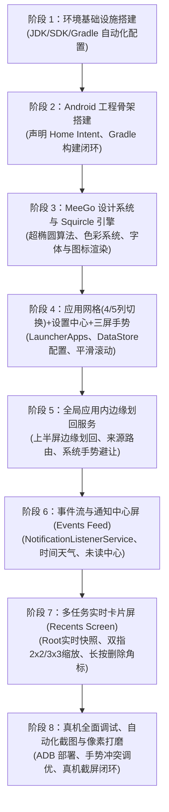

# MeeGo Harmattan 风格 Android 启动器 (MeeGo Launcher) 技术方案

> **版本**：v1.8.43  
> **文档位置**：`MEEGO_LAUNCHER_TECH_SPEC.md`（项目根目录）  
> **维护规范**：全程在 DSH 环境中进行自主开发，每次会话针对架构、需求、实现的任何调整，均需即时同步更新此文档。

> ⚠️ **v1.8.43 文档校准说明（重要）**
> 本次对全部 20 个 Kotlin 源文件（6349 行）逐行通读后，发现**本文档早期章节（§1.1、§3.2、§4.1~§4.3、§4.5）中若干条设计描述与当前代码实现已经脱节**——部分是早期规划从未落地，部分是实现在演进中改用了另一条路径。本版已逐条核对并在原处标注**「✅ 已落地 / ⚠️ 未实现（以代码为准） / 🔀 实际实现与本节描述不同」**，并给出代码中的真实位置与取值。**凡本文档与代码冲突，一律以代码为准。**

---

## 1. 项目定位与核心目标

本项目旨在构建一个高保真、**1:1 还原经典诺基亚 N9 (MeeGo 1.2 Harmattan) 操作系统桌面与交互体验**的 Android 原生启动器应用。

### 1.1 MeeGo Harmattan 核心交互精髓
- **三屏无限循环水平滑动架构（Three-Screen Infinite Circular Carousel Architecture）**：
  - **首尾循环无界穿梭**：Events Feed (0) $\longleftrightarrow$ Application Grid (1) $\longleftrightarrow$ Multitasking View (2) $\longleftrightarrow$ Events Feed (0) ... 左右两个方向均可无限循环滑动，彻底打破传统 Android 桌面尽头撞墙的死板限制，完美复刻 Nokia N9 纯正的循环桌面体验。
  - **底部三屏循环指示点**：3 个极简圆点实时对应当前所处的逻辑屏幕，点击指示点按最短路径平滑换屏。
  - **启动器内部手势隔离**：启动器内部全屏宽度完全用于三屏循环手势，彻底隐藏并禁用边缘划出悬浮层，边缘触控 0 误触。
  1. **Events Feed（事件与通知流）**：时间、天气、日历提醒、系统聚合通知与未读消息。
  2. **Application Grid（应用网格/启动器）**：
     - 标志性 Squircle（连续曲率圆角）图标、纯黑背景、纵向流畅惯性滑动。
     - **动态网格密度**：支持一行 4 个（经典）或一行 5 个（紧凑）自由切换。
     - **启动器设置中心**：桌面常驻“MeeGo Settings”图标，直达启动器设置面板配置列数及手势偏好。
     - ⚠️ **长按编辑管理（图标抖动、快速卸载/隐藏）在当前代码中未实现**。`AppGridScreen` 的 `AppGridItem` 仅用 `Modifier.clickable(interactionSource, indication = null, onClick = ...)`，全项目无 `combinedClickable` / `onLongClick` 命中于该文件（`onLongClick` 仅存在于 `MultitaskingScreen.kt`）。另注：`FeedScreen` 中一条 MOCK 文案写有“长按桌面进入编辑模式”，那是**假数据**，非实现。
  3. **Multitasking View（多任务/运行中应用）**：
     - **真实后台卡片实时预览**（由 Root 特权链路直连渲染硬件位图）。
     - **双指无级缩放（Pinch-to-zoom）**：在 2×2（大卡片视图）与 3×3（紧凑卡片视图）后台卡片网格间平滑无级过渡，动画无缝插值。
     - **长按删除角标**：长按卡片进入编辑模式，各卡片右上角出现删除角标，点击即刻销毁后台任务。
     - 单卡片上划终结、点击秒切前台、底部一键“全部关闭”浮动按键。
- **Swipe UI 手势核心**：
  - ⚠️ **Quick Launch Bar（快速启动底栏）在当前代码中不存在**。`HomeScreen` 的 `Column` 仅含两个子项：`HorizontalPager(weight = 1f)` 与（沉浸式关闭时的）三屏指示点 `Row`，无 dock / 底栏 / 快捷启动栏；全项目 grep `QuickLaunch|quickLaunch|Dock` 零命中。应用入口**只**存在于第 1 屏的 `LazyVerticalGrid` 内。（`FeedScreen` 中一条 MOCK 文案含“快捷”一词，属假数据。）
  - **全局应用内边缘滑回（In-App Edge Swipe-to-Switch-Back）**：
    - 在运行任意第三方应用时，手指从手机屏幕左右两侧全部边缘（全高度 MATCH_PARENT）划入**超过屏幕宽度的 1/3**（🔀 早期文档记为 1/2；v1.8.33 已收窄为 `SWIPE_OUT_THRESHOLD_RATIO = 1f / 3f`，且震动时机前移为「手指滑过阈值即刻」）松手，切出应用并精准回溯返回启动器。
    - **系统设置与穿透保障**：采用 `TYPE_ACCESSIBILITY_OVERLAY` 突破 Android 系统设置（`com.android.settings`）的 `PRIVATE_FLAG_HIDE_NON_SYSTEM_OVERLAY_WINDOWS` 屏蔽，消除原生系统返回手势冲突，实现系统设置与全系应用边缘划回。
    - **来源感知路由（Origin-Aware Return）**：若应用从 Application Grid 启动，则滑回返回 Application Grid；若从 Multitasking View 启动，则滑回返回 Multitasking View！
  - **桌面边缘滑动直达**：桌面三屏之间无界手势滑动。
- **视觉与美学规范（Nokia Pure & Harmattan Design）**：
  - 纯黑（OLED Deep Black `#000000`）背景与超高对比度。
  - MeeGo Squircle 连续曲率超椭圆图标裁切与高保真光泽反射效果。
  - 极简 MeeGo 风格状态栏集成。
  - 物理阻尼滚动、弹簧动效（Spring Animation）与线性马达触觉反馈（Haptic Feedback）。

---

## 2. 跨平台开发环境准备方案（Ubuntu / macOS 双平台支持）

### 2.1 双平台开发环境支持矩阵与诊断
本项目原生支持在 **macOS** 与 **Ubuntu Linux** 两个主流平台进行无缝协同开发与真机调试：

| 平台特性 | macOS 运行环境 (Darwin) | Ubuntu 运行环境 (Linux x86_64) |
| :--- | :--- | :--- |
| **测试基准系统** | macOS Sequoia (Darwin 24.x, Apple Silicon / Intel) | Ubuntu 22.04 / 24.04 LTS (x86_64) |
| **JDK 管理方案** | SDKMAN (`17.0.1-open`) / `/usr/libexec/java_home` / Homebrew | SDKMAN (`17.0.1-open`) / APT (`openjdk-17-jdk`) / Trebuchet prebuilts |
| **Android SDK 默认路径** | `~/Library/Android/sdk` | `~/Android/Sdk` 或 `/home/tiny/android-sdk` |
| **Gradle 构建机制** | `./gradlew` (Gradle 8.5 包装器) 或 SDKMAN | `./gradlew` (Gradle 8.5 包装器) 或 SDKMAN |
| **ADB 路径** | `/usr/local/bin/adb`、Homebrew (`/opt/homebrew/bin/adb`) 或 SDK | `platform-tools/adb`、`/usr/bin/adb` 或 Prebuilts |
| **真机连接通道** | USB 直接即插即用 / Wi-Fi 无线配对连接 | USB (需配置 udev 规则) / Wi-Fi 无线配对连接 |
| **环境自适应探针** | `scripts/env_detect.sh` 动态识别自动生效 | `scripts/env_detect.sh` 动态识别自动生效 |

### 2.2 使用 SDKMAN 统一管理跨平台核心依赖
为了消除跨操作系统在 JDK 与 Gradle 版本上的碎片化差异，项目根目录配置了标准的 `.sdkmanrc`：
```properties
java=17.0.1-open
gradle=8.5
```

**SDKMAN 快速上手步骤（Ubuntu 与 macOS 通用）**：
1. **安装 SDKMAN**：
   ```bash
   curl -s "https://get.sdkman.io" | bash
   source "$HOME/.sdkman/bin/sdkman-init.sh"
   ```
2. **在项目根目录下自动安装并激活指定版本**：
   ```bash
   sdk env install
   sdk env
   ```

### 2.3 网络代理配置与依赖同步指南
在中国大陆或企业内网开发环境下，Gradle 依赖解析（Google Maven / Maven Central）需配置代理通道。

**双平台通用终端代理**：
```bash
export http_proxy="http://127.0.0.1:1087"
export https_proxy="http://127.0.0.1:1087"
export ALL_PROXY="socks5://127.0.0.1:1086"
```

**Gradle 独立代理配置（可选，写入 `~/.gradle/gradle.properties`）**：
```properties
systemProp.http.proxyHost=127.0.0.1
systemProp.http.proxyPort=1087
systemProp.https.proxyHost=127.0.0.1
systemProp.https.proxyPort=1087
```

### 2.4 macOS 专用配置细节
1. **Android SDK 部署**：
   - 安装 Android Studio 或通过 Homebrew 安装命令行工具：`brew install --cask android-commandlinetools`。
   - SDK 默认安装于 `~/Library/Android/sdk`。
   - 包含的必要组件：`platforms;android-34` 与 `build-tools;34.0.0`。
2. **JDK 17 识别**：
   - 优先通过 SDKMAN：`sdk install java 17.0.1-open`。
   - 备选通过 Homebrew：`brew install openjdk@17`。
   - 系统级快捷识别：`/usr/libexec/java_home -v 17`。
3. **USB 物理机免驱动即插即用**：
   - macOS 原生支持 Android 手机 USB 调试连接，无需配置 udev rules。
   - 若遇到无法识别，执行 `adb kill-server && adb start-server`。
4. **⚠️ bash 3.2 的变量插值陷阱（本机实测踩中，务必遵守）**：
   - macOS 自带的是 **GNU bash 3.2.57**（2007 年发布；Apple 因 GPLv3 不再更新它），其解析器存在缺陷：**当 `$VAR` 后面紧跟一个多字节（UTF-8）字符时，变量名边界被误判** —— 变量被当作未定义而展开为空，紧跟的那个中文字符还会被咬掉首字节，最终在终端上显示为乱码 `��`。
   - 最小复现（本机 bash 3.2.57 实测）：
     ```bash
     V=11474
     echo "PID=$V，watchdog"      # → PID=\xbc\x8cwatchdog           变量被吞
     echo "PID=${V}，watchdog"    # → PID=11474\xef\xbc\x8cwatchdog   正确
     ```
   - **本项目硬性书写规范**：所有 shell 脚本中，**凡变量后紧跟中文（或多字节字符）一律写成 `${VAR}`**。这在本项目不是风格问题而是正确性问题 —— 全部脚本都往终端打印中文，踩中概率极高。
   - 该陷阱在 v1.8.41 修复 `deploy.sh` 第 [7/7] 步输出乱码时被定位，完整推导见 §4.11.4。

### 2.5 Ubuntu 专用配置细节
1. **Android SDK 部署**：
   - 默认安装于 `~/Android/Sdk` 或独立部署路径（如 `/home/tiny/android-sdk`）。
   - 设置 `ANDROID_HOME` 与 `ANDROID_SDK_ROOT`。
2. **JDK 17 识别**：
   - 优先通过 SDKMAN：`sdk install java 17.0.1-open`。
   - 备选通过 apt：`sudo apt-get install -y openjdk-17-jdk`。
3. **USB udev 权限配置（关键）**：
   - 在 Linux 下，普通用户访问 USB 调试设备需要 udev 规则，避免 `adb devices` 显示 `no permissions (user in plugdev group)`：
     ```bash
     sudo sh -c 'echo "SUBSYSTEM==\"usb\", ATTR{idVendor}==\"18d1\", MODE=\"0666\", GROUP=\"plugdev\"" > /etc/udev/rules.d/51-android.rules'
     sudo udevadm control --reload-rules && sudo udevadm trigger
     adb kill-server
     ```

### 2.6 跨平台自动化脚本集合与工作流
所有脚本位于 `scripts/` 目录下，底层统一由 `scripts/env_detect.sh` 驱动，具备平台自适应感知能力：

1. **`scripts/setup_env.sh`**：
   - 跨平台自适应检测 JDK 17、Android SDK、Gradle 与 ADB。
   - 自动在当前工作区生成或更新 `local.properties`（写入对应系统的 `sdk.dir`）。
   - 自动预写入官方 Android SDK 许可证 Hash，避免命令行交互卡死。
2. **`scripts/run_build.sh` (或 `scripts/build.sh`)**：
   - 自动解析当前系统的 `JAVA_HOME` 与 `ANDROID_HOME`。
   - 调用项目根目录的 `./gradlew assembleDebug` 进行标准化构建。
   - 编译产物位于 `app/build/outputs/apk/debug/app-debug.apk`。
3. **`scripts/check_device.sh`**：
   - 自动寻找系统可用 ADB，输出设备连接状态、型号、Android 系统版本、屏幕分辨率/DPI 及 Root 状态。
4. **`scripts/deploy.sh`**（共 8 步）：
   - 自动执行构建、安装至已连接物理机、向 `/data/local/tmp` 部署**常驻快照服务 `meego_svc.dex`** 与 `meego_daemon.sh` 特权守护脚本、授予权限并冷启动 Launcher。
   - 末尾两步专门做验证：守护链自愈、以及**主动 ping 常驻快照服务**确认 IPC 真的通 —— 服务不工作时应用既不会崩也不会报错，只是所有卡片安静退化成图标，属典型的「安静地坏掉」，必须 fail fast。
   - **部署位置**：`push` + `chmod` 到 `/data/local/tmp`；开机自启由 Magisk `service.d` 钩子承担。
   - **设备已安装 Magisk（30.7）**：系统层面已具备「不经 `adb root` 也能取得 root」的能力 —— 实测 `su -c id` → `uid=0(root)`、`context=u:r:magisk:s0`。当前 `deploy.sh` 的前置检查仍是「`adb shell` 必须为 uid 0」并 fail fast，**尚未**接入 `su` 分支；若要支持仅有 Magisk 的 `user` 构建，需在部署脚本中加入该分支。
   - **需要改动 `/system` 内容时**（例如把启动器装成 privapp 以直接持有签名级权限），走 **Magisk 模块叠加（magic mount）**：它在挂载命名空间内叠加文件，**不写真实分区**。真实分区当前以 `ro` 挂载（`/proc/mounts`：`/dev/block/dm-1 / ext4 ro,…`），直接 `remount,rw` 后写真实分区不是受支持路径。
   - ⚠️ **但「装成 privapp 就能直接拿到那两个签名级权限」这个设想经评估不成立** —— 这两个权限不带 `privileged` 标志，白名单 XML 对它们无效。完整核查、修正后的可行路径与替代方案见 [`docs/PRIVAPP_INPROCESS_TASKSNAPSHOT_EVAL.md`](docs/PRIVAPP_INPROCESS_TASKSNAPSHOT_EVAL.md)。
   - **部署顺序固定为「watchdog 先、主进程后」**：先以双重 `setsid` 预置一个独立 watchdog 并等其落定，再拉起主进程。顺序不可颠倒，原因见 §2.7.1。
5. **`scripts/screenshot.sh`**：
   - 通过 ADB 执行底层 `exec-out screencap -p` 捕获物理机最新屏幕快照至 `screenshots/` 目录，供 UI 还原度核查。

> 以上为**跨平台环境类**脚本。特权链路（`TaskSnapService.java` / `meego_daemon.sh` / `meego_boot.sh`）与性能工具（`perf_grid.sh` / `analyze_framestats.py`）的完整索引见 [README.md](./README.md) 的「自动化脚本索引」。

### 2.7 物理机调试与 Root 特权通道（双平台通用）
1. **无线调试模式（ADB over Wi-Fi）**：
   - 无论在 macOS 还是 Ubuntu，手机与电脑处于同一局域网时，开启“开发者选项 -> 无线调试”：
     ```bash
     adb pair <IP>:<PORT>
     adb connect <IP>:<PORT>
     ```
2. **实测物理机基准与特权能力**：
   - 型号：Redmi K40 / POCO F3 (`alioth` / `M2012K11AC`)
   - 系统：LineageOS (Android 16 / SDK 36)
   - 屏幕规格：1080×2400 (20:9)，密度 440 DPI
   - 特权链路：设备为 **Magisk 30.7**（`su` 可用，`context=u:r:magisk:s0`）且 `adb root` 亦已就绪，两种途径均可取得 uid 0。特权侧由 `meego_daemon.sh` + `TaskSnapService` 提供实时任务快照与应用任务切换/销毁。

#### 2.7.1 守护进程存活模型与 watchdog 自愈（v1.8.35）

**缺陷背景**：init 以 **oneshot** 方式托管 `meego_daemon`，而 oneshot 的语义是「进程一退出即标记 service 为 stopped」，`on property:sys.boot_completed=1` 又只在开机触发一次。脚本一旦死亡，service 永久停在 `stopped`，直到下次重启 —— 表现为多任务屏删除卡片只清 UI、后台进程未被真正杀死。第二重缺陷是旧 `deploy.sh` 用 `nohup` 手动拉起脚本，与 init 实例被脚本开头的「单实例保障」互相 `kill -9`，init 侧随即变 stopped，手动实例成为 PPID=1 的孤儿，再无组件会重启它。

**三次真机否决与最终结论（关键约束）**：逐一实测四种形态，只有一种能活。

| 形态 | 结果 |
|---|---|
| service 启动时 fork 的 watchdog（setsid 后 PPID=1） | **必死** |
| 再套一层 setsid 双重脱离（PPID=1、cgroup 与 PGID 均独立） | **仍必死** |
| 在 service 启动**之前**就已存在的独立 watchdog | **存活** |

原因是 init 终止 oneshot service 时按「本次启动的派生树」清理，前两种均由该次 service 派生；`setsid` 只换进程组与会话，换不掉这层派生关系。**故启动顺序必须固定为「watchdog 先、主进程后」**。

**脚本入口约定**：入口在 fork watchdog 后**不能 `exit`** —— oneshot 会立刻把 service 标记 stopped，而重跑入口时又因 watchdog 已存在而只空转，形成「谁也起不来主进程」的死结；必须继续向下把自己变成主进程。

**自愈机制**：watchdog 每 5s 读 `/data/local/tmp/meego_daemon.pid` 校验主进程存活，连续 3 次（15s 宽限期）确认死亡才重启，避免抖动引发重启风暴。重启**刻意不用 `setprop ctl.start`**：`.rc` 指向 `/system/bin/meego_daemon.sh`，而 `/system` 不可更新，实测 ctl.start 拉起的正是那份旧脚本（既不写心跳也无本版修复），自愈一次等于回退一次；改为直接拉起当前运行的 `$0`。

**旧副本收敛**：watchdog 存活判定要求「存在**与本进程同源**的 watchdog」，而非「存在任意 `__WATCHDOG`」。boot 时 init 会按 `.rc` 启动 `/system` 旧副本并 fork 出指向自己的 watchdog，若沿用宽判定就会误认为 watchdog 已存在而不启动自己的，紧接着单实例逻辑又把旧 watchdog 清掉，两个都落空。收紧后旧副本的整条守护链被主动接管清除，全局收敛到当前脚本。

#### 2.7.2 App 侧辅助唤醒（`DaemonWatchdogClient`）

启动器启动时读心跳判断链路是否健在，仅在「主进程已死而 watchdog 尚存」时投递 `ENSURE_DAEMON`，省掉 15s 宽限等待。

**当前实现为何是「辅助」而非「直接拉起」**：早期该设备无 `su` 二进制，App 进程（u0_a209）无法提权执行 `setprop`，只能靠投递指令让 root 侧自己完成。**该前提已随 Magisk 安装而改变**（现有 `/product/bin/su`），故「App 经 `su -c` 直接拉起守护链」在系统层面已可行；代码尚未按新前提改造，故现行为仍是辅助式。

心跳判据的两次修正：

1. **不能扫 `/proc`**：本机 `/proc` 挂载了 `hidepid=2`，普通 uid 看不到其他进程的 cmdline（实测 root 可见而 App 不可见），改为双方各自申报心跳、App 读文件判断。
2. **心跳不能放 `/data/local/tmp`**：该目录 SELinux 标签为 `shell_data_file`，即便权限 666，App（`untrusted_app`）仍被 `avc: denied { read }` 拒绝。改放 App 私有目录（`app_data_file` 标签）：
   - `/data/user/0/com.meego.launcher/files/cmd_queue/daemon.hb` —— 主进程每 2s 刷新
   - `/data/user/0/com.meego.launcher/files/cmd_queue/watchdog.hb` —— watchdog 每 5s 刷新

   内容为 `<pid> <epochSeconds>`，并显式 `chown` 对齐 App uid，否则 root 写入的文件 App 读不到。

#### 2.7.3 常驻快照服务的守护

守护主进程**额外承担一个自愈职责**：每 2s 巡检常驻快照服务（`TaskSnapService`），缺失即拉起。
服务是本项目**唯一**的画面来源，却没有自己的 watchdog，只能由主循环兜底。

拉起前必须先清掉可能存在的**孤儿实例**（`kill_orphan_svc`）—— 否则 `pgrep | head -1`
会取到最老的匹配项，导致 pidfile 写下的是一个早已被 kill 的旧 PID。
完整缺陷分析与验证见 §4.10.10(a)。

#### 2.7.4 App 私有目录自愈

App 被重装/清数据后 `/data/user/0/<pkg>/files` 会被删除，而旧脚本的 `mkdir -p` 在父目录缺失时一并失败且被 `2>/dev/null || true` 静默吞掉，表现为日志连篇 `can't create ... No such file or directory`，且命令队列永远收不到指令。新增 `ensure_app_dirs()` 逐级创建 `cmd_queue` / `snapshots` 并显式 `chown` 对齐 App uid，主循环内兜底重试（目录由 App 下次启动自建后补齐）。


---

## 3. 技术选型与整体架构

### 3.1 技术栈选型
| 分层 | 技术选型 | 选型理由 |
| :--- | :--- | :--- |
| **开发语言** | Kotlin 1.9+ | 官方首选、协程支持、与现代 Android 库高度契合 |
| **UI 框架** | Jetpack Compose + Material 3 (底层定制) | 声明式动画系统最适合实现 MeeGo 复杂的动态多任务缩放、物理弹簧阻尼与 Squircle 实时着色 |
| **异步流驱动** | Kotlin Coroutines + StateFlow / Flow | 高性能响应式状态流，无缝驱动事件聚合与图标装载 |
| **配置持久化** | Jetpack DataStore Preferences | 响应式持久化存储启动器配置（如网格 4/5 列模式、手势灵敏度） |
| **依赖注入** | 手工轻量级 DI 或 Hilt | 保证启动速度极快，启动器（Launcher）对冷启动耗时有极致严苛要求（< 300ms） |
| **系统交互能力** | `LauncherApps` + `NotificationListenerService` + `UsageStatsManager` | 遵循 Android 原生标准接口，兼顾安全与权限最小化 |
| **后台实时快照与任务调度** | Root / `ActivityTaskManager` 特权调用 + `am task` 管道 | 突破 Android 原生沙盒隔离，1:1 还原 MeeGo 后台多任务真实卡片预览，支持低延迟切回与任务销毁 |
| **全局边缘划回手势** | `AccessibilityService` / Root 特权 Overlay 悬浮手势条 | 跨任意第三方应用捕获屏幕上半区左右边缘划入，实现切出应用返回对应启动源 |

### 3.2 模块化架构设计

> 下表按当前代码逐文件核对（20 个 Kotlin 文件 / 6183 行），非早期规划目录树。

```
test-meego-launcher/
├── build.gradle.kts / settings.gradle.kts / gradlew
├── .build-env.sh                      # 沙箱内 Gradle 环境（GRADLE_USER_HOME 指向工作区副本）
├── scripts/
│   ├── setup_env.sh                   # 跨平台环境初始化（JDK17 / SDK / local.properties / License）
│   ├── env_detect.sh                  # 跨平台环境自适应探针（Darwin / Linux）
│   ├── run_build.sh -> build.sh       # 一键编译
│   ├── deploy.sh                      # 一键部署（8 步：检查→编译→安装→常驻服务→守护→启动→自愈→服务IPC）
│   ├── check_device.sh                # 真机诊断（Root / 常驻快照服务 / 开机自启）
│   ├── meego_daemon.sh                # 特权守护主脚本（47511 B，watchdog + 主进程 + 3 monitor + 取帧循环）
│   ├── meego_boot.sh                  # 唯一拉起器（幂等；开机钩子复用同一份）
│   ├── TaskSnapService.java           # 常驻 Task Snapshot 服务（部署时现编为 dex）★ 画面唯一来源
│   ├── TaskSnapBridge.java            # 一次性快照桥（部署自检/排障兜底，非主链路）
│   ├── perf_grid.sh                   # 滑动性能对照基准
│   ├── analyze_framestats.py          # framestats 逐帧分段解析
│   └── screenshot.sh                  # 屏幕快照回传
├── docs/  screenshots/
└── app/src/main/
    ├── AndroidManifest.xml
    ├── res/values/strings.xml, themes.xml | res/values-v35/themes.xml | res/xml/accessibility_service_config.xml
    └── java/com/meego/launcher/
        ├── MeeGoApplication.kt        (15)     Application 单例
        ├── MainActivity.kt            (431)    唯一宿主 Activity：窗口/沉浸/任务刷新/边缘服务授权
        ├── model/Models.kt            (267)    LaunchOriginTracker / LauncherPreviews / TaskSnapshotCache / AppItem / RecentTask
        ├── data/
        │   ├── AppRepository.kt        (140)    应用列表装载 + 20 个测试图标注入
        │   ├── LauncherPreferences.kt (70)     DataStore Preferences（meego_settings）
        │   └── RootTaskProvider.kt    (565)    任务列表四级降级 + 单一快照来源 + 指令下发 + 任务增删切
        ├── service/
        │   └── EdgeSwipeGestureService.kt (1186) 无障碍边缘划回服务（全局最大文件）
        ├── receiver/BootReceiver.kt   (39)     开机/换包广播预热
        ├── util/
        │   ├── AppIconRenderer.kt      (116)    统一无 mask 图标光栅化器（v1.8.42）
        │   ├── ScreenCaptureHelper.kt  (150)    PixelCopy 抓桌面快照 + 窗口真实屏幕矩形
        │   └── DaemonWatchdogClient.kt (109)    心跳判活 + ENSURE_DAEMON 投递
        └── ui/
            ├── theme/Theme.kt          (31)     MeeGo 调色板
            ├── components/
            │   ├── SquircleShape.kt    (217)    Lamé 超椭圆 + 有界全局 Outline 缓存
            │   ├── MeeGoScrollPhysics.kt (396)  ScrollPhysicsConfig / MeeGoSmoothFlingBehavior / 橡皮筋回弹
            │   └── TopSafeArea.kt      (44)     meeGoTopSafeArea（仅避让挖孔）
            └── screens/
                ├── HomeScreen.kt       (510)    三屏无限循环 Pager + 指示点
                ├── AppGridScreen.kt    (380)    4/5 列应用网格
                ├── FeedScreen.kt       (396)    事件流（MOCK 数据）
                ├── MultitaskingScreen.kt (872)  多任务卡片 + 双指缩放 + 两段式删除
                └── SettingsScreen.kt   (249)    启动器设置面板（纯受控）
```

**分层与依赖方向**：`ui/` → `model/` + `data/` + `util/`；`service/` 独立于 Activity 生命周期，跨进程通过 App 私有目录的文件与 FIFO 与 `data/` 通信；`model/Models.kt` 中的 `object` 单例是三者的**唯一共享可变状态面**。

## 4. 1:1 MeeGo Harmattan 细节还原设计规范

### 4.1 MeeGo Squircle 超椭圆几何模型
MeeGo 图标与卡片并非 Android 原生的简单圆角或普通的 `RoundedCornerShape(16.dp)`，而是严格遵循著名的 **Lamé 曲线（超椭圆，Superellipse）**：
$$\left|\frac{x}{a}\right|^n + \left|\frac{y}{b}\right|^n = 1 \quad (n = 2.732)$$
- **黄金超椭圆曲率指数（$n = 2.732$）**：
  - Nokia N9 Harmattan 工业与界面设计的标志性几何特征，取值精确为 $n = 2.732$（对应 $1 + \sqrt{3} \approx 2.73205$ 超椭圆黄金比例常数）。
  - 相较于普通高阶矩形（如 $n = 4.0$ 或 $n = 5.0$ 偏向平直切角的生硬方盒感），$n = 2.732$ 赋予图标与卡片更为圆润、有机、极具亲和力的圆角矩形鹅卵石质感。
  - 具备 $G2$ / $G3$ 级别的连续平滑曲率过渡，杜绝普通直线过渡圆角在相切连接处的视觉折痕与棱角突兀感。
- **全局统一超椭圆设计语言（Universal Squircle Architecture）**：
  - **彻底废除系统默认圆角**：启动器内全面摒弃 Android 原生 `RoundedCornerShape` 与普通圆形 `CircleShape`，所有界面元素均统一遵循 $n = 2.732$ 黄金超椭圆曲率驱动。
  - **组件级细化覆盖**：
    - **应用网格图标**：✅ 已落地。实际取值见 `AppGridScreen` 的 `GridMetrics`：`4列 -> (62.dp, 12.sp)`、`5列 -> (52.dp, 11.sp)`、其他 -> (56.dp, 12.sp)；横间距 12.dp、纵间距 18.dp。均为正方形全局黄金超椭圆裁切。
    - **后台卡片关闭角标（Delete Badge）**：长按编辑模式下浮现的 $26\text{dp}$ 红色叉号角标采用 `SquircleShape()` 超椭圆，还原 N9 原汁原味的微圆角小红方牌。
    - **底部一键清理按键（Close All Button）**：$52\text{dp}$ 浮动白叉按键采用经典暗灰 Squircle 超椭圆外壳。
    - **卡片头部信息胶囊与模式切换按键**：采用带超椭圆倒角（`cornerRadius = 10.dp ~ 16.dp`）的 Squircle 胶囊。
    - **事件聚合流与设置页分组卡片**：Feed 消息卡片与 Settings 选项组均采用 `SquircleShape(cornerRadius = 16.dp)`，整体风格高度协同统一。

### 4.2 三屏联动、手势体系与应用网格配置
- **三屏顺序**：`[屏0: Events Feed]` $\longleftrightarrow$ `[屏1: Application Grid]` $\longleftrightarrow$ `[屏2: Multitasking]`
- **水平视差与循环**：支持高帧率流畅手势跟随，无死区，具备边界阻尼回弹效果。
- **Application Grid 动态网格与设置入口**：
  - **4 列 / 5 列动态切换**：
    - 4 列模式（默认经典，`LauncherPreferences` 默认值）：图标 `62.dp` / 标签 `12.sp`。
    - 5 列模式（紧凑长屏）：图标 `52.dp` / 标签 `11.sp`，充分利用现代 20:9 物理机长屏纵深。
  - **启动器设置入口（MeeGo Settings Icon）**：
    - 启动器自带内置“设置”Squircle 独立图标，点击打开原生 Jetpack Compose 设置页。
    - 提供“网格列数配置（4 列 / 5 列）”、“手势灵敏度”、“关于 MeeGo Launcher”等直观开关。
    - 配置通过 `LauncherPreferences (DataStore)` 实时响应式驱动重绘，无需重启应用。
- ⚠️ **Quick Launch Bar 未实现**：`HomeScreen` 的 `Column` 只有 `HorizontalPager(weight = 1f)` 与指示点 `Row` 两个子项，无底栏。应用入口只存在于第 1 屏网格内。详见 §1.1 同名条目。

- ✅ **三屏无限循环的真实实现（v1.8.43 补记，此前文档未记录）**：**不是** modulo 折叠，而是一条**超长 Pager**：
  - `SCREEN_COUNT = 3`、`LOOP_COUNT = 10000` → `TOTAL_PAGES = 30000`，起点 `INITIAL_PAGE = (10000 / 2) * 3 + 1 = 15001`；用 `Math.floorMod(page, 3)` 映射到 0/1/2，故**永不触及 Pager 边界**。
  - `HorizontalPager(userScrollEnabled = false, beyondBoundsPageCount = 1)`——**滚动不交给 Pager**，而由自研 `pointerInput(awaitEachGesture)` 在 `PointerEventPass.Initial` 驱动：`awaitFirstDown` 后**仅当落点在左右 36.dp 边缘区内**才继续探测，否则直接 `return@awaitEachGesture`（中央区域零阻断，图标点击不受影响）。
  - 拖拽每帧 `pagerState.dispatchRawDelta(-deltaX)`；抬手判定取「**距离** `size.width * SWITCH_DISTANCE_FRACTION(0.12f)` **或速度** `SWITCH_VELOCITY(400f)`」的**或**（两项均可单独触发），松手速度取负号注入吸附弹簧。
  - 吸附 `snapToPageWithoutBounce` 自实现：`stiffness = (CRITICAL_SETTLE_FACTOR(5.0f) / durationSec)²`，`durationSec = (0.15f + (0.26f - 0.15f) * frac) * scale`，阻尼比 `SNAP_DAMPING_RATIO = 1.0f`（临界阻尼、零过冲）。**为何不用 `animateScrollToPage`**：项目锁定 foundation `1.6.2`，其 `animateScrollToPage` **不接受 `initialVelocity`**，松手速度被丢弃导致顿挫。
- **三屏指示点**：仅在沉浸式 UI 关闭时渲染（`Row` 的 `padding(bottom = 30.dp)`，每点 `padding(8.dp, 6.dp)`，选中 8.dp / 未选 5.dp，`MeeGoCyan` / `#444444`，`clip(SquircleShape())`）；点击同样走最短路（±2 折成 ∓1）且 `durationScale = DOT_TAP_SPEED_SCALE(0.85f)`。

### 4.3 多任务（Recents）动态双模交互与真实后台快照体系
- **Root 赋能的真实后台卡片实时预览（Live Task Snapshot）**：
  - 普通 Launcher 只能展示静态应用 Icon；本项目经 Root 特权管道直取系统的 `TaskSnapshot`，拿到**只含该任务窗口**的真实像素。
  - 真正实现诺基亚 N9 标志性的“当前后台界面所见即所得”效果，动态捕捉浏览器网页、聊天消息、播放器卡片的实时状态。
  - 画面**唯一来源**为常驻特权服务产出的 `snapshots/<taskId>_sys.jpg`；完整原理、权限链与实测数据见 **§4.10**。
  - **降级策略**：常驻服务未运行时无新帧，卡片显示应用图标 + 深色底板（不再回退整屏截图 —— 整屏帧必然混入状态栏/导航栏，观感上「这不是这个应用的画面」）。**Root 是本项目的硬前提**（见 §4.10.2），不存在无 Root 可用形态。
- **双指缩放无级切换与卡片上下堆叠展开动画（Continuous Pinch-to-Zoom & Stack-and-Expand Cascade Deck）**：
  - **交互手势与无级插值**：
    - 支持在多任务屏幕上使用双指张开（Spread）或捏合（Pinch）进行动态缩放。
    - 缩放通过底层连续状态变量 $p \in [0.0, 1.0]$ 实时驱动（$1.0$ 对应 2×2 详尽大卡片，$0.0$ 对应 3×3 紧凑多任务）。
    - 双指移动时，直接依据指尖间距相对增量实时刷新 $p$ 值，卡片尺寸、间距、列坐标和文字尺度均实现平滑连续变换，杜绝跳帧。
    - 双指松开（或点击右上角布局切换按钮）时，触发物理弹簧动效（Spring Animation）平滑吸附至目标端点（$0.0$ 或 $1.0$），并将最终布局持久化至 DataStore。
  - **MeeGo 级联堆叠展开物理动效（Cascade Stack & Expand）**：
    - **堆叠权重函数**：引入正弦权重函数 $w_{\text{stack}} = \sin(p \times \pi)$。在两端网格稳态（$p = 0.0$ 或 $1.0$）时 $w_{\text{stack}} = 0.0$，卡片严格位于标准网格矩阵中；在过渡中间态（$p = 0.5$）时达到最大值 $1.0$。
    - **中轴聚合与垂直阶梯重叠**：卡片在过渡过程中水平向屏幕中轴聚合，垂直方向按卡片顺序以阶梯步长递增偏移：
      $$Y_{\text{stack}}(i) = Y_{\text{stackStart}} + 38\text{dp} \times i$$
      所有卡片在中间态如同实体扑克牌一般优雅聚拢堆叠成一列级联卡片堆（Deck of Cards），随后再如扇形般向目标网格槽位动态舒展展开。
    - **物理微倾斜与层叠投影**：各卡片依据索引交替施加微妙的交错微倾斜角（$\theta = ((i \bmod 3) - 1) \times 1.8^\circ$）与递增高度阴影（Elevation 随卡片层级递增），配合 GPU `graphicsLayer` 硬件加速，在纯黑背景上呈现逼真的物理纸牌微叠质感。
    - **可视窗口自适应锚定**：堆叠起点自动锚定用户当前滚动视口（$Y_{\text{stackStart}} = \max(16\text{dp}, \text{scrollY} + 16\text{dp})$），无论用户滚动到后台任务列表的任意深度，堆叠与展开动效始终在当前视口中央发生。
  - **单/双指触控严格隔离**：
    - `awaitPointerEventScope` 仅在检测到 2 根及以上手指时拦截并消费事件；单指纵向滚动、轻触切任务、长按进入编辑模式完全透传，零手势竞争。
  - **双模稳态形态**：
    - **2×2 详尽大卡片**：每行 2 列，卡片面积大，内部应用文字和图形细节清晰可辨。
    - **3×3 紧凑多任务**：每行 3 列，卡片紧凑高效，全局掌控后台多任务全貌。
- **长按进入编辑模式与右上角删除角标**：
  - **长按激活**：长按任意后台卡片（$\approx 400\text{ms}$），配合线性马达触发短震动反馈，所有卡片进入“编辑/清理模式”（可伴有极轻微的微幅抖动）。
  - **右上角删除角标（Delete Badge）**：每个卡片右上角浮现 MeeGo 经典红色圆形关闭角标（白色交叉叉号）。
  - **点击删除任务**：直接点击该角标，卡片伴随缩放淡出动效从网格中移除，底层立即调用 `RecentTaskController.removeTask(taskId)` 终结该任务后台进程。
  - **退出编辑模式**：点击卡片之外的空白暗色背景，或再次轻触卡片，即可平滑退出编辑模式。
  - **删除不退出编辑模式（v1.8.34 修复）**：删除动作与「退出编辑模式」严格解耦——`onDelete` 仅向 `deletingTaskIds` 登记 taskId，绝不触碰 `isEditMode`。此前删除角标是卡片 `combinedClickable` 的子节点，点击落点落在 26dp 红点之外（外层 48dp 命中盒或卡片本体）时会被卡片本体接管并触发「退出编辑模式」，导致底部一键删除浮键随之消失；修复后底部按钮的存活只取决于 `isEditMode`，删除流程无法再将其置空。
- **两段式删除动画（消失 → 补位，v1.8.34）**：
  - **第一段·消失动画**：点击删除后**不立即**从数据源摘除任务，而是先把 taskId 加入 `deletingTaskIds`。对应卡片以 `zIndex = 100f` 浮至最上层，**线性缩小 20%**（`SCALE_FACTOR = 0.8f`）且**线性变淡至 50%**（`MIN_ALPHA = 0.5f`），阴影同步衰减。🔀 **v1.8.37 已调整**：`DURATION_MS` 由 `260ms` → **`150ms`**，缓动由 `LinearEasing` 改为 **`FastOutSlowInEasing`**（线性缓动尾段位移极小却仍在占时，观感拖沓；减速曲线把位移压进前 1/3 时长）。配套常量 `EditModeAnim.BADGE_MS = 150` / `CLEAR_ALL_MS = 180`。
  - **第二段·补位动画**：消失动画播放完毕才回调 `onDeleteAnimFinished` 真正执行 `removeTask` + `onTaskRemoved`。「先消失、后补位」由此成为**结构性保证而非时序妥协**——卡片在整个消失动画期间始终留在 `tasks` 中占据原索引，其余卡片的 `i` 不变、坐标纹丝不动；只有动画结束、列表长度真正缩短之后索引才整体前移，既有 `animateDpAsState` 弹簧补位动画才得以启动。
  - **一键删除复用同一套表现**：点击底部按钮时将全部 taskId 一次性加入 `deletingTaskIds`，所有卡片同步播放完全相同的消失动画；待最后一张播完，才统一走一次 `removeAllTasks` + `onClearAll()`。此处刻意**不逐张调用 `removeTask`**——逐个强杀会产生 N 轮竞态与无谓开销。`pendingClearAll` 标记承载该收尾流程。
  - **健壮性兜底**：`LaunchedEffect(tasks, deletingTaskIds)` 监听两侧集合，若守护进程轮询等外部因素把任务从数据源直接抹掉，则清理 `deletingTaskIds` 中的陈旧 id，并在集合空且 `pendingClearAll` 仍为 true 时补做收尾，杜绝「一键删除永远等不到最后一张卡片」的死锁。
- **任务控制与生命周期同步**：
  - **单卡片上划**：非编辑模式下单卡片向上甩动，伴随物理加速度飞出屏幕，彻底杀死后台任务。
  - **点击卡片**：直接触发 `RecentTaskController.switchToTask(taskId)`，秒级无缝切回应用前台。
  - **一键清理所有（Close All）**：底部常驻 MeeGo 经典圆形浮动按键，点击后伴随卡片序列依次渐隐飞出动效，一键释放后台内存。
- **卡片顺位重排与后移位移物理动效（Card Reordering & Layout Transition Animation）**：
  - 当用户从前台应用划出返回 Multitasking View，或者最近任务顺序发生重排（如 A B C $\rightarrow$ C A B）时，卡片采用专属的 `animateDpAsState` 弹簧物理动画（$animX$ 与 $animY$）。
  - **动力学刚度与阻尼模型**：🔀 **v1.8.37 已调整**（原为 `stiffness = 140f` / `dampingRatio = 0.92f`）：现为 `TaskDeleteAnim.REFLOW_STIFFNESS = 300f` / `REFLOW_DAMPING_RATIO = 0.95f`——收敛时间由 ~425ms 降至 ~290ms（临界阻尼收敛时间 ≈ 5/√stiffness），阻尼比保持接近临界、无过冲无来回晃动。配合浮层 $zIndex = 25f$ 呈现顺畅飞升与顺位后移的流体质感。
  - **分层交互隔离**：通过 `if (isPinching) currentX else animX` 隔离双指缩放，确保用户主动交互时保持绝对零延迟直接跟手。


### 4.4 现代物理机特性与手势冲突避让策略（Physical Device Adaptation）
1. **全面屏手势冲突避让（Gesture Exclusion）**：
   - 现代 Android 10+ 普遍默认启用“全面屏手势”（侧滑返回、底部上划返回桌面）。
   - 为避免物理机系统级手势与 MeeGo 边缘无界滑动产生冲突，采用以下协同机制：
     - **系统侧滑返回清零**：由守护脚本持续写入 `settings put secure back_gesture_inset_scale_left/right 0`，直接消除原生侧滑与本项目边缘手势的冲突（比申请 `systemGestureExclusionRects` 更彻底）。
     - **全屏沉浸**：`MainActivity` 经 `WindowInsetsControllerCompat.hide(Type.systemBars())` 真正隐藏状态栏与导航条，其系统手势区随之消失。
     - **系统手势排除区域**：对屏幕左右侧边缘申请 `ViewCompat.setSystemGestureExclusionRects()`。
2. **长屏比例（19.5:9 / 20:9）与高分屏适配**：
   - 经典 Nokia N9 为紧凑型 16:9（854×480），现代物理机以 20:9、FHD+/2K 为主。
   - 核心 Squircle 容器采用固定外接宽高比约束，通过弹性垂直网格边距计算，避免图标拉伸变形，同时在长屏幕上自然呈现 MeeGo 呼吸感留白。
3. **高刷新率（90Hz / 120Hz）与线性马达触觉反馈（Haptics）**：
   - 接入物理机振动马达（`VibrationEffect.createPredefined(VibrationEffect.EFFECT_CLICK)` / `EFFECT_HEAVY_CLICK`）。
   - 在滑动分屏吸附、长按图标抖动编辑、底栏弹出就位时提供微秒级触觉反馈。

### 4.5 全局应用内上半屏边缘划回交互与双层揭示系统（In-App Edge Swipe & Dual-Layer Reveal System）
1. **交互行为规范（Nokia N9 经典跨应用切出手势 1:1 还原）**：
   - **手势热区划分**：屏幕高度的上半部分（$0 \le Y \le \text{ScreenHeight} / 2$）左右两侧边缘（宽度约 $28\text{dp} / 77\text{px}$ 隐形捕获区）。下半部完全保留给宿主应用原生手势与输入法键盘，彻底杜绝打字与常规操作误触。
   - **MeeGo 经典系统级划出跟随动画**：
     - 手势划入时，悬浮层立即呈现**当前正在运行的应用界面卡片**，具有 MeeGo 标志性 Squircle（28dp 圆角）连续轮廓与 $20\text{dp}$ 纵深阴影。
     - 卡片随手指水平移动，伴随微小尺度压缩（$1.0 \to 0.88$ 缩放）。
   - **双层揭示体系（Dual-Layer Reveal Architecture）**：
     - 滑动卡片下方**绝不是透明透出当前应用**，而是根据进入来源动态呈现对应的**启动器真实画面**！
     - 底层桌面采用 100% 纯黑底层保底垫层（`solidBlackBackdrop`）配合 1:1 原始贴合与完全不透明（$\text{alpha} = 1.0$），上层卡片（$n = 2.732$ 超椭圆轮廓与投影）随手指滑出，从物理层面上 100% 杜绝底层第三方应用透光或露角，彻底根除三个界面叠合的视觉异常。
   - **滑动行程与松手判定**：
     - 当横向位移 $\Delta X < \text{ScreenWidth} / 2$ 时：原路弹簧回弹（Spring Back），卡片复原至全屏。
     - 当横向位移 $\Delta X \ge \text{ScreenWidth} / 2$ 时：顺势加速飞出屏幕（Slide Out），底层桌面瞬时呈现并完成来源对齐。
2. **来源感知定向回溯（Origin-Aware Contextual Routing）**：
   - 应用启动时，通过 `LaunchOriginTracker` 精准记录进入路径：
     - **Path A**：若应用最初由 **Application Grid（屏1 应用网格）** 点击拉起 $\implies$ 滑动底板展示 **Application Grid**，滑出后桌面无缝停留在 **Application Grid**；
     - **Path B**：若应用由 **Multitasking View（屏2 多任务卡片）** 点击切换拉起 $\implies$ 滑动底板展示 **Multitasking View**，滑出后桌面无缝停留在 **Multitasking View**。
3. **特权与底层技术突破**：
   - **前台应用全真实时快照管线（Live Task Snapshot Pipeline）**：
     - 突破限制：普通应用拿不到任务快照（`MANAGE_ACTIVITY_TASKS` 为 signature 级），只能显示应用图标。
     - 特权方案：常驻 Root 服务 `TaskSnapService` 持有 `ITaskSnapshotManager`，对**可见**任务调 `takeTaskSnapshot` 取实时帧（11~42ms）、对**已转后台**任务调 `getTaskSnapshot` 取系统最终帧，落盘为 `snapshots/<taskId>_sys.jpg`。守护脚本监听 `ResumedActivity` 驱动取帧时机。**完整原理与权限链见 §4.10。**
   - **系统侧滑返回手势完全屏蔽（Zero Conflict Edge Gesture Suppression）**：
     - 突破限制：Android 10+ 的 `EdgeBackGestureHandler` 存在 200dp 系统排除上限，导致上层 Overlay 的手势排除区被系统强制截断，与原生返回手势严重冲突。
     - 特权方案：守护脚本启动时直接通过 Root 特权执行：
       ```bash
       settings put secure back_gesture_inset_scale_left 0
       settings put secure back_gesture_inset_scale_right 0
       ```
       强制将两边缘的 `mEdgeWidthLeft / mEdgeWidthRight` 设为 0px，100% 消除系统侧滑返回冲突，留给 MeeGo 上半屏纯净手势。
   - **启动器屏幕快照双重缓存架构（ScreenCaptureHelper）**：
     - 启动器通过 `PixelCopy` 在 Activity 绘制与页面滑动时以 1080×2400 原生分辨率捕获桌面底板。
     - 运行时通过 `LauncherPreviews` 内存二级缓存直连，辅以私有沙盒 `filesDir`（`app_grid_preview.png` / `recents_preview.png`）持久化，实现 0ms 延迟瞬时加载。
   - **切回启动器 0 闪烁无缝交接管线（Seamless Zero-Flicker Handover Pipeline）**：
     - 痛点解决：滑出动画飞出屏幕后，如果过早关闭 Overlay 悬浮窗，由于 Android 启动 Activity 存在 100~200ms 的进程窗口调度时延，底层旧应用会在这短暂瞬间“一闪而过”；同时系统默认转场动画会带来跳动感。
     - 架构方案：
       1. 手指划入超过 **1/3 屏**（`SWIPE_OUT_THRESHOLD_RATIO`）松手瞬间，立即以 `FLAG_ACTIVITY_NO_ANIMATION` 唤起 `MainActivity`，与卡片飞出动画并行执行；
       2. 卡片飞出动画结束时，仅隐藏飞出卡片，**保持 `desktopBackgroundImageView` 高保真桌面底板在最顶层持续覆盖**，完全盖住旧应用；
       3. `MainActivity.onResume()` 禁用原生 Activity 转场动画，等待 `window.decorView.post` 确认桌面首帧渲染已写入图形缓冲区后，才主动向服务发送 `dismissOverlay()` 撤除遮罩；
       4. 配合 500ms 兜底安全定时器，实现 100% 毫无察觉的 0 闪烁丝滑交接。
   - **任务快照的当前管线（v1.8.44 起）**：
     - **唯一来源**：常驻特权服务 `TaskSnapService` 产出的 `files/snapshots/<taskId>_sys.jpg`（只含该任务窗口，无系统栏杂质）。
     - **运行期取帧**：服务对**可见**任务走 `takeTaskSnapshot`（11~42ms 实时帧），对**已转后台**任务走 `getTaskSnapshot`（系统在「变不可见」那刻抓下的最终帧）。守护脚本以约 0.3s 节奏驱动前台取帧，并在前后台切换瞬间为主角任务取帧。
     - **内存快路径**：`TaskSnapshotCache` 单例缓存，手势服务在 `startSwipeOutAnimation` / `finishSwipeOut` 时写入滑出画面及其时刻戳，供划出动画即时取用，免去一次解码。
     - **降级**：三级来源（文件 → 内存 → 滑出记录）全空时保持 `snapshot = null`，渲染层显示应用图标。这是**有意选择**的行为——与其展示一张混入状态栏/导航栏的整屏截图，不如诚实地只显示图标。
     - **守护链开机自启**：由 Magisk `service.d` 钩子承担，拉起顺序收敛到唯一的 `meego_boot.sh`（幂等、开机路径自脱离）。见 §4.11。
     - 完整原理、权限链、五处已修缺陷与真机实测见 **§4.10**。

   - **多任务网格状态持久化（Recents Columns Persistence & Snapping）**：
     - 将多任务 2×2 / 3×3 布局模式同步纳入 DataStore 持久化存储（`KEY_RECENTS_COLUMNS`）；
      - 双指缩放（Pinch-to-zoom）手势结束时，依据 🔀 **`animProgress.value < 0.5f`** 智能平滑吸附到 3×3（`p = 0`）或 2×2（`p = 1`），吸附弹簧为 `spring(dampingRatio = 0.96f, stiffness = 450f)`，并经 `onColumnsChanged` 实时持久化到 DataStore。（**原文档记为阈值 `0.83`，与代码不符**，本次已校准。捏合灵敏度常量 `680f`：双指间距需变化 680px 才走完整个 `p ∈ [0,1]`，较早期的 260px 更平缓细致。）

  - **系统浮层下禁用手势（v1.8.45 新增，真机实测通过）**：
    - **需求**：通知栏下拉面板展开时、以及经底部手势条上滑进入**系统后台卡片（Quickstep）**时，均**不允许**侧滑划出应用界面。
    - **实现**：触发区显隐收敛为**唯一出口** `applyTriggerVisibility()`，判据由二元扩为**三元**：
      `visible = !isInLauncher && isGestureEnabledByUser && !lastSystemOverlayShowing`。
      落指时另有**第二道防线**（`createEdgeTouchListener` 内当场复核标志），
      杜绝「浮层刚展开、触发区 GONE 尚未生效」那一帧的竞态。
    - **判据来源：现查焦点窗口（不是事件顺序）—— 首版真机实测出缺陷后修正**：
      首版把标记绑在 `TYPE_WINDOW_STATE_CHANGED` 的先后顺序上，真机实测「下拉 → 收起」即暴露
      `false` 后 **378ms 又被置回 `true`**：收起动画期间 SystemUI 会**再补发自己的**窗口事件，
      而「收到 SystemUI 事件」≠「面板正在显示」（面板收起后窗口仍存在，只是不可见），
      于是标记被永久留在错误的 `true` 上 —— **「收起通知栏后边缘划回永久失灵」**。
      现改为：**事件只作「何时去查」，绝不作为「是什么」的结论** ——
      任何窗口事件一律触发 `refreshSystemOverlayState()`，由 `querySystemOverlayShowing()`
      **现查当前焦点窗口**给出唯一结论。收起后焦点已交还应用，现查即得 `false`，
      迟到的那个 SystemUI 事件再触发重算也只会**再次得到 `false`**。
    - **必须同时改两项配置，否则该 API 恒返回空（静默失效）**：
      AOSP 规定 `getWindowsOnAllDisplays()` 需**同时**具备 `canRetrieveWindowContent`
      **与** `FLAG_RETRIEVE_INTERACTIVE_WINDOWS`，否则**返回空列表**（javadoc 原文）。
      故 `res/xml/accessibility_service_config.xml` 的 `canRetrieveWindowContent`
      由 `false` 改为 `true`，并在 `onServiceConnected` 置位该 flag。
      不改则判据**编译通过、运行不报错、功能却不生效** —— 即「安静地坏掉」。
    - **判据按「窗口身份」而非「包名」，且必须排除输入法**：
      SystemUI 同时托管下拉面板与 **IME 输入法窗口**，弹键盘时焦点同样切到 SystemUI；
      若按包名判定，**打字时边缘划回会被误禁用** —— 而这恰是最需要划回换界面的场景。
      故以类名 `NotificationShadeWindowView` / `RecentsActivity` / `QuickstepActivity` 为主判据，
      宿主包仅作补充并**显式排除**类名含 `InputMethod` 的窗口。
    - **为何用焦点而非可见性**：`AccessibilityWindowInfo` 的**公开** API 只有
      `isActive` / `isFocused` / `title` / `type` / `root`，**没有** `isVisible` 与
      `getClassName`（属 system 私有），类名只能取自 `root`；而其 javadoc 明确
      「只返回用户能交互的窗口，被模态面板盖住的不返回」，故**焦点窗口即当前真正的顶层界面**。
    - **真机实测（Redmi K40 / LineageOS 23.2 / Android 16，全部通过）**：
      下拉通知栏 → 判定 `pkg=com.android.systemui` 成立、触发区 `GONE`，侧滑**只收起面板不划出**；
      收起 → 恢复 `VISIBLE` 且**无回跳**；系统后台卡片 → `pkg=com.android.launcher3` 成立、
      侧滑**被拦截**；**应用内正常侧滑仍可用**；**输入法弹出时侧滑仍可用**（无误禁用）；
      连续 3 轮循环后状态稳定，crash buffer 零记录。
    - **XML 踩坑留档**：说明性注释写在 `<accessibility-service>` 属性列表**内部**时，
      AAPT2 报「元素类型必须后跟属性规范 ">"」。已把说明移到根元素**之外**的注释块。

### 4.6 系统栏隐藏与端到端沉浸（System Bar Hiding）

**当前实现**：由 `MainActivity` 经 `WindowInsetsControllerCompat` 统一处理，服务与视图层不再持有任何遮罩窗口。

```kotlin
controller.hide(WindowInsetsCompat.Type.systemBars())
controller.systemBarsBehavior =
    WindowInsetsControllerCompat.BEHAVIOR_SHOW_TRANSIENT_BARS_BY_SWIPE
```

配合 `WindowCompat.setDecorFitsSystemWindows(window, false)`（在 `res/values-v35/themes.xml` 中以 `windowOptOutEdgeToEdgeEnforcement` 退出 Android 15 强制 edge-to-edge），内容铺满至物理屏幕底边 y=2400，消除底部 66px 黑缝。

**已被废弃并移除的两条旧路线（留档以免重走）**：

| 旧方案 | 废弃根因 |
|---|---|
| 全局改设置 `navigation_bar_hint = 0` | 全局永久生效 —— 用户切入任何第三方应用后，底栏提示条同样被抹杀，部分 ROM 下原生返回/切换手势偶发失灵 |
| Launcher 窗口调 `hide(navigationBars)` 强制沉浸 | Android 14+ 会转入粘性沉浸模式，每次切换应用或滑回桌面时 WindowInsets 剧烈重算，状态栏与底部黑边反复闪烁 |
| 无障碍遮罩窗口 `TYPE_ACCESSIBILITY_OVERLAY` 盖住导航条 | 层级压制思路可行，但**引入了一整条额外的视图生命周期**（需按 `isInLauncher` 同步显隐、需 `setOnTouchListener` 抢触摸）。而 `WindowInsetsControllerCompat` 已能真正隐藏系统栏、其手势区随之消失，遮罩遂成为纯冗余 —— **已从代码整体移除**（`EdgeSwipeGestureService.kt` 中留有移除说明） |

> **教训**：先穷尽平台提供的正规 API，再考虑用更高层级窗口去「盖住」问题。遮罩方案能work，但它把「隐藏系统栏」这件平台已支持的事，变成了需要自己维护显隐同步与触摸抢占的长期负担。

### 4.7 Application Grid 滑动流畅度工程化与真机实测校正（Grid Scroll Performance）

> 方案原文：`docs/GRID_SCROLL_PERFORMANCE_PLAN.md`；基准脚本：`scripts/perf_grid.sh`、`scripts/analyze_framestats.py`；报告产物：`docs/perf/`。

#### 4.7.1 测量基础设施（Step 1）
- **`scripts/perf_grid.sh`**：同机同手势对照基准。对 `com.meego.launcher` 与 LineageOS Trebuchet（`com.android.launcher3`，本机 Trebuchet 实际包名）跑**完全相同**的往返滑动序列，输出 Total / Janky frames 与 P50/P90/P95/P99。
  - **刷新率强校验（关键踩坑修正）**：本机 Redmi K40 / LineageOS 上**只设 `peak_refresh_rate` 不足以切到 120Hz**——只要 `min_refresh_rate` 仍为 60，`mActiveSfDisplayMode` 就停在 60Hz 模式。此时应用按 8.26ms 节奏出帧，却每帧排队等 16.6ms 的 vsync，`dumpsys` 会把几乎所有帧判为 jank（实测虚高到 P50 12~13ms / jank 17~24%），**这是测量档位造成的假象，不是应用慢**。脚本现同时设置 `peak/min/user_refresh_rate` 与 `secure preferred_refresh_rate`，并强校验 `mActiveSfDisplayMode`，未真正到 120Hz 直接以退出码 4 失败。
  - **不作弊**：全程保持系统动画开启（不通过关闭动画换分数），采用预热轮次 + 正式轮次分离。
- **`scripts/analyze_framestats.py`**：解析 `dumpsys gfxinfo <pkg> framestats` 逐帧分段耗时，输出**端到端帧时长、真实主线程开销、送显等待、输入延迟**四个口径——这才是判断"是否真的踩到 vsync 预算"的可信度量。

#### 4.7.2 真机实测结论（对方案 §2 前提的**重要修正**）

在同一台 Redmi K40 / Android 16 / 真 120Hz（`FrameInterval` 8.26ms ≈ 121Hz）下，对比 MeeGo Grid 与 Trebuchet 应用抽屉的逐帧分段：

| 分段（framestats） | MeeGo Grid | Trebuchet | 结论 |
|---|---|---|---|
| 布局 `PerformTraversals→DrawStart` | **0.05ms** | 0.04ms | 布局开销已与原生持平，**无优化空间** |
| 主线程总 `→IssueDrawCommands` | 0.59ms | 0.28ms | 量级极小 |
| **送显等待 `IssueDraw→FrameCompleted`** | **5.59ms** | **3.22ms** | **差距几乎全部在此（≈2.4ms）** |
| 端到端 `FrameStart→Completed` P50/P95 | 7.17 / 8.09ms | 3.74 / 4.68ms | MeeGo 端到端 **max 8.26ms = 恰好一个 120Hz 帧预算** |
| `gfxinfo` 汇总 Janky % / P95 | 6.98% / 13ms | 0.30% / 5ms | 含 present 等待的粗口径 |

**结论**：本项目 Grid 的**真实渲染与布局工作量已极轻（0.05ms 布局、约 0.6ms 主线程），端到端帧时长稳定在 8.33ms 预算内（采样帧 max 恰为 8.26ms，即每帧都命中当拍）**。与 Trebuchet 的剩余差距**集中在 buffer 提交 / SurfaceFlinger 合成 / 送显这一段（present 等待）**，属于设备与合成管线特性，**不是 Compose 重组或图标绘制能优化的部分**。方案 §2 假设的"主线程重组成本是滑动不顺的根因"，在本机上**不成立**。

#### 4.7.3 已落地的代码改动（低风险、零手感变化）
所有改动**默认值与优化前逐位一致**，仅做结构显式化与滑动期分配削减，**不改变任何物理观感**：
- **`AppItem.gridKey`（`model/Models.kt`）**：在 data class 构造期**预计算**稳定 key。原先 `key = { it.packageName + it.activityName }` 会在每次 measure/recycle 对每个可见项做一次字符串拼接（30+ 应用 = 每帧 30+ 次 String 分配），属滑动期主线程分配抖动。
- **`ScrollPhysicsConfig`（`ui/components/MeeGoScrollPhysics.kt`）**：把 Fling 增益/速度分界、橡皮筋阻尼/冲击/回弹弹簧等"魔法数字"显式化为一个 `@Stable data class`，`Default` 与优化前**逐位一致**；另提供 `ShortTravel`（增益 1.0x）作为**默认关闭**的 A/B 对照档（用于区分"阻滞感来自摩擦还是掉帧"，绝不作为卡顿修复手段）。
- **`JobHolder`（`ui/screens/AppGridScreen.kt`）**：用**非快照** holder 保存 Fling Job，取代原 `mutableStateOf<Job?>`，避免手指抬起/落下时写入快照状态触发无效重组。
- **`GridMetrics`**：列数→图标尺寸/字号收敛到 `remember(columns)`，避免每个 item 重复分支。
- **全局共享 Outline 缓存（`ui/components/SquircleShape.kt`）**：Squircle `Outline` 由"单槽实例缓存"升级为**按 (n, cornerRadius, w, h, density) 键的有界全局表**（上限 128，长尾组合整体清空重建防无界增长），避免 `DefaultSquircleShape` 单例在 Grid/多任务卡片间交替请求时互相挤掉单槽、反复重走 72 点 Path。

#### 4.7.4 经实测**否决**的优化（重要留档）
- **把图标绘制改为 `Modifier.drawBehind { clipPath(...) { drawImage(...) } }`（方案 §3.2 的"每项 2 draw→1 draw"）**：实测**明显劣化并已回滚**。原因：`Modifier.clip` 走 RenderNode 的 clip 变换（近乎免费），而 `drawBehind` 里的 `clipPath` 必须**下发真实 canvas 绘制指令**——"Slow issue draw commands" 由 5 飙到 46，jank 15.7%→21.5%。**结论：在本渲染栈上手工 canvas clip 比框架级 clip 更贵，保留 `clip + background + Image`。**
- **显式开启/调大预取（方案 §3.3）**：在 Compose **foundation 1.6.2**（本项目 BOM 2024.02.01）下不可行——`LazyGridState.prefetchingEnabled` 为 **internal**（编译期不可访问），而 `beyondBoundsItemCount` / `prefetchItemCount` / `prefetchStrategy` 均为 **1.7+/1.8 API**。反编译确认：**预取由 `onScroll` 驱动，而本项目自研手势走 `dispatchRawDelta → scrollableState.dispatchRawDelta → onScroll` 同一链路，故框架预取在本项目手势路径下本就生效**（且默认即为 `true`），无需也无法干预。**不升级 Compose BOM**（升级需连带更换 Kotlin 编译器扩展，AGP/Kotlin 兼容风险大于收益，符合方案 §6 失败模式 5）。

#### 4.7.5 回归验证（Step 6）
真机验证通过、无崩溃：4/5 列切换 ✅、Feed↔Grid↔Multitasking 往返滑动 ✅、触顶/触底橡皮筋回弹 ✅、120Hz 大行程/快速 fling ✅。

### 4.8 触顶/触底"先卡住再回弹"修复：回弹动画中途停顿（v1.8.22）

> 现象：Application Grid 与 Multitasking View 快速上下滑动触顶/触底后，列表**不是即时回弹**，而是先卡住一段，再回弹到正常位。

#### 4.8.1 根因：两段弹簧中的第一段是一次「无位移空转」

修复前的 `releaseOverscroll`（以及 `onPostFling`）在高速撞界时走**两段**弹簧：

1. `animateTo(impactTarget, spring(0.65f, 520f))` —— 冲击吸能段
2. `animateTo(0f, spring(0.78f, 380f))` —— 归零段

关键缺陷：**`impactTarget` 只由速度决定**（`velocity * 0.022` 再限幅到 ±`maxOverscroll*0.35`），**与当前越界位移 `current` 无关**。撞界时手指速度极高，该值被限幅钳到固定的 ±86.6px（90dp × 2.75 密度 × 0.35），于是第一段变成一次"从越界位置冲到 86.6px、再在 86.6px 附近来回阻尼振荡"的**长时间空转**，画面看上去就是"卡住不动"。

#### 4.8.2 真机插桩实测（Redmi K40 / 120Hz，Application Grid）

越界 213.8px、释放速度 5113px/s 时逐帧记录 `overscrollOffset`：

| 阶段 | t=0 | 104ms | 203ms | 303ms | 401ms | 500ms | 600ms | 707ms | 806ms | … | 1302ms |
|---|---|---|---|---|---|---|---|---|---|---|---|
| offset(px) | 213.8 | 107.2 | 78.5 | 86.1 | 87.1 | 86.6 | **86.6** | 74.5 | 14.0 | … | 0.0 |

- 第一段在 **664ms** 内仅走完 127px，其中 **t=203ms→664ms（461ms，占第一段 69%）** 停在 78.5~86.6px 反复阻尼振荡；
- 归零总耗时 **1302ms**，其中"屏幕完全静止"的最长连续区间 **397ms（占全程 30%）**——即用户感知到的"卡住"。

#### 4.8.3 修复：单段弹簧 + 释放速度作为初速度注入

`releaseOverscroll` / `onPostFling` 改为**一次连续**弹簧归零，把释放速度直接作为 `Animatable.animateTo` 的 `initialVelocity`，一次走完"吸能 + 归零"：

```kotlin
animatable.animateTo(
    targetValue = 0f,
    animationSpec = spring(dampingRatio = 0.78f, stiffness = 380f),
    initialVelocity = velocity.coerceIn(-maxReboundInitialVelocity, maxReboundInitialVelocity)
) { overscrollOffset = this.value }
```

同时新增 `maxReboundInitialVelocity = 8000f`：**撞界速度是未经限幅的**（高速 fling 已叠加 1.85x 冲量增益），若不设上限，弹簧初速远超 `stiffness=380` 的固有频率（ω₀≈19.5rad/s）会冲过静止点，实测峰值可达 **505px**——**击穿 90dp(248px) 的橡皮筋位移上限**。限幅后峰值被夹在上限内，既保留冲击感又不破坏阻尼上限。

随本次重构删除已无用的 `impactRatio` / `impactScale` / `impactDampingRatio` / `impactStiffness`（两段结构专属），`impactVelocityThreshold` 保留（仍用于 `onPostFling` 判定是否把剩余速度交给回弹）。

#### 4.8.4 修复前后对比（同一真机、同一手势）

| 指标 | 修复前（两段） | 修复后（单段） |
|---|---|---|
| 归零总耗时 | **1302ms** | **502ms**（↓61%） |
| 最长"屏幕完全静止"区间 | **397ms**（占 30%） | **0ms** |
| 位移曲线 | 78.5→86.6 反跳并长时间空转 | 单调收敛，无反跳 |

复测 offset 轨迹：`205 → 155 → 14.4 → −5.4 → −1.6 → 0.0`（502ms 内走完全程）。

#### 4.8.5 验证
Application Grid 与 Multitasking View 双屏：触顶/触底快速 fling 后即时回弹、精确归位（回弹后页头元素回到静止位 y 坐标），慢速拖拽释放路径无回归，零崩溃。

### 4.9 越界回弹遮挡页头标题修复：滚动容器缺失越界裁剪（v1.8.23）

> 现象：Application Grid 与 Multitasking View 在触顶/触底回弹过程中，图标或卡片会**压到标题上**——"Applications" / "Open Applications" 被内容盖住，甚至整行扫入状态栏区域。

#### 4.9.1 根因

两屏的滚动内容都放在一个带 `graphicsLayer { translationY = bounceController.overscrollOffset }` 的容器 `Box` 里（`AppGridScreen.kt` / `MultitaskingScreen.kt`），该 `Box` 是 `Column` 中位于标题 `Row` **之后**的兄弟节点。

Compose **默认不对布局节点做裁剪**，因此：

1. 触底/触顶时 `overscrollOffset` 把整层内容拖出自身布局边界；
2. 越界部分照常绘制，且绘制顺序在后 → **直接覆盖在标题之上**；
3. 越界位移上限 `maxOverscrollDp = 90dp`（440dpi 下 247.5px），而标题与滚动区顶边之间仅 `16dp`（44px）间距，远不足以容纳。

关键细节：`graphicsLayer` 的 `translationY` 为**负**（触底时内容上移）才会撞上标题；触顶时为正（内容下移）反而远离标题，因此该缺陷**只在触底/向上甩动时出现**，容易被漏测。

#### 4.9.2 真机实测（Redmi K40 / 1080x2400 / 440dpi）

以 `screencap` 逐帧解码统计非黑像素行区间，标题带为 `y = 149..236`（高 88px）：

| 帧 | 标题带 | 首行图标顶边 | 判定 |
|---|---|---|---|
| 静止 | 149..236 | 281 | 留白 45px，正常 |
| 触底上拉（修复前） | 149..**561** | 605 | **标题与卡片粘连，严重遮挡** |
| 触底上拉（修复前，更强） | **33**..396 | 441 | **内容扫入状态栏** |
| 修复后全部 12 帧 | 149..236 | ≥281 | **恒定留白 ≥45px，零遮挡** |

#### 4.9.3 修复

在越界容器上、`graphicsLayer` **之前**插入 `.clipToBounds()`：

```kotlin
Box(
    modifier = Modifier
        .fillMaxWidth()
        .weight(1f)
        .clipToBounds()                       // 必须在 graphicsLayer 之前
        .graphicsLayer { translationY = bounceController.overscrollOffset }
) { /* LazyVerticalGrid / 卡片 */ }
```

**顺序不可调换**：Compose 中靠前的 modifier 包裹靠后的。`graphicsLayer` 放在 `clipToBounds()` 外层会把裁剪矩形一起平移，等于没有裁剪；置于其外层才能在**未平移的父坐标系**中裁掉越界内容。

**性能**：`clipToBounds()` 走 RenderNode 的 clip 变换（近乎免费，不下发 canvas 绘制指令），与 §4.7 中"保留 `Modifier.clip` 而非 `drawBehind { clipPath }`"的实测结论一致。同手势 A/B 对照（各 2~3 轮 `gfxinfo`，jank 5.08% / 11.67% / 12.19% vs 基线 5.68% / 9.79%）落在同一波动区间，**无可测量的性能代价**。

#### 4.9.4 验证

两屏 × 触顶/触底 × 多帧采样共 12 帧，标题带恒为 `149..236`、与内容恒留 ≥45px，**零遮挡**。回归：图标点击唤起、列数胶囊打开设置、`BACK` 返回、Grid↔Multitasking↔Feed 三屏往返、Feed 滚动后返回 Grid 的 1:1 跟手（v1.8.19 行为保持）、Multitasking 长按进入编辑模式与 "Close all" 浮现，均无回归，零崩溃。

### 4.10 任务快照体系：权限链、常驻服务与实测（对齐 Quickstep）

> 这是本项目最核心、也最难的一条链路。以下内容**全部来自真机实测，无一条为推断**。
> 设备：Redmi K40 / LineageOS 23.2 / Android 16 / 1080x2400 / `adb root`。

#### 4.10.1 结论速览

| 指标 | 实测值 |
| :--- | :--- |
| 单帧端到端（常驻服务，当前） | **11~42 ms** |
| 单帧端到端（旧一次性桥，已弃用） | ~1.35 s |
| 落盘（JPEG 92） | ~40 ms，产物约 170 KB |
| 像素纯净度 | **只含该任务窗口**；应用区域与实时屏幕逐像素 **0.00% 差异** |

#### 4.10.2 权限链：为什么必须在特权侧（实测证据）

取快照的唯一入口带有权限校验。由 `framework.jar` 反编译得到的静态数组：

```
PERMISSIONS_getTaskSnapshotManager = {
    "android.permission.MANAGE_ACTIVITY_TASKS",   // signature|privileged
    "android.permission.READ_FRAME_BUFFER",       // signature|recents|role
}
```

二者均为 signature 级。**真机实测**（同一 dex，仅 uid 不同）：

| 调用方 uid | 结果 |
|---|---|
| `10209`（`untrusted_app`，即启动器自身） | ❌ `SecurityException: Access denied, requires: allOf={MANAGE_ACTIVITY_TASKS, READ_FRAME_BUFFER}` |
| `0`（adbd root / Magisk su） | ✅ 通过 |

**这决定了架构**：特权能力收敛在 `meego_daemon.sh` 与 `TaskSnapService` 这一个 root 侧，**不新增特权面、不改 sepolicy**。App 进程无论如何都拿不到这两个权限（见 §4.10.2 实测）—— 除非把启动器装成 **privapp**（需要 Magisk 模块叠加 `/system`，见 §2.6）。


#### 4.10.3 取快照接口的三个坑（务必留档）

> 以下针对**底层 AIDL** `ITaskSnapshotManager`（`TaskSnapBridge.java` 走的就是这条）。
> 常驻服务用的是更高一层的 `android.window.TaskSnapshotManager` 封装，不受第 1 条影响，但第 2、3 条同属像素链路、两处都适用。

1. **`resolution` 是第三个参数，且不可传 0**。真实签名为 `getTaskSnapshot(int taskId, long maxSnapshotAgeMillis, int resolution)`。把它当第二个传，会得到一个**极具误导性**的异常：`IllegalArgumentException: Invalidate resolution=0`——错误信息指向"值非法"，而真实原因是"参数位置错了"。合法值 1/2/3 均可。
2. **`HardwareBuffer.writeToByteBuffer` / `lock` 在 Android 16 上被 hidden-api 屏蔽**，`getMethod` 直接抛 `NoSuchMethodException`，**不可用**；`getDeclaredMethods()` 枚举出来的清单里也确实没有它们。唯一可行的公开通路就是 `Bitmap.wrapHardwareBuffer`。
3. **不存在 `android.graphics.NamedColorSpace` 类**（写错会得到 `ClassNotFoundException`）。正确形式是 `ColorSpace.get(ColorSpace.Named.SRGB)`，枚举类为 `android.graphics.ColorSpace$Named`。


#### 4.10.4 旧方案的瓶颈拆解：为什么必须常驻

画面采集原为「每次要一帧就 fork 一个 `app_process`」。把 1.35 s 端到端耗时拆开后，
真正的瓶颈一目了然 —— 也是本链路最重要的一次测量：

```
binder 取快照        11 ms
wrapHardwareBuffer   10 ms
PNG 编码            246 ms      ← 内部合计 ~267ms
---------------------------
app_process 冷启动 ~1100 ms     ← 真正的瓶颈，占比 81%
---------------------------
端到端 real        ~1.35 s
```

**结论：瓶颈从来不在取帧，而在「每次都要重新起一个 JVM 进程」。** 常驻化之后，
内部那 267ms 里的 246ms（PNG）也一并被换成 JPEG（40ms），于是得到上表的数字。

#### 4.10.5 原理：改用 Quickstep 自己的接入点

v1.8.40 直接操纵 `IActivityTaskManager$Stub`。v1.8.44 改为使用 **Quickstep 在 ROM 里
实际使用的那套封装**：

```java
android.window.TaskSnapshotManager.getInstance()
    .takeTaskSnapshot(taskId, updateCache)          // 可见任务 → 实时帧
    .getTaskSnapshot(taskId, resolution)            // 后台任务 → 系统缓存帧
    .registerTaskSnapshotListener(TaskSnapshotListener)
```

**这不是推测，而是从 ROM 里验证出来的**：把 `Launcher3QuickStep.apk` 拉下来反查 dex，
其中确实存在

```
Lcom/android/systemui/shared/system/TaskStackChangeListeners$Impl$TaskSnapshotListenerImpl;
    Superclass: 'Landroid/window/TaskSnapshotListener;'
```

即 ROM 的 Quickstep 自己继承 `android.window.TaskSnapshotListener` 并覆写
`onTaskSnapshotChanged` / `onTaskSnapshotInvalidated`。也就是说，本服务走的是
**与系统 Recents 完全同一条通路**，而非另辟蹊径。

之所以仍用**反射**：这些是 `@hide` 类，在 `compileSdk 35` 下无法直接 `import`；
反射则可在任意 SDK 下用 `javac` 现编（与 `TaskSnapBridge` 同一策略，
dex 随 ROM 走，不提交预编译二进制）。

#### 4.10.6 取帧语义：`takeTaskSnapshot` 对**可见**任务也能取帧

这推翻了本项目早期的一条结论。早期文档写道：

> 「TaskSnapshot 在应用**仍可见**时**根本不存在**」

**该结论对 `getTaskSnapshot` 成立，对 `takeTaskSnapshot` 不成立。** 实测：

| 调用 | 任务状态 | 结果 |
| :--- | :--- | :--- |
| `takeTaskSnapshot` | **可见**（`mCurrentFocus` 指向它） | ✅ 8~42 ms，`isRealSnapshot=true`，1080x2400 |
| `takeTaskSnapshot` | 已转后台 | ❌ 恒返回 `null` |
| `getTaskSnapshot` | 已转后台 | ✅ 返回系统在「变不可见」那刻抓的缓存帧 |
| `getTaskSnapshot` | 可见 | ✅（但拿到的是旧的缓存帧，不是当前画面） |

因此本服务对两种状态分别取帧，互为兜底（`write` 命令的 `live` 参数决定优先顺序）。

**附带验证的一个反直觉点**：把通知栏拉下来盖住屏幕后，对被覆盖的任务调
`takeTaskSnapshot` **仍然成功且拿到的是该任务窗口的干净画面**。这说明
TaskSnapshot 取的是**任务自身窗口的缓冲**，与屏幕上叠了什么浮窗无关 ——
这正是它能彻底消除「划出遮罩污染」的原因（旧 `screencap` 方案无法做到）。

#### 4.10.7 像素纯净度：逐像素比对验证

不靠肉眼、不靠 OCR，直接用像素级比对。同一时刻对同一任务：

```bash
adb shell screencap -p /data/local/tmp/full.png     # 整屏抓图（含系统栏）
# 服务取帧 → <tid>_sys.jpg（只含任务窗口）
```

逐区域统计差异像素比例：

| 区域 | 差异像素 | 说明 |
| :--- | :--- | :--- |
| y 0–105（状态栏区） | **0 / 39960（0.0%）** | 完全一致 |
| y 105–400 | **0 / 189000（0.0%）** | 完全一致 |
| y 400–1800 | **0 / 72090（0.0%）** | 完全一致 |
| y 1800–2334 | 368 / 8910（4.1%） | 轻微差异（动画帧时序差） |

即：**任务快照在应用区域与实时屏幕逐像素完全相同**，而它不含系统栏 ——
因为 `contentInsets=[0,105][0,66]` 那两条本就是系统栏占用的区域，
AOSP 给出的快照天然不带它们。

#### 4.10.8 监听器：注册成功，但回调**永不触发**（重要否证）

`registerTaskSnapshotListener` 是本方案最初希望采用的「事件驱动」路径：不轮询，
系统一有新快照就推给我们。**实测证明它在第三方应用上走不通**，排查过程如下：

1. 注册调用**成功**，无异常、无警告 —— 极易误判为「已生效」。
2. 进程 Binder 线程池**已就绪**：`app_process` **默认不建池**（`/proc/<pid>/task`
   实测只有 1 个线程），导致入站回调无人接收。主动调 `Binder.joinThreadPool()`
   后线程数升到 **11~12**。
3. 系统侧**确实在持续抓快照**：`/data/system_ce/0/snapshots/*/` 下 jpg/proto 持续刷新。
4. 但连续 8 次以上应用切换 + 等待 8s，`lastEvent` **恒为空** ——
   两个回调一次都没被调用。

根因（AOSP 源码交叉确认）：系统只把回调投递给**平台侧登记的 recents 组件**。
`config_recentsComponentName` 解析出 recents 包名后，还要经
`filterOnlySystemPackages()` **丢弃一切非系统包**。本项目是第三方应用
（即便以 root 运行也不改变其包身份），因此不在名单内。

> **留档价值**：这个 API「注册成功但永不回调」的特征极具迷惑性 ——
> 若不做端到端触发验证，很容易上线一个「看起来接上了、实际永远收不到事件」的链路。
> 本服务因此**不以监听器为主路径**，`watch` 命令保留为可选能力
> （将来若本应用被预置为系统应用即可直接生效），默认调度由守护脚本的
> 前台 `take` 轮询驱动。

#### 4.10.9 落盘格式：JPEG 替代 PNG，编码耗时降为 1/5

实测同一帧（1080x2400）两种编码：

| 编码 | 耗时 | 产物 |
| :--- | :--- | :--- |
| `PNG 95` | **~200 ms** | 192 KB |
| `JPEG 92` | **~40 ms** | 170 KB |

`write` 命令总耗时因此从 **213 ms → 54 ms**。且产物文件名本来就是 `_sys.jpg`，
此前用 PNG 编码写进 `.jpg` 文件属于名实不符。卡片显示宽度约 1/3 屏（~350px），
JPEG 92 的压缩伪影在该尺寸下不可见。

> 附带说明：实测 `takeTaskSnapshot(..., lowResolution=true)` **并不会**返回
> 低分辨率缓冲（仍是 1080x2400，且 `mIsLowResolution=false`），故不能靠它省开销；
> 真正的省钱手段是 JPEG + 常驻化。

#### 4.10.10 修掉的五处真实缺陷

**(a) 孤儿服务实例导致 pidfile 错乱（本版引入后自查发现）**

`pgrep -f "app_process / TaskSnapService" | head -1` 取的是**最老**的匹配项。
若历史上遗留过一个 `PPID=1` 的孤儿实例，它会一直排在最前，于是：

- 新实例拉起后，pidfile 里写下的仍是那个**早已存在的旧 PID**；
- 随后 `svc_alive` 依据旧 PID 判定为「存活」，pidfile 永不被纠正；
- 实测复现：**两个服务并存，pidfile 指向已被 kill 的那个**。

修法：拉起新实例**之前**先 `kill_orphan_svc` 清掉所有旧实例。服务自身无状态
（`TaskSnapshotManager` 只是 system_server 侧的代理），清理零代价。
修复后实测：kill 服务 → 守护主循环 2s 内自愈 → pidfile 正确指向**唯一**新实例。

**(b) 划出卡片的候选列表漏了 `_sys.jpg`（v1.8.40 遗留）**

`EdgeSwipeGestureService.snapshotCandidates` 列的是 `_live.png` / `_reduced.jpg` /
`.jpg`，**唯独漏了唯一「只含任务窗口」的 `_sys.jpg`**。后果是同一次采集的结果
在两处 UI 上不一致：多任务卡片（`RootTaskProvider`）用纯净帧，而**划出卡片**
反而退回混入系统栏的整屏帧。本版两处统一为 `_sys.jpg`。

**(c) `SVC_HB` 变量引用早于定义，服务心跳恒不出现（自查发现）**

服务心跳路径写成 `SVC_HB="$APP_CMD_DIR/svc.hb"`，却**排在 `APP_CMD_DIR` 定义之前**。
shell 解析到该行时 `APP_CMD_DIR` 尚为空串，于是 `SVC_HB` 退化成 `/svc.hb`——
写入被 `2>/dev/null || true` 静默吞掉，表现为「服务明明在产出帧，心跳文件却永远不存在」。

这类缺陷的隐蔽性在于：**它不报错、不影响功能，只是让一个诊断信号永远失真**。
修法是把 `SVC_HB` 的赋值移到 `APP_CMD_DIR` 之后，并在原处补注说明依赖顺序。

**(d) 诊断脚本 ping「固定 sleep 后 tail」与服务处理赛跑（自查发现）**

`check_device.sh` / `deploy.sh` 的 ping 原本写作「写指令 → `sleep 0.3` → `tail -n 1`」。
服务处理耗时与服务负载相关，抢跑时会取到**上一条**早已存在的响应——例如启动横幅
`{"ok":true,"ready":true,"listening":false}`。它同样含 `"ok":true`，**能骗过 case 判断**，
却**不含 `"threads"`**，于是打印出 `Binder 线程数=?` 这种「看起来通过了、其实没验到」的结果。

修法：改为「**先记行数 → 发指令 → 轮询等新行**」，最多等 1.5s。
这与守护脚本 `svc_cmd()` 用的是同一套判据，两处口径统一。

**（附）帧龄诊断的一个假警报，顺手修掉**

`check_device.sh` 的「最新帧 N 秒前」在超过 120s 时会告警「采集循环可能已停止」。
但取帧循环**只对前台的应用取帧**——用户停在桌面（`com.meego.launcher` 在最前）时
本就没有可采任务，那是**正常静息态**。不区分这一点，就会在用户最常处的状态打出假警报。

**假警报比不报更糟**：它会训练用户忽略这条诊断，等真的坏了也不再有人看。
现改为先取 `mCurrentFocus`，桌面在最前时输出 `ℹ️ 桌面在最前，无可采任务（正常静息态）`。
两态均已实测（桌面 → 提示；应用 → 允许告警）。

#### 4.10.11 删除的旧方案：整条 screencap 采集层

新链路是唯一画面来源，故以下内容**整段删除**（`meego_daemon.sh` 减少约 260 行）：

| 删除项 | 原职责 | 为何不再需要 |
| :--- | :--- | :--- |
| `capture_current_screen` | `screencap -p` 整屏抓帧 | 像素必然混入系统栏；且 0.65s/次 |
| `capture_backgrounding` | 退后台瞬间整屏补抓 | `getTaskSnapshot` 直接给出最终态 |
| `start_settle_window` | 启动动画期加密抓帧（3s 窗口） | `take` 对可见任务实时取帧，无空窗 |
| `expire_stale_provisionals` | provisional 标记 TTL 清理 | provisional 机制整体消失 |
| `sync_from_system_snapshot` | 从系统快照目录拷文件 | 不再读该目录，改由服务直取内存帧 |
| `_live.png` / `_live.provisional` / `_reduced.jpg` 候选链 | 四级仲裁 | 收敛为 `_sys.jpg` 单一来源 |

App 侧同步收敛：`RootTaskProvider` 的候选仲裁（约 110 行）与
`EdgeSwipeGestureService` 的 provisional 两级仲裁一并删除。

**产品行为变更（经确认）**：失败即降级为**应用图标**，不再回退整屏 screencap 帧。
理由是「与其展示一张混入状态栏的截图，不如诚实地只显示图标」。

#### 4.10.12 FIFO 的一个实测陷阱

朴素写法 `app_process ... < fifo` 会在「当前没有写端」时**立刻收到 EOF 而退出**。
正确做法是在服务进程内部用 `exec 9<>fifo` 以**读写方式**打开同一 FIFO
（`<>` 同时持有读端与写端，永不产生 EOF），调用方再另开写端投递指令。

#### 4.10.13 新增诊断能力

`check_device.sh` 的「快照链路诊断」重写为常驻服务诊断，五项：

```
=== 常驻快照服务诊断 (TaskSnapService) ===
  ✅ 服务进程存活（PID=30219）
  ✅ IPC 正常响应（Binder 线程数=12，>1 才具备回调能力）
  最新帧: 758_sys.jpg（1s 前）  ✅
  产物总数: 11 张
  ✅ 全部产物尺寸正常（无 <20KB 的可疑小图）
```

`deploy.sh` 新增第 [8/8] 步：主动 `ping` 服务确认 IPC 真的通（而不只是进程在）。
这一步是必要的 —— 服务未工作时应用**不会崩、不会报错**，只是所有卡片安静地
退化成图标，属于典型的「安静地坏掉」。

#### 4.10.14 真机端到端验证（Redmi K40 / LineageOS 23.2 / Android 16）

| 验证项 | 结果 |
| :--- | :--- |
| 常驻服务启动 | ✅ `/data/local/tmp/meego_snap_out` 输出 `{"ok":true,"ready":true}` |
| 单帧延迟 | ✅ `take` 11~42ms（连续 10 次实测 11~28ms） |
| 后台任务取帧 | ✅ `get` 1ms |
| 落盘耗时 | ✅ `write` total 54ms（writeMs 40~41ms，JPEG 92） |
| 像素纯净度 | ✅ 应用区域与整屏抓图**逐像素 0.0% 差异** |
| 帧刷新节奏 | ✅ 前台任务下 mtime 每秒推进 |
| 服务自愈 | ✅ kill -9 后守护主循环 ~2s 内拉起，pidfile 正确指向唯一新实例 |
| 孤儿清理 | ✅ 不再出现双实例 / pidfile 错乱 |
| 诊断脚本 | ✅ 五项全绿 |
| 构建 | ✅ `:app:assembleDebug` 零错误 |

> **写入量说明（诚实的取舍）**：前台应用时每帧落盘约 170 KB，节奏约 1s/帧。
> 对比旧方案（整屏 PNG ~650 KB / ~1.5~2.4s ≈ 270~430 KB/s），
> 本方案写入量**更低**，且延迟、纯净度同时更优。若未来需要进一步降低，
> 可在服务内对 `TaskSnapshot.mCaptureTime` 去重（画面未变则不重写），
> 但实测 `take` 每次都会产生新的 captureTime，故该优化对可见任务无效。

---

### 4.11 守护链开机自启与拉起器抽取

> 现象：**设备每次重启后守护链都不存在** —— 多任务卡片拿不到新帧，删除任务只清 UI 不杀进程，直到手动跑一次 `deploy.sh`。

#### 4.11.1 根因：开机自启这条路在本设备上从未成立

`deploy.sh` 原本的注释是"依赖既有的 `meego_daemon.rc`"，但**本机 `/system/etc/init/meego_daemon.rc` 根本不存在**（该 `.rc` 从未随构建刷入）—— 也就是说这条自启路径从一开始就是空的，脚本只会打印一句"需由启动器首次运行时拉起"。

而"由启动器拉起"在当时同样不成立：`DaemonWatchdogClient` 写明 App 无法提权，只能投递 `ENSURE_DAEMON` 指令，而**该指令依赖 watchdog 还活着** —— 若 watchdog 也随进程树一起消失（重启后必然如此），就彻底无人可拉起。

> **该限制已随 Magisk 的引入而改变**：本机现有 `su`（`/product/bin/su`），App 经 `su -c` 提权在系统层面已可行，只需在 Magisk 中授予该应用 root。也就是说「启动器自己把守护链拉起来」现在是一条**可选项**，不再是死路。当前代码与注释仍按「无 su」的旧前提编写，尚未改造。

结论：**重启后守护链永久缺失，除非手工部署。**

#### 4.11.2 方案选择：为什么是 Magisk `service.d` 而不是自建模块

Magisk 官方为「开机跑一个脚本」提供了现成钩子：

| 目录 | 阶段 |
|---|---|
| `/data/adb/post-fs-data.d/` | 极早期（zygote 之前） |
| `/data/adb/service.d/` | late_start service ← **本用途** |

二者都是「放进目录即生效、无需 `module.prop`」的通用脚本位，正是为此场景设计的。

**不选自建 Magisk 模块的理由**：模块需要额外维护 `module.prop` / 版本号 / `updateJson` 一整套打包元数据，而本项目的守护进程**不覆盖 `/system` 任何文件**，没有任何需要靠模块挂载才能实现的东西 —— 那纯粹是给「跑个脚本」套一层壳。`service.d` 一处 push、无元数据、随 Magisk 升级自然存活。
> 反之，若将来需要把启动器装成 **privapp** 以便直接持有 `MANAGE_ACTIVITY_TASKS` 等签名级权限，则**必须**改用模块叠加 —— 那种场景下模块是唯一正确工具。

**SELinux 上下文已核实**：`/data/adb/service.d` 目录本身标签即 `u:object_r:adb_data_file:s0`，我们的钩子与之同标签（Magisk 刻意如此标定），且实测在 `u:r:magisk:s0` 域下可直接执行 —— 无需任何 `chcon`。

#### 4.11.3 关键设计：抽出唯一的拉起器 `scripts/meego_boot.sh`

**要解决的问题**：拉起顺序「watchdog 先、主进程后」是 v1.8.35 用四次真机否决换来的结论（完整推导见 `meego_daemon.sh` 顶部）。若 `deploy.sh`（手动拉起）与开机钩子各写一份内联逻辑，两份迟早漂移 —— 而**顺序一旦漂移，watchdog 就会被"本次启动派生树"清理一并带走**，表现为「守护进程又失联了」，且这种回归只在开机路径上出现、极难复现。

**解法**：把顺序逻辑收敛到 `meego_boot.sh` 单一实现，两条入口都调用它：

```
/data/local/tmp/meego_boot.sh      ← deploy.sh 立即拉起时执行（不等开机）
/data/adb/service.d/meego_boot.sh  ← Magisk 开机时执行（先等 boot_completed）
```

**同一份文件、两处部署**，靠 `$0` 路径自识别区分行为（见下），因此不可能漂移。脚本**幂等**：watchdog 或主进程已就绪即跳过。

**防砖保护（自脱离）**：开机路径下脚本要先等 `sys.boot_completed=1`，而该属性恰恰是**开机流程走完之后**才置位的。若上层（Magisk / init）会等待脚本返回，就构成死锁 —— 上层等脚本 → 脚本等 boot_completed → boot_completed 等上层放行 → **设备卡在开机永远完不成**。Magisk 当前用的是 `fork_dont_care()`（不等待），现实中不会触发；但这个失败模式代价是「设备卡开机」，且取决于第三方实现细节，**不能赌**。故钩子在开机路径下**无条件把自己转入后台后立即退出**：

```
09-28 15:16:32 detached from boot stage, will wait for boot_completed in background
09-28 15:16:35 watchdog spawned
09-28 15:16:38 main started (pid=23813, 1s)
```

实测调用耗时 **0s** 返回（对比原先若有等待则需 10s+），且后台子进程正常完成整条拉起。

#### 4.11.4 顺带修掉的两处部署输出缺陷

**缺陷一：`pgrep -f meego_daemon.sh` 的匹配面过宽。**
该模式会同时命中 watchdog 与 `monitor_cmd_queue` / `process_fifo` / `monitor_current_app` 三个后台子 shell（它们 fork 自同一脚本、cmdline 完全相同），于是第 [6/8] 步把 6 个 PID 全打印出来、输出错乱。

更隐蔽的是**第三类误匹配**：`setsid /system/bin/sh -c "... meego_daemon.sh ..."` 的**外层包装进程**——它的 `argv[2]` 是 `-c`，但 cmdline 里含脚本路径、`argv[3]` 为空，**看起来与主进程一模一样**。本次实测踩中：它被误判为"主进程已就绪"从而**跳过了真正的拉起**，最终整条链只剩一个 watchdog、没有任何主进程工作。

修正后的判据（与 `meego_daemon.sh` 内部 `watchdog_alive()` 保持一致，必须**同时**校验）：
- `argv[2] == $DAEMON` —— 排除 `-c` 包装进程
- `argv[3] == __WATCHDOG` —— 区分 watchdog 与主进程

另外主进程 PID 优先取**权威来源** `/data/local/tmp/meego_daemon.pid`：该文件由脚本用 `$$` 写入（`meego_daemon.sh` 第 228 行），而只有主进程会执行到那一行 —— watchdog 在其上方进入无限循环、永不抵达。这比任何启发式都精确。

**缺陷二：`$_` 被当作循环变量，导致耗时打印成乱码。**
原代码 `for _ in $(seq 1 25)` 后接 `~${_}s` —— `$_` 是 bash **特殊变量**（上一条命令的末参数），会在插值时展开成任意内容，输出 `~]s`。

**缺陷三（最隐蔽）：bash 3.2 的多字节插值缺陷，见 §2.4 第 4 条。**
修完前两处后第 [7/8] 步**仍然乱码**，形如 `PID=��watchdog PID=��主动 kill`。逐字节取证后定位到 macOS 自带 bash 3.2.57 的解析器缺陷：`$MAIN_PID_BEFORE，` 中变量紧跟全角逗号时，变量被吞、逗号前导字节 `\xef` 也被咬掉。对照实验证明 `PID=$V，` 坏而 `PID=${V}，` 好 —— **凡变量后接中文必须加花括号**。这条已升级为本项目 shell 脚本的硬性规范，写入 §2.4 并落进 `deploy.sh` 注释。

> 留档价值：该缺陷同时解释了「为什么第 [6/8] 步一直是好的」—— 它恰好写的是 `${DAEMON_MAIN:-?}`，花括号形式绕开了缺陷。**偶然写对不是写对**，故固化为规范。

#### 4.11.5 真机验证（Redmi K40 / LineageOS 23.2 / Android 16）

| 验证项 | 结果 |
|---|---|
| 钩子安装 | `/data/adb/service.d/meego_boot.sh`（root:root 755，`adb_data_file` 标签） |
| 域内可执行性 | `u:r:magisk:s0` 下直接执行成功 |
| **自脱离不阻塞** | 调用耗时 **0s** 返回（未拖住开机路径） |
| **冷启动从零拉起** | 清空整条链（含 watchdog）后执行钩子 → `watchdog spawned` → `main started (pid=23813, 1s)`，最终 watchdog + 主进程 + 3 个 monitor 齐备 |
| 心跳对上 | `daemon.hb` 首字段 == 主进程 PID，且为当前时刻 |
| 幂等性 | 链已就绪时执行 → `watchdog already alive, skip` / `main already alive, skip` |
| 冷启动后功能 | 删除全部 `_sys.jpg` 后重新切应用，`690/691_sys.jpg` 自动重生，`recent_tasks.json` 正确优选 |
| 第 [6/8] 步输出 | `主进程 PID=11474、watchdog PID=8650（同脚本进程共 7 个）` —— 单值、无冗余 |
| 第 [7/8] 步输出 | `业务主进程 PID=11474，watchdog PID=8650；主动 kill -9 模拟崩溃…` —— **无乱码** |
| 自愈仍有效 | kill 主进程后 `~1s` 内由 watchdog 拉起新主进程 |
| 全流程 | `deploy.sh` 全绿（当时为 7 步；v1.8.44 起为 8 步） |

#### 4.11.6 诊断能力补强

`check_device.sh` 新增**开机自启诊断**段落，把「重启之后守护链还在不在」变成一条命令可查的事：

```
=== 开机自启诊断 ===
  ✅ Magisk 开机钩子已安装（/data/adb/service.d/meego_boot.sh）
  最近一次拉起日志（/data/local/tmp/meego_boot.log）：
    09-28 15:16:32 detached from boot stage, will wait for boot_completed in background
    09-28 15:16:35 watchdog spawned
    09-28 15:16:38 main started (pid=23813, 1s)
```

日志由 `meego_boot.sh` 写入并自轮转（只保留最近 200 行），是排查「重启后没起来」的第一现场。

#### 4.11.7 遗留说明

- 本节的验证是**在已开机的系统上调用 service.d 钩子**完成的（等价于 Magisk 开机时的执行环境与域），**未做真实重启**：本机仅有无线 ADB（`adb-..._adb-tls-connect._tcp`），重启会断开调试通道且无线调试端口通常需在设备上重新配对，导致无法回连取证。若需要端到端重启验证，建议接 USB 后进行。
- 钩子的健壮性边界：它依赖 `/data/local/tmp/meego_daemon.sh` 存在（该目录在 `/data` 上、跨重启保留）。若该文件被清掉，钩子会记录 `FATAL daemon script missing` 到 `meego_boot.log` 并退出，此时需重跑 `deploy.sh` —— 这是有意的：**不静默失败**。


### 4.12 ⚠️ 规划中但从未落地的功能（防止把「规划」误当「现状」）

> 本项目的文档历史上一度**领先于实现**：早期规划写入文档后，部分功能从未落地，或改用了另一条路径。
> 本节把这些差异固化为显式清单，避免后续再次误判。核查方式为**全项目逐文件通读 + grep 验证**。

#### 4.12.1 从未落地的功能

| 描述的功能 | 核查结论 |
|---|---|
| **Quick Launch Bar**（底部快捷启动栏，上划呼出电话/短信/相机/浏览器） | **不存在**。`HomeScreen` 的 `Column` 仅有 `HorizontalPager(weight=1f)` + 指示点 `Row`；全项目 grep `QuickLaunch\|quickLaunch\|Dock\|dock` **零命中**。应用入口只存在于第 1 屏 `LazyVerticalGrid`。 |
| **应用网格长按编辑**（图标抖动、快速卸载/隐藏） | **不存在**。`AppGridScreen` 的 `AppGridItem` 用 `Modifier.clickable(interactionSource, indication = null, onClick = ...)`，无 `combinedClickable` / `onLongClick`；全项目 `onLongClick` **仅命中 `MultitaskingScreen.kt`**（多任务卡片的长按删除）。 |
| **Events Feed 的真实数据源** | **未实现**。除**时间**（真实、每秒刷新）外，天气与通知均为 **MOCK 假数据**；`NotificationListenerService` 在代码中**不存在**。 |

> ⚠️ **一个必须留档的陷阱**：`FeedScreen.kt` 的 MOCK 列表里有一条文案写着「图标列数已更新为 4 列，**长按桌面进入编辑模式**」，另有一条含「快捷…」。
> **这两条都是演示用假数据，不是功能说明。** 本项目早期正是据此误判「功能已存在」，故在此显式留档。

#### 4.12.2 其他需注意的现状

- **`recents_columns` 有存储通路但未暴露 UI**：`LauncherPreferences` 中该 key 完整可用（双指缩放会经 `onColumnsChanged` 写入），但 `SettingsScreen` 未提供对应设置项。
- **`ScreenCaptureHelper` 仍在使用**：它负责抓**桌面自身**（Grid / Recents 页）的快照，用于边缘划出时的底层揭示动画 —— 与「应用任务快照」是两条完全不同的链路，勿混淆。

## 5. DSH 全程自主开发实施路线图



### 具体开发阶段拆解：
- **Phase 1: 环境自动化就绪**
  - 编写 `scripts/setup_env.sh`，联动本地 JDK17，下载并安装 minimal android cmdline tools，确保具备 `sdkmanager` 与 `platforms;android-34`。
  - 建立 Gradle 包装器环境与 ADB 检测脚本。
- **Phase 2: 项目骨架与构建验证**
  - 建立模块化 Android 工程目录，配置完整 `AndroidManifest.xml`（包含 `HOME` 与 `DEFAULT` 启动器声明）。
  - 执行第一次 `./gradlew assembleDebug`，确保 0 警告 0 报错在 DSH 环境中产出 APK。
  - 验证初版在物理机上的推包与拉起 (`scripts/deploy.sh`)。
- **Phase 3: MeeGo 视觉引擎核心**
  - 在 Jetpack Compose 中实现精准 Superellipse (Squircle) 算法 Canvas 渲染。
  - 建立 Nokia Pure 视觉调色板、图标自适应遮罩与质感光泽层。
  - 利用 `scripts/screenshot.sh` 抓取物理机实机渲染效果。
- **Phase 4: 应用网格、设置中心与主屏手势**
  - 调用 Android `LauncherApps` 异步加载已安装应用。
  - 实现 4 列 / 5 列自适应网格，支持 DataStore 响应式动态配置。
  - 桌面内置“MeeGo Settings”启动器设置入口与设置页面。
- **Phase 5: 全局应用内边缘划回服务**
  - 针对物理机系统手势冲突进行排除区域适配（守护脚本清零 `back_gesture_inset_scale_*`，并对侧边缘申请 `systemGestureExclusionRects`）。
  - 实现 `EdgeSwipeGestureService` 与 `LaunchOriginTracker`（`model/Models.kt`），在第三方 App 运行期间捕获全高左右边缘滑动，划入**超过 1/3 屏**松手，精准回退到 Grid 或 Recents。
- **Phase 6: Events Feed 屏**（除时间外仍为 MOCK，未接真实源 —— 见 §4.12）
  - 实现时间面板（真实，每秒刷新）。
  - ⚠️ 天气与通知为 **MOCK 假数据**：`NotificationListenerService` **未实现**，代码中无该服务类。
- **Phase 7: 多任务实时卡片屏（Root 实时快照 + 双指缩放 + 删除角标）**
  - 接入 `RootTaskProvider`，经常驻特权服务取后台任务的真实 `TaskSnapshot`（见 §4.10）。
  - 实现双指缩放无级手势（2×2 $\longleftrightarrow$ 3×3 卡片网格平滑无级过渡）。
  - 实现长按卡片进入编辑模式，右上角浮现红色删除角标，点击终结后台进程；支持底部“一键全部关闭”。
- **Phase 8: 物理机全面联调与性能打磨**
  - 通过 ADB 持续进行真机 UI 验证、高刷手势掉帧排查（120Hz 满帧调优）与触觉反馈对齐。
  - 特权链路侧的收尾：watchdog 自愈（§2.7.1）、常驻 Task Snapshot 服务（§4.10）、开机自启（§4.11）、图标统一光栅化。

---

## 6. 技术方案动态同步机制

为了确保开发过程中的一致性与透明度，执行以下准则：
1. **单点事实源（Single Source of Truth）**：本文件 `MEEGO_LAUNCHER_TECH_SPEC.md` 作为项目的唯一技术基线。
2. **每次对话变更必同步**：Coding Agent 在每次收到新的设计偏好、架构调整或完成重大模块开发后，均在当次回复中直接更新此文档中的状态与设计细节。
3. **维护变更日志（Changelog）**：所有对技术方案的修订统一记录在独立变更日志文件 [changelog.md](./changelog.md) 中（不含本文档正文，避免双份维护）。

---


## 7. 变更日志 (Changelog)

变更日志已独立抽取并维护于 [changelog.md](./changelog.md)。

- 最新版本：**v1.8.44**（2026-09-28）
- 历史版本条目全部见 `changelog.md`。

